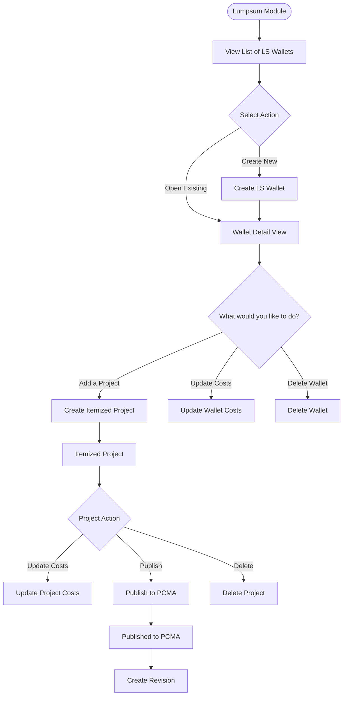
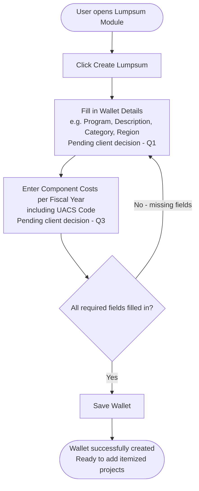
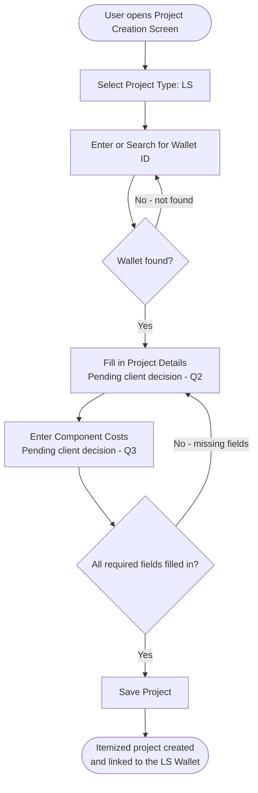
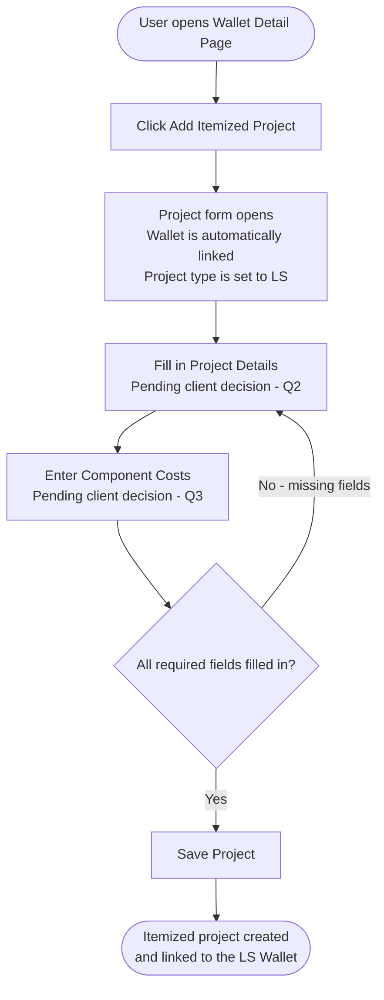
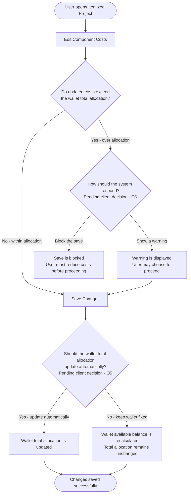
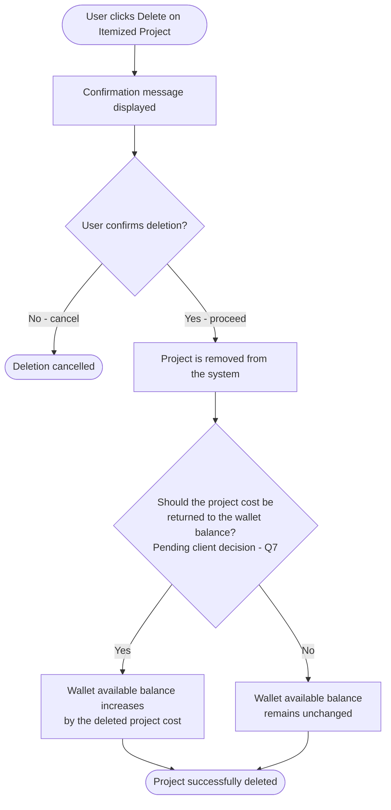
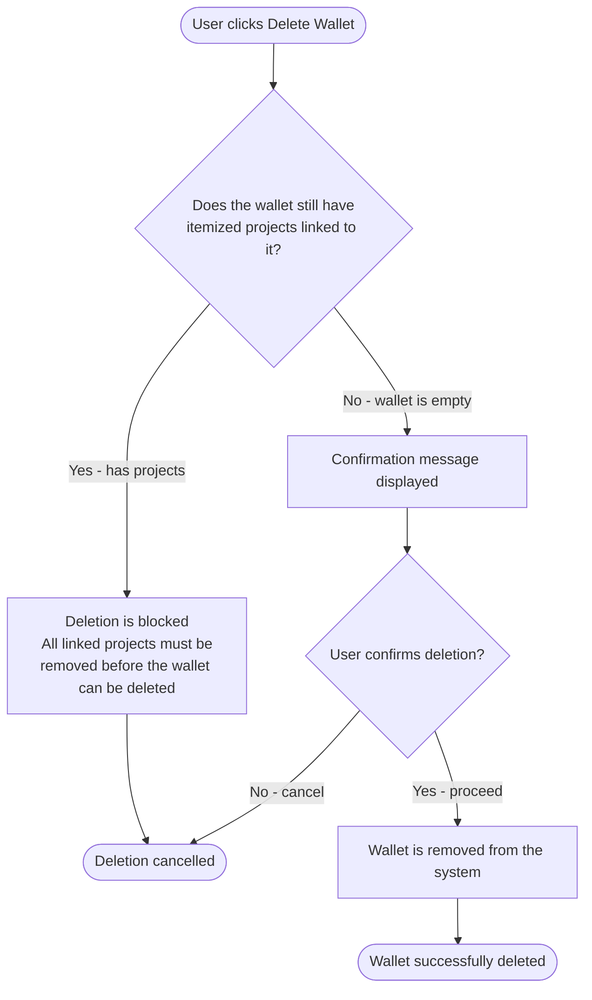
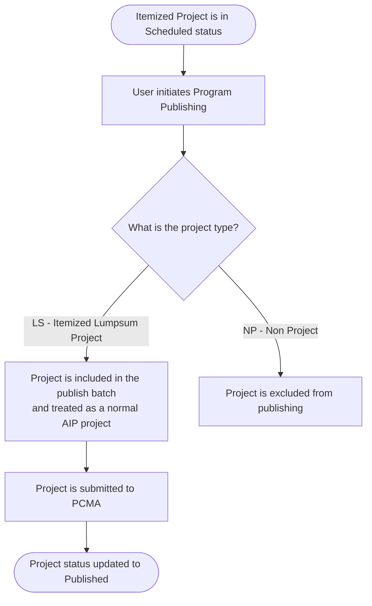
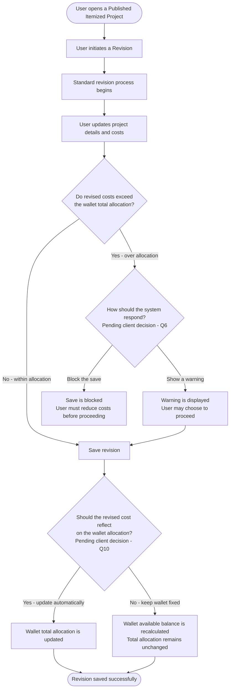

# MYPS — LS Enhancement: New Process Flow
**Project:** MYPS | **Client:** DPWH
**Prepared by:** AI SA/PM Employee
**Date:** 2026-06-11
**Status:** Draft — pending client decisions on marked items

> Items marked **[Pending Qx]** are open questions in the Client Questions document.

---

## 1. LS Wallet Lifecycle Overview

---

## 2. Create LS Wallet

> **[Pending Q1]** Confirm required fields for Wallet Details.
> **[Pending Q3]** Confirm fields required for Component Costs.

---

## 3. Create Itemized Project

> **Important:** The project type is selected at creation and **cannot be changed** afterwards.
> Available project types: **LS** (Itemized Lumpsum), **NP** (Non Project), **Regular** (AIP Project).

### Option A — From the Project Creation Screen

### Option B — From the LS Wallet Page (Recommended)

> **[Pending Q2]** Should project fields auto-fill from the wallet when linked?
> **[Pending Q3]** Should component costs pre-fill from the wallet?
> **[Pending Q4]** Is Option A acceptable to remove since Option B covers the same workflow?

---

## 4. Update Itemized Project Costs

> **[Pending Q5]** Should modifying project costs automatically update the wallet total allocation?
> **[Pending Q6]** Should the system block or warn when project costs exceed the wallet allocation?
> **[Pending Q8]** Can the wallet total allocation be changed after itemized projects are created?

---

## 5. Delete Itemized Project

> **[Pending Q7]** When a project is deleted, should its cost be returned to the wallet's available balance?

---

## 6. Delete LS Wallet

> **Rule:** A wallet cannot be deleted while it still has active itemized projects. This is enforced by the system.

---

## 7. Publish Itemized Project to PCMA

> **Note:** LS Wallets themselves are never published to PCMA. Only the itemized projects under them go through this process.

---

## 8. Create Revision for a Published Itemized Project

> **[Pending Q6]** Block or warn when revised costs exceed wallet allocation?
> **[Pending Q10]** Should cost changes in a revision automatically update the wallet total allocation?

---

## Pending Client Decisions Summary

| Ref | Question | Affects |
|---|---|---|
| Q1 | What fields are required when creating a wallet? | Process 2 |
| Q2 | Should project fields auto-fill from the wallet? | Process 3 |
| Q3 | Should component costs pre-fill from the wallet? | Process 2, 3 |
| Q4 | Is Option A for project creation acceptable to remove? | Process 3 |
| Q5 | Should updating project costs auto-update the wallet allocation? | Process 4 |
| Q6 | Block or warn when project costs exceed wallet allocation? | Process 4, 8 |
| Q7 | Should deleted project cost return to wallet balance? | Process 5 |
| Q8 | Can wallet allocation be changed after projects are created? | Process 4 |
| Q10 | Should revised costs reflect on the wallet allocation? | Process 8 |
| Q11 | Does the wallet go through budget stages (NEP, GAA, GAAR)? | All processes |

---

*Reference: Client Questions Document | LS Enhancement Conflict Tracker*
*Last updated: 2026-06-11*
