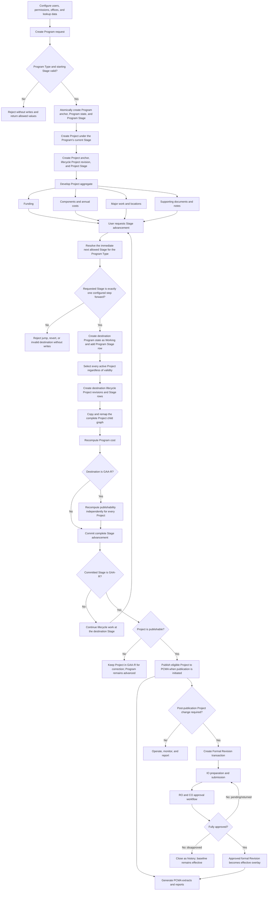
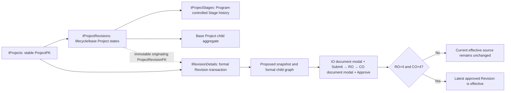

# MYPS Program-to-Project Lifecycle

## End-to-end business flow

## Normal lifecycle versus formal Revision

## Governing rules

1. The Program controls the ordinary Project lifecycle.
2. Initial Program creation may use any Stage allowed for the Program Type.
3. Existing Programs advance only to the immediate next allowed Stage; jumps and reversals are prohibited.
4. Stage order is resolved from the Program Type's allowed Stage set and `StageHierarchy`, not `StageId + 1`.
5. Every active Project advances; invalid Projects do not block or remain behind.
6. Stage advancement adds Program, Project, Stage, and child rows. Source history becomes read-only.
7. The destination Program revision starts as `Working (3)` and receives a new ProgramId.
8. `ProjectPK` remains the original ProjectId; the lifecycle ProjectId changes only its Stage-prefix segment when necessary.
9. Destination child records must point only to destination parent SQL IDs.
10. At GAA-R, Project publishability is independent. The Program advances even when some Projects fail validation.
11. A Project created after advancement begins only in the Program's current Stage.
12. `IsPublishable` is derived readiness; `IsPublished` is an actual publication state.
13. A published baseline is changed through the formal Revision workflow, not ordinary direct editing.
14. Pending or disapproved formal Revisions never replace current effective data.
15. LS/wallet and special-Project advancement behavior remains pending and must be raised when encountered.

The detailed process contract is `docs/process/MYPS_PROGRAM_STAGE_ADVANCEMENT_SPECIFICATION.md`.
