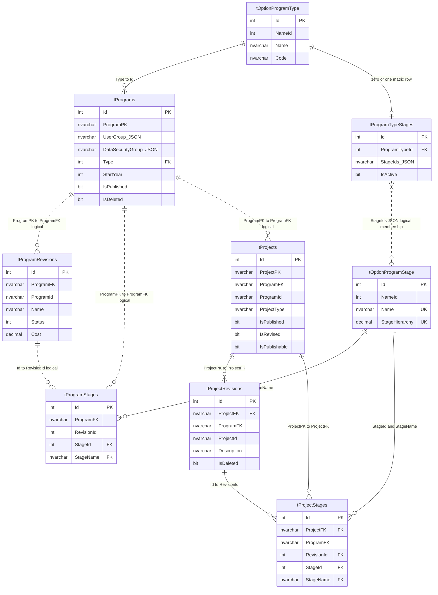

# MYPS Core Program and Project ERD

## Conceptual ERD

## Relationship register

| Source | Target | Enforcement | Important condition |
|---|---|---|---|
| `tPrograms.Type` | `tOptionProgramType.Id` | Physical FK | Use `Id`; do not confuse it with `NameId` |
| `tProgramTypeStages.ProgramTypeId` | `tOptionProgramType.Id` | Physical FK + unique | Zero or one matrix row per Program Type |
| `tProgramTypeStages.StageIds` | `tOptionProgramStage.Id` | JSON/application | SQL validates JSON syntax, not every member |
| `tProgramRevisions.ProgramFK` | `tPrograms.ProgramPK` | Logical | Application must preserve stable Program ownership |
| `tProgramStages.ProgramFK` | `tPrograms.ProgramPK` | Logical | Must agree with the referenced Program revision |
| `tProgramStages.RevisionId` | `tProgramRevisions.Id` | Logical in supplied schema | Must belong to the same ProgramFK |
| `tProgramStages.(StageId,StageName)` | `tOptionProgramStage.(Id,Name)` | Physical composite FK | Stage label and identifier must agree |
| `tProjects.ProgramFK` | `tPrograms.ProgramPK` | Logical | Program owns the active Project lifecycle |
| `tProjectRevisions.ProjectFK` | `tProjects.ProjectPK` | Declared physical FK | Live catalog must confirm a valid unique target index |
| `tProjectStages.ProjectFK` | `tProjects.ProjectPK` | Declared physical FK | Live catalog verification required |
| `tProjectStages.RevisionId` | `tProjectRevisions.Id` | Physical FK | Separate FKs do not prove matching Project ownership |
| `tProjectStages.(StageId,StageName)` | `tOptionProgramStage.(Id,Name)` | Physical composite FK | Use dictionary values, not enum text |

## Integrity warnings

- The supplied DDL declares foreign keys to `tProjects.ProjectPK` but does not show a unique constraint on that column. Verify the live database catalog before deployment documentation treats these constraints as valid.
- Preserve `tProjectStages.ProjectFK = tProjectRevisions.ProjectFK` for the referenced `RevisionId`.
- Program stage duplicate combinations are not prevented by a visible unique constraint.
- Project stage duplicate combinations are not prevented by a visible unique constraint.
- Current sample data shows `tProjects.ProgramId` retaining the creation-time ProgramId while destination `tProjectRevisions` and `tProjectStages` rows use the new ProgramId. Treat the anchor field as nonauthoritative for current-stage reads until its role is formally confirmed.

## Confirmed lifecycle identity rules

- `tPrograms.ProgramPK` is stable. `tPrograms` has no `ProgramId`.
- `tProgramRevisions.ProgramId` is regenerated for every Program Stage state and repeated on the corresponding `tProgramStages` row.
- `tProjects.ProjectPK` is the ProjectId assigned at creation and remains stable forever.
- `tProjectRevisions.ProjectId` is Stage-specific. During advancement, only its Stage prefix may change; the year, sequence, and island-code segments remain fixed.
- An advanced Program may receive a new Project. That Project begins only in the current Stage and has no historical Project revision or Stage rows for earlier Program Stages.
- Current Stage must be resolved through business hierarchy and stage-aware state, not by independently choosing unrelated “latest” rows.
