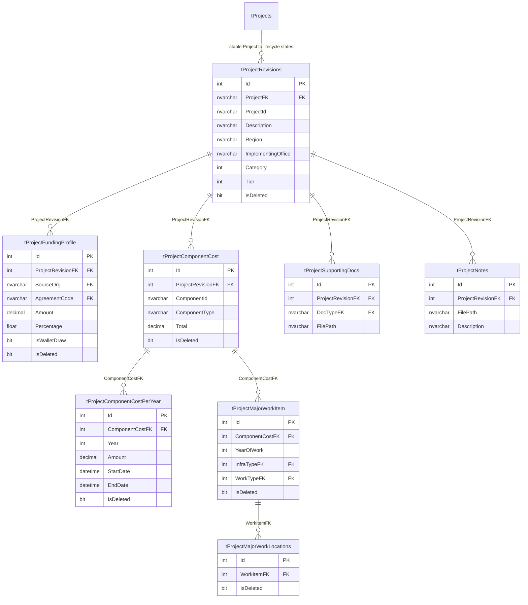
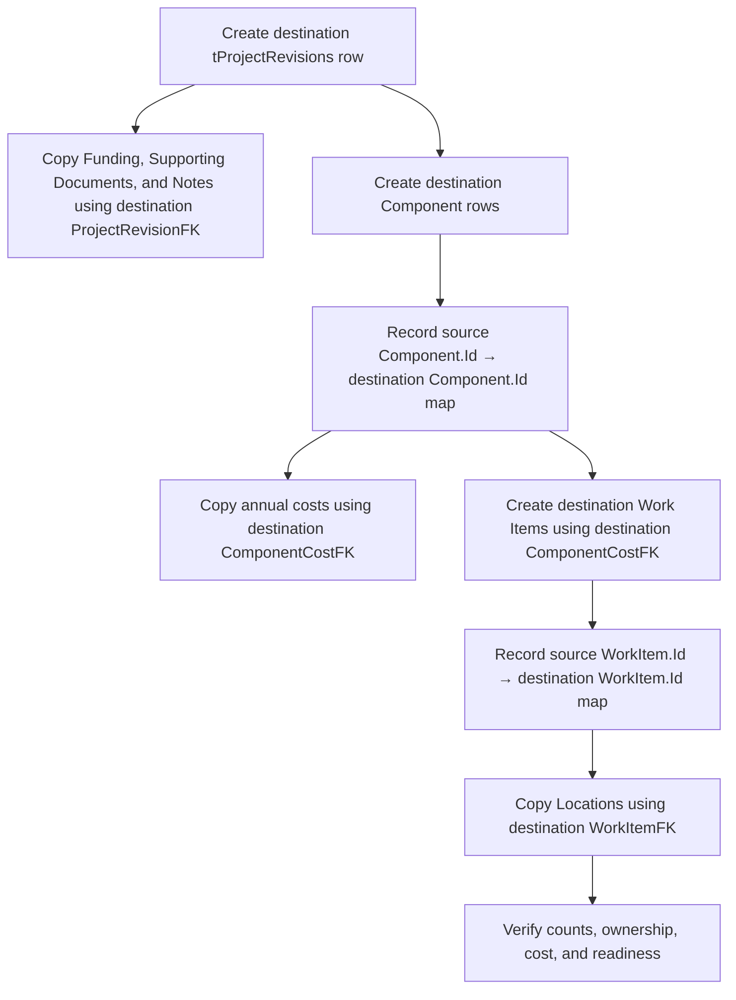

# MYPS Base Project Aggregate ERD

## Ownership model

## Stage-copy remapping

## Modeling cautions

- `ComponentId` is a business/correlation value, not the relational parent key for annual costs or work items.
- Work locations inherit `YearOfWork` through their parent work item; the location table has no `YearOfWork` column.
- Supporting documents and notes do not expose the same soft-delete behavior as the other child tables.
- Component and work-item business-key uniqueness is not database-enforced.
- Destination children must never retain source-stage SQL parent IDs.

## Client-confirmed Stage-copy rules

- Copy every active Project in the Program. Completeness and publishability do not filter the advancement set.
- Copy the complete active aggregate: scalar revision, funding, components, annual costs, work items, locations, supporting documents, and notes.
- Create a new lifecycle Project revision and Project Stage even when the ProjectId prefix remains unchanged.
- Preserve immutable `ProjectPK`; recalculate only the lifecycle ProjectId Stage prefix when the destination enters another prefix group.
- After commit, the complete source aggregate is read-only Stage history.
- At GAA-R, calculate publishability per destination Project after copying. Failed Projects remain in the current GAA-R Stage for correction.
- LS/wallet and special-Project copy behavior remains pending and must be raised before implementation.
