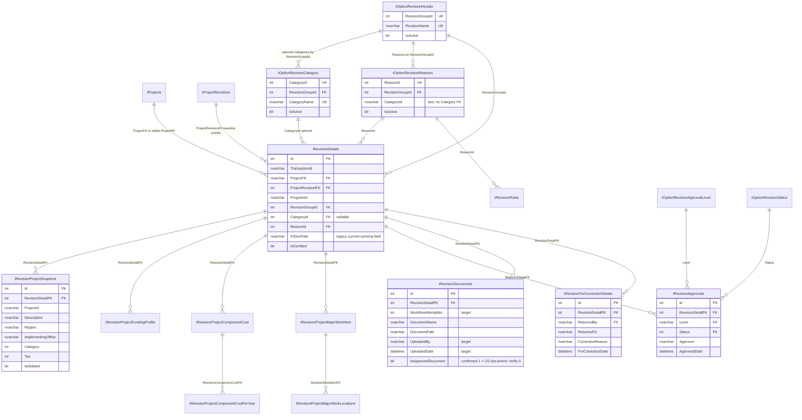
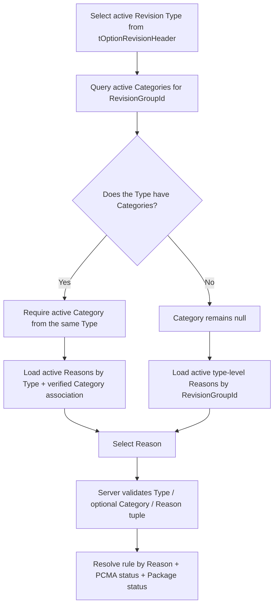

# MYPS Formal Project Revision ERD and Workflow

> Current-state note: this ERD reflects the supplied `myps_db` schema, including
> `tRevisionProjectSnapshot`. The approved redesign scope proposes the target
> `tRevisionProjects` role but requires live-catalog verification before the
> rename/copy strategy is finalized. See the
> [Formal Revision redesign and migration plan](../formal-revision/MYPS_FORMAL_REVISION_REDESIGN_AND_MIGRATION_PLAN.md)
> and [use-case specification](../formal-revision/MYPS_FORMAL_REVISION_USE_CASE_SPECIFICATION.md).

## Formal Revision aggregate

## Critical cardinality and ownership notes

- `TransactionId` is not declared unique in the supplied schema.
- `RevisionDetailFK` on the snapshot is not unique; “one active snapshot” is a domain/application expectation, not a physical one-to-one constraint.
- Formal major work items are direct children of `tRevisionDetails`. Their `ComponentId` is correlation data, not a physical FK to formal components.
- `ProjectFK` and `ProjectRevisionFK` are independently constrained; the schema does not prove that the selected baseline belongs to the same Project.
- `ReturnedTo` has no physical FK even though read logic resolves it through approval-level metadata.
- Revision Type comes from Header. Category is required only when the selected Type has active Category rows; otherwise `tRevisionDetails.CategoryId` remains null and Reasons resolve directly by Type.
- Header, Reason, and optional Category have separate FKs, but matching `RevisionGroupId` combinations are not enforced as one composite constraint.
- `tOptionRevisionReasons.CategoryId` is `nvarchar(200) NOT NULL`, has no physical FK to Category, and has no seed data in the supplied DDL. Its deployed encoding and no-Category representation must be verified before implementing the Reason filter.
- The current full schema exposes `IODocPath` but no equivalent CO path. The older local schema exposes IO/CO document dates. `tRevisionDocuments.IsApprovedDocument = 1` supplies the confirmed CO classification; whether the existing bit is sufficient for both gates depends on confirming that zero exclusively means the IO document. Attempt/version metadata is still required for repeated submit/approve cycles.
- IO submission evidence and CO approval evidence are separate. `IsApprovedDocument = 1` means the CO document and is not a generic approval state. Confirm whether zero exclusively means the IO document before using it as the IO gate.

## Revision Type, optional Category, and Reason selector

## IO–RO–CO state machine

```mermaid
stateDiagram-v2
    [*] --> IODraft
    IODraft --> IOSubmitDocumentModal: IO selects Submit
    IOSubmitDocumentModal --> IODraft: Cancel or invalid IO document
    IOSubmitDocumentModal --> ROSubmitted: Valid IO document + Submit; RO=1

    ROSubmitted --> IOCorrection: RO returns; RO=3
    IOCorrection --> IOSubmitDocumentModal: IO corrects and selects Resubmit
    ROSubmitted --> RODisapproved: RO disapproves; RO=5
    ROSubmitted --> COPending: RO approves; RO=4

    COPending --> IOReturnedFromCO: CO returns; CO=3
    IOReturnedFromCO --> IOResubmitToCODocumentModal: IO corrects and selects Resubmit
    IOResubmitToCODocumentModal --> IOReturnedFromCO: Cancel or invalid IO document
    IOResubmitToCODocumentModal --> COPending: Valid IO document + Resubmit
    COPending --> CODisapproved: CO disapproves; CO=5
    COPending --> COApprovalDocumentModal: CO selects Approve
    COApprovalDocumentModal --> COPending: Cancel or invalid CO document
    COApprovalDocumentModal --> FullyApproved: Valid separate CO document + approve/publish; CO=4

    RODisapproved --> [*]
    CODisapproved --> [*]
    FullyApproved --> [*]
```

## Terminal effects

| Outcome | Effective-data consequence |
|---|---|
| Draft, modal-open, submitted, correction, or pending CO | Proposed data remains isolated |
| RO or CO disapproved | Transaction becomes history; previous effective source remains |
| RO=4 and CO=4 | Latest approved formal Revision becomes eligible as effective source |
