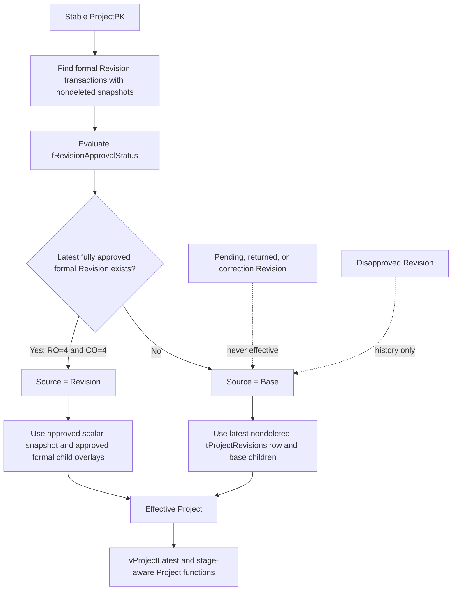
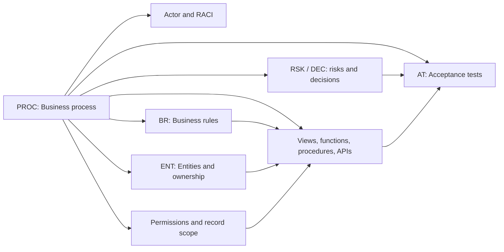

# MYPS Effective Data and Developer Traceability

## Effective Project decision

The decision function orders candidate rows by SQL identity descending. It does not independently prove Stage compatibility; current-stage consumers must retain stage-aware safeguards.

## Workflow lists versus effective lists

| Question | Canonical object |
|---|---|
| Which Revision transactions are unresolved? | `vRevisionPending` or `fOpenRevision(ProjectPK)` |
| Which transactions belong to an approval owner? | `fRevisionQueue('IO'|'RO'|'CO')` |
| Which Revision transactions are completed? | `vRevisionHistory` |
| What is the current effective Project? | `vProjectLatest` and effective Project functions |
| Which Projects currently display approved Revision data? | `vProjectLatest WHERE Source='Revision'` |

## Traceability pattern

## Minimum traceability record

| Field | Required content |
|---|---|
| Process | Stable `PROC-*` identifier, trigger, actors, outcome |
| Rules | Stable `BR-*` conditions and error/result behavior |
| Data | Stable `ENT-*` objects, keys, ownership, and soft-delete behavior |
| Implementation | Current table/view/function/procedure/API/service/UI action |
| Security | Route/action permission and record-level scope |
| Risks | Known mismatch, ambiguity, or unenforced invariant |
| Decisions | Named owner and status for unresolved policy |
| Tests | Positive, negative, authorization, concurrency, retry, and rollback cases |

