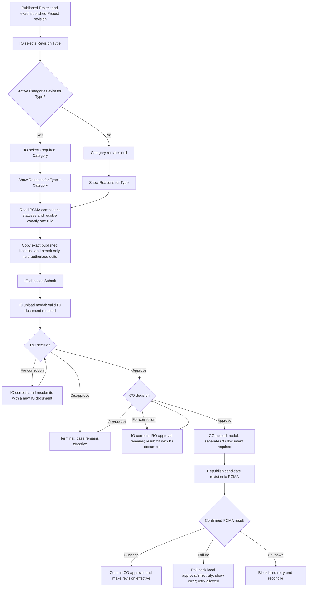
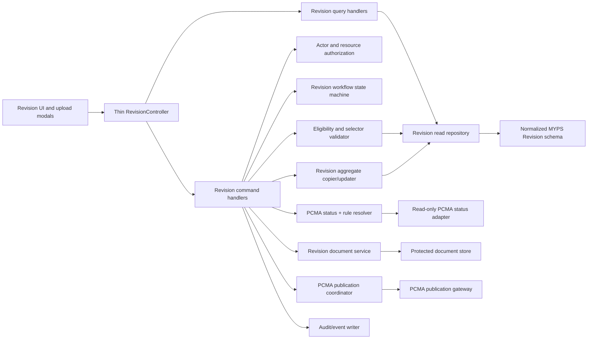

# MYPS `RevisionController` Refactoring Plan

Status: Code-informed implementation plan  
Date: 2026-08-11  
Implementation authorization: Not granted by this document  
Primary audience: Product owner, business analyst, application developer, database developer, QA, security, operations, and support

## 1. Outcome

The current `RevisionController` should be replaced incrementally by a thin HTTP layer over explicit Revision queries, commands, a workflow state machine, a server-side rule engine, a document service, and a PCMA publication gateway.

This must not be treated as a cosmetic controller split. The analysis found defects that can change which Project version becomes effective, accept untrusted rule context, expose Revision documents outside the controller authorization path, and report final approval without an active PCMA publication call.

The refactor is complete only when:

- the confirmed IO -> RO -> CO workflow is the only permitted state path;
- IO and CO documents are separately required at the correct modal/command boundaries;
- pending, returned, and disapproved snapshots can never become effective;
- CO approval becomes effective only with confirmed PCMA publication success;
- the application uses the normalized `RevisionDetailFK` ownership model;
- Type, optional Category, Reason, PCMA statuses, and field rules are validated on the server;
- duplicate, stale, unauthorized, and ambiguous commands fail safely;
- all critical behavior is covered by automated tests and operational reconciliation.

No engineering plan can guarantee that software will never have a future defect. This plan instead defines enforceable invariants, database constraints, test gates, idempotency, observability, and rollback controls so defects are prevented where possible and detected or recovered safely where prevention is impossible.

## 2. Scope and authority

### 2.1 Primary code reviewed

Source root:

`C:\Users\khen\source\repos\mf1027\project_myps`

Primary file:

`WebAPI\Controllers\Revision\RevisionController.cs`

Directly related code reviewed:

- `WebAPI\Controllers\Revision\DTORevision.cs`;
- `WebAPI\Controllers\CoreController.cs`;
- `WebAPI\Controllers\AuthorizeSessionAttribute.cs`;
- `WebAPI\Controllers\PCMA\PCMAController.cs`;
- `WebAPI\Controllers\CodeTable\CodeTableController.cs` Revision sections;
- `Helpers\Functions.cs`, including file validation, upload, and `UpdateRevisionData`;
- `Helpers\API\PCMA.cs`;
- `Helpers\Appsetting.cs`;
- `Main\Program.cs` and `Main\ServiceRegistration.cs`;
- legacy Revision entities under `DBHelper\Models\Table`;
- Revision lookup entities and `RevisionRules` models;
- `FE\src\pages\Modification\Service.ts`;
- Revision submit, resubmit, approval, correction, and rejection dialogs;
- `FE\src\pages\Modification\projectmodification\components\ProjectForm.tsx`.

Database and business references:

- `sources/database/myps_db(08-10-2026-full-schema).sql`;
- `docs/formal-revision/MYPS_FORMAL_REVISION_REDESIGN_AND_MIGRATION_PLAN.md`;
- `docs/formal-revision/MYPS_FORMAL_REVISION_USE_CASE_SPECIFICATION.md`;
- client-confirmed behavior recorded in this project.

### 2.2 Evidence labels

| Label | Meaning |
|---|---|
| `BUSINESS-CONFIRMED` | Explicitly confirmed by the client in this project |
| `CODE-OBSERVED` | Present in the supplied application source |
| `SCHEMA-OBSERVED` | Present in the supplied SQL/schema evidence |
| `PROPOSED` | Recommended target behavior or design |
| `OPEN-DECISION` | Must be verified before implementation or release |

When code conflicts with confirmed business behavior, the business behavior defines the target and the current code is recorded as a defect or migration concern.

### 2.3 Out of scope

- changing `tRevisionRules` or the preserved Revision option/approval lookup tables;
- deciding LS/wallet Project behavior;
- changing Program or lifecycle/base Project stage advancement;
- executing the database migration;
- editing the supplied application source in this planning task.

## 3. Current controller inventory

The supplied controller contains 3,123 lines and six public asynchronous actions.

| Action | Approximate lines | Responsibility observed | Main concern |
|---|---:|---|---|
| `RevisionRequests` | 94 | Queue filtering and cursor pagination | Incorrect filter bindings and inconsistent CO group mapping |
| `ViewReviseProject` | 230 | Existing Revision read model, PCMA status, rules, lookups, logs, documents | Authorization predicate defect and a large sequential query graph |
| `ReviseProject` | 253 | New Revision preparation, selector validation, PCMA status, baseline aggregate | Duplicate read logic and incomplete selector validation |
| `RequestRevision` | 1,049 | Eligibility, rule enforcement, transaction ID generation, snapshot creation, documents, special cases, audit, persistence | God method; trusts client status; transaction/file/concurrency hazards |
| `UpdateRevisionStatus` | 199 | RO/CO decision handling, effectivity, CO document, special cases | CO rejection can activate rejected data; no PCMA publication |
| `ResubmitRevision` | 1,255 | Correction update, rule enforcement, full graph rewrite, IO document, audit | Duplicates creation logic; weak exception/transaction handling |

The three write actions contain roughly 2,500 lines. They combine HTTP concerns, role authorization, business validation, state transitions, PCMA status interpretation, JSON rule parsing, aggregate mapping, file I/O, transaction control, audit creation, and persistence.

### 3.1 Current dependencies by action

| Action | Significant data dependencies |
|---|---|
| `RevisionRequests` | `fRevisionQueue` through `FilterDataCursor` |
| `ViewReviseProject` | Formal Revision views/tables, base Project aggregate, option tables, Program stage, PCMA component-status view, documents, corrections, audit |
| `ReviseProject` | Published Project aggregate, Program stage, option tables, PCMA component-status view, rules, pending Revision view |
| `RequestRevision` | Formal Revision root and all snapshot children, base Project tables, Program view, documents, component status, audit |
| `UpdateRevisionStatus` | Formal Revision root/snapshot, documents, correction history, special Group 9/13 tables, component status |
| `ResubmitRevision` | Formal Revision root and all snapshot children, rules, document naming, audit, selected base lookups |

No action invokes `_pcma`, and no active caller of `Helpers.API.PCMA` was found. The only discovered PCMA caller is commented out in `PCMAController`.

## 4. Confirmed target process



Non-negotiable rules:

- only a published Project is eligible;
- the baseline is the exact published lifecycle/base `tProjectRevisions` row;
- the linked-server PCMA status surface is read-only;
- `true` means editable, `false` means read-only, and a missing field is read-only;
- rule records cannot be edited while affected Revisions are pending;
- `IsApprovedDocument = 1` identifies the CO approval document;
- current repository writers use `IsApprovedDocument = 0` for initial IO submission and IO resubmission documents;
- RO approval routes directly to CO pending;
- a CO-return resubmission preserves the RO approval;
- LS/wallet behavior remains blocked pending clarification.

## 5. Critical findings

### 5.1 Priority 0: correctness, effectivity, publication, and access

| ID | Finding | Evidence | Required response |
|---|---|---|---|
| `P0-REV-001` | A CO rejection activates the selected Revision snapshot and deactivates the prior effective snapshot. | `UpdateRevisionStatus`, lines 1699-1717, performs effectivity changes for both `Approved` and `Rejected`; the approval-only condition starts later. | Hotfix before further feature work; move effectivity behind the fully approved plus PCMA-success condition and add a regression test. |
| `P0-REV-002` | Final CO approval does not actively republish to PCMA. | No `_pcma` use in the controller; no active `PCMA` caller; only a commented call exists. | Fail closed until a tested publication gateway is active. The UI must not claim publication when none occurred. |
| `P0-REV-003` | The existing PCMA helper is not a proven Formal Revision publication contract. | It sends a Program ID, a hard-coded `Project_ID` value, and a username-like value; any SOAP result element is treated as success without interpreting business content. | Verify the real endpoint contract and success semantics in a sandbox before wiring approval. |
| `P0-REV-004` | `ViewReviseProject` appears to deny access when the Project region equals the filtered user's region. | Line 142 uses `_Session.ApplyFilter && Project.Region == _Session.RegCode` as the denial condition, opposite the filtered query used in `ReviseProject`. | Correct and test resource-level authorization for same-region and other-region access. |
| `P0-REV-005` | Write actions trust client-supplied construction and package statuses when selecting field rules. | `RevisionDetailsDTO` accepts both values; `RequestRevision` line 668 and `ResubmitRevision` line 1935 use them directly. | Remove them from write authority. Derive them server-side from fresh PCMA rows and persist the evidence used. |
| `P0-REV-006` | Revision documents are stored beneath `Resources/UploadedFiles/Revisions`, while `Program.cs` exposes the complete `Resources` tree through static-file middleware before authentication/authorization. | `Appsetting.PrepareAppsettings` composes the Revision path under `Resources`; `Program.cs` exposes `/Resources`. | Move Revision evidence outside the public static tree and serve it through an authorized download endpoint. Verify reverse-proxy controls; do not assume they exist. |
| `P0-REV-007` | Legacy C# entities use textual `TransactionId` ownership, while the normalized SQL design uses `RevisionDetailFK` and relational child keys. | Legacy `RevisionDetails`, `RevisionProjects`, documents, costs, funding, work, and location models do not match the normalized schema. | Treat EF-model/schema alignment as a release gate; never deploy one side without the compatible application release. |
| `P0-REV-008` | Uploaded document content can leak into browser/server logs. | Submit/resubmit dialogs and `Service.ts` log full payloads containing `DataUrl`; the exception handler serializes DTOs and its sensitive-name list does not include `DataUrl`. | Remove full-payload console logging and redact/omit all file-body properties before structured logging. Test that no base64 prefix or document content reaches logs. |

### 5.2 Priority 1: workflow, concurrency, validation, and audit

| ID | Finding | Evidence | Required response |
|---|---|---|---|
| `P1-REV-001` | There is no explicit legal-transition matrix. | `UpdateRevisionStatus` accepts broad status/role combinations and loads a row with `(RegionStatus != Rejected OR COStatus != Rejected)`. | Use one state machine that validates actor, current state, requested action, required document, and next state. |
| `P1-REV-002` | Role mapping is inconsistent. | Queue: `RPC -> RO`, `DPDAdmin -> CO`; write actions: `RPC -> RO`, `AUC -> CO`; front end also treats `DPC` or `RPC` as an initiating office in one path. | Establish one actor-resolution policy and test every group-to-role mapping. |
| `P1-REV-003` | Queue filters bind incorrect fields/parameters. | Project ID reuses Transaction ID at lines 49-55; Revision Type uses parameter name `@RevisionStatus` at lines 56-61. | Replace tuple construction with a typed query specification and tests per filter and filter combination. |
| `P1-REV-004` | Type/Category/Reason validation is incomplete. | Category is checked by ID only, not Type ownership; Reason is checked by Type but not Category membership; active flags are not consistently enforced. | Implement the confirmed optional-Category resolver as one service used by prepare and submit/resubmit. |
| `P1-REV-004A` | Submit/resubmit Category naming does not match the backend DTO, and the write DTO carries no explicit Revision Type/Group. | Front end sends `RevisionDetails.RevisionCategory`; backend expects `CategoryId`. `RevisionDetailsDTO` has no `RevisionGroupId`, so create/resubmit infer Type from a rule lookup. | Replace both sides with one generated/typed contract containing `RevisionGroupId`, nullable `CategoryId`, and `ReasonId`; add request-contract tests. |
| `P1-REV-005` | Rule selection is nondeterministic and incomplete. | `FirstOrDefault` is used; create/resubmit omit `RevisionGroupId` from the matching predicate; zero is handled, multiple matches are not. | Require exactly one active match for Reason + Type/Group + derived construction status + derived package status. |
| `P1-REV-006` | Transaction IDs and pending checks use substring matching. | `TransactionId.Contains(ProjectId)` and `MAX/split/+1`-style generation are used without a visible uniqueness constraint. | Use stable `ProjectFK`, a database-generated identifier, a unique index, and an idempotency key. |
| `P1-REV-007` | Transactions begin before basic validation and are not `await using`; many early returns do not explicitly end the transaction. | All three write actions begin the transaction at the top. | Validate read-only prerequisites first; use a short `await using` transaction only for the mutation boundary. |
| `P1-REV-008` | File writes occur before database commit and are not compensated. | `UploadFile` calls `File.WriteAllBytes`; later database failure can leave an orphan. | Introduce staged storage, checksum metadata, and delete/cleanup compensation. |
| `P1-REV-009` | CO document validation is weaker than IO validation. | Create/resubmit check PDF content and 50 MB size; CO approval checks only non-null before `UploadFile`. | Use the same server document policy for both gates. |
| `P1-REV-010` | The file name can include unvalidated administrative naming content and the helper overwrites existing paths. | `SecondSegmentName` and client extension are interpolated into a filesystem path; `WriteAllBytes` overwrites. | Generate a server storage key, sanitize display names, use collision-safe writes, and keep original name separately. |
| `P1-REV-011` | No optimistic concurrency or idempotency protects edits and approvals. | DTOs contain no row version or command key; updates do not assert the expected state in the SQL predicate. | Require `ExpectedVersion` and `IdempotencyKey`; update exactly one expected-state row. |
| `P1-REV-012` | `ToListAsync()` results are checked for null. | Multiple branches return “not found” only when a list is null, although EF returns an empty list. | Decide whether empty is valid per collection; use `Any`, `Count`, or allow empty explicitly. |
| `P1-REV-013` | Field-rule wiring contains copy/paste defects. | Examples include annual-cost add checking `ComponentCostRules`, location handling checking work-item rules, and incorrect audit table names. | Replace section-by-section reflection/copy blocks with typed rule descriptors, aggregate operations, and table-driven tests. |
| `P1-REV-014` | The generic reflection helper silently ignores unknown or type-mismatched rule fields. | `UpdateRevisionData` continues when a property is missing, not writable, or type-incompatible. | Validate rule JSON at administration/deployment time and fail closed at runtime with a configuration error. |
| `P1-REV-015` | Monetary DTOs use `double`. | Costs, amounts, and percentages are represented as `Double/double`. | Use `decimal` matching the target SQL precision; define rounding and percentage ranges. |
| `P1-REV-016` | Audit output is manually duplicated and weakly structured. | Many branches build string-valued old/new logs; inconsistent affected-table values are visible. | Emit append-only domain events with stable entity/row identity and canonical serialized values. |
| `P1-REV-017` | `ResubmitRevision` catches only `DbUpdateException`. | Other exceptions can escape without the method's explicit rollback path. | Use one transaction-execution wrapper with broad exception handling, cancellation preservation, and compensation. |

### 5.3 Priority 2: maintainability and performance

- `ViewReviseProject` and `ReviseProject` duplicate status derivation, selector validation, option loading, and aggregate materialization.
- Each read performs many sequential awaits and reloads mostly static lookup data.
- Synchronous EF query calls occur inside asynchronous actions.
- Magic group names, Revision Group IDs, numeric status codes, PCMA status strings, and stage names are spread across the controller and front end.
- Responses are anonymous objects, making API compatibility and contract testing difficult.
- Large commented sections obscure the executable behavior.
- The repository contains no discovered .NET test project for the Revision module.
- Front-end comments and button labels conflict with the actual status values and actor behavior.

## 6. Target architecture



### 6.1 Thin controller

The controller should be limited to:

1. model binding;
2. invoking the existing route/action permission system;
3. dispatching one query or command;
4. translating a typed result into the standard HTTP error contract;
5. passing the cancellation token.

Target: no EF queries, file operations, rule parsing, state mutation, or PCMA calls in the controller.

### 6.2 Recommended application components

| Component | Responsibility |
|---|---|
| `IRevisionActorResolver` | Resolve authenticated user to IO, RO, or CO using one canonical group policy |
| `IRevisionAuthorizationService` | Enforce route action plus Project/region/ownership/state authorization |
| `IRevisionSelectorService` | Validate active Type, optional Category, and Reason hierarchy |
| `IPcmaProjectStatusReader` | Read component construction/package statuses from the approved read-only PCMA surface |
| `ProjectStatusDeriver` | Apply the confirmed construction/package precedence with normalized values |
| `IRevisionRuleResolver` | Resolve exactly one active rule and return a typed deny-by-default permission set |
| `IRevisionEligibilityService` | Validate published baseline, special Project exclusions, open-Revision policy, and selector/rule eligibility |
| `IRevisionAggregateFactory` | Copy the exact published baseline into a new Formal Revision aggregate |
| `IRevisionAggregateUpdater` | Apply only authorized scalar/collection changes during correction |
| `RevisionWorkflowStateMachine` | Define legal actor/action/state/document/effectivity transitions |
| `IRevisionDocumentService` | Validate, classify, stage, store, retrieve, supersede, and compensate documents |
| `IPcmaPublicationGateway` | Build/send/interpret the verified PCMA publication contract |
| `IRevisionPublicationCoordinator` | Coordinate approval, document, PCMA result, effectivity, retry, and unknown-outcome handling |
| `IRevisionRepository` | Load/save the normalized aggregate by `RevisionDetailFK` and stable `ProjectFK` |
| `IRevisionAuditWriter` | Append canonical business and publication events |
| `IRevisionClock` | Supply the approved business timestamp policy for deterministic tests |

### 6.3 Suggested source layout

```text
WebAPI/Features/Revisions/
  Contracts/
  Queries/
  Commands/
  Domain/
    RevisionWorkflowStateMachine.cs
    ProjectStatusDeriver.cs
    RevisionDocumentRole.cs
  Application/
    RevisionEligibilityService.cs
    RevisionRuleResolver.cs
    RevisionAggregateFactory.cs
    RevisionAggregateUpdater.cs
    RevisionPublicationCoordinator.cs
  Infrastructure/
    RevisionRepository.cs
    PcmaProjectStatusReader.cs
    PcmaPublicationGateway.cs
    RevisionDocumentStore.cs
  Validation/
  Tests/
```

Exact folder names may follow repository conventions, but dependency direction must remain controller -> application -> domain, with database/filesystem/PCMA behind interfaces.

## 7. Query and command model

### 7.1 Queries

| Query | Replaces | Result |
|---|---|---|
| `SearchRevisionQueueQuery` | `RevisionRequests` | Typed paged queue rows with server-authorized scope |
| `GetRevisionDetailsQuery` | `ViewReviseProject` | One typed Revision read model with snapshot, documents, corrections, rule context, and permitted actions |
| `PrepareRevisionQuery` | `ReviseProject` | Published baseline, derived PCMA status, valid selector context, exact rule, editable-field contract, and lookup references |
| `GetRevisionSelectorsQuery` | Unstructured code-table filtering | Active Type -> optional Category -> Reason choices |
| `DownloadRevisionDocumentQuery` | Public static path | Authorized document stream with audit-safe metadata |

Static lookup data should be supplied separately and cached with a version/ETag. A Revision details query should not reload every admin lookup table on each request.

### 7.2 Commands

| Command | Actor | Required evidence | Successful result |
|---|---|---|---|
| `SubmitRevisionCommand` | IO | IO PDF and certification/date policy | New root/snapshot; RO pending |
| `ResubmitRevisionCommand` | IO | New or explicitly reusable IO document according to final policy | RO pending, or CO pending while preserving RO approval |
| `ReturnRevisionForCorrectionCommand` | RO or CO | Required reason | Append correction event; correct level becomes `ForCorrection` |
| `DisapproveRevisionCommand` | RO or CO | Required reason | Terminal at deciding level; base remains effective |
| `ApproveRevisionAtROCommand` | RO | Expected version/state | Region approved; CO pending; no new IO document step |
| `ApproveAndPublishRevisionAtCOCommand` | CO | Separate CO PDF, approval date policy, expected version, idempotency key | PCMA success, CO approved, candidate effective |

Do not retain one generic `UpdateRevisionStatus` command. Its shape allows illegal actor/status combinations. Commands should express business intent.

### 7.3 Write-contract rules

The client must not be authoritative for:

- `TransactionId` generation;
- `ProjectFK`, `ProjectRevisionFK`, or `RevisionDetailFK` ownership;
- construction status or package status;
- active rule identity;
- `RegionStatus`, `COStatus`, effectivity, or `IsActive`;
- creator, approver, uploader, or timestamps;
- document name/path/storage key;
- revision counters;
- PCMA publication outcome.

The client supplies:

- selected Type, optional Category, and Reason;
- intended editable scalar values;
- explicit collection operations using server-issued row IDs;
- expected concurrency version;
- idempotency key for submit/resubmit/approval;
- the actor-specific file in the modal-confirmed command.

For every write, the server reloads the baseline/current snapshot, reapplies the exact rule, applies only allowed fields and collection operations, and rejects cross-transaction row IDs.

## 8. Selector and rule pipeline

### 8.1 Type, optional Category, and Reason

1. Load active `tOptionRevisionHeader` by `RevisionGroupId`.
2. Load active `tOptionRevisionCategory` rows for that Type.
3. If one or more exist, require Category and verify it belongs to the Type.
4. If none exist, require Category to be null.
5. Load an active Reason that belongs to the Type.
6. When Category exists, verify the Reason includes that Category using the deployed encoding.
7. Reject an inactive, unrelated, or ambiguous option.

The existing tables remain unchanged. The resolver hides their storage quirks from controllers and front-end code.

### 8.2 PCMA construction-status derivation

Use a typed value object and one tested precedence table:

1. zero components -> `No Components`;
2. any `On-Going` -> `On-Going`;
3. only `Terminated` -> `Terminated`;
4. any `Not Yet Started`, without `On-Going` -> `Not Yet Started`;
5. otherwise any `Completed`, ignoring terminated components -> `Completed`;
6. any unrecognized combination -> configuration/data error, not an empty string.

Normalize source spelling/case for comparison while retaining the raw PCMA values in the captured evidence.

Package status:

- any component `Not Packaged` -> `Not Packaged`;
- otherwise -> `Packaged`;
- zero-component handling must be explicitly tested against the applicable rule catalog.

### 8.3 Exact rule resolution

The authoritative match is:

```text
Revision Type/Group
+ Reason
+ derived PCMA construction status
+ derived package status
+ active rule
```

Category is validated through the selector hierarchy even if the unchanged rule table does not store Category.

Result handling:

- zero rows -> `REV_RULE_NOT_FOUND`;
- one row -> parse and validate;
- multiple rows -> `REV_RULE_AMBIGUOUS` and alert configuration support;
- malformed JSON or unknown section/field -> fail closed;
- missing field -> read-only;
- `false` -> read-only;
- `true` -> editable.

Recommended within the approved `tRevisionDetails` scope: retain the selected rule ID plus a canonical rule JSON/hash snapshot. This preserves auditability even though rule administration is blocked while affected Revisions are pending. It does not require changing `tRevisionRules`.

### 8.4 Typed rule enforcement

Replace reflection-driven lists with a typed permission model:

```text
ProjectDetailsPermissions
ComponentCostPermissions + CollectionPermissions
AnnualCostPermissions + CollectionPermissions
FundingPermissions + CollectionPermissions
WorkItemPermissions + CollectionPermissions
LocationPermissions + CollectionPermissions
```

Validate every stored rule against a JSON schema or equivalent validator before it can become active. Runtime code should never silently skip a misspelled rule property.

## 9. Workflow state machine

### 9.1 Legal transitions

| Current Region | Current CO | Actor/action | Next Region | Next CO | Effective? |
|---|---|---|---|---|---:|
| Pending | Pending | RO approve | Approved | Pending | No |
| Pending | Pending | RO for correction | ForCorrection | Pending | No |
| Pending | Pending | RO disapprove | Rejected | Pending/terminal compatibility value | No |
| ForCorrection | Pending | IO resubmit + IO document | Pending | Pending | No |
| Approved | Pending | CO for correction | Approved | ForCorrection | No |
| Approved | Pending | CO disapprove | Approved | Rejected | No |
| Approved | ForCorrection | IO resubmit + IO document | Approved | Pending | No |
| Approved | Pending | CO approve + CO document + confirmed PCMA success | Approved | Approved | Yes |

Every other transition returns `REV_INVALID_STATE_TRANSITION` without changing documents, audit state, base data, or effectivity.

### 9.2 Effectivity predicate

A Formal Revision is effective only when all are true:

1. RO status is Approved;
2. CO status is Approved;
3. the CO approval command has a valid CO document for that workflow attempt;
4. PCMA publication is confirmed successful;
5. the row is the latest successful effective result for the same stable `ProjectFK`.

Do not use a freely writable `tRevisionProjects.IsActive` flag as the authority. If retained temporarily for compatibility, it must be derived/maintained only by the publication coordinator and checked against the authoritative predicate.

### 9.3 Actor policy

The current repository suggests `DPC`, `RPC`, `AUC`, and `DPDAdmin`, but maps them inconsistently. Before implementation, approve one mapping table and use it in backend policy handlers, queue scope, and front-end permitted-action responses.

The API should return `AllowedActions` derived by the server. The UI may hide/disable buttons from this list, but the server remains authoritative.

## 10. Aggregate and database alignment

The controller refactor and normalized schema must be released as one compatible sequence.

### 10.1 Root and identity

- use `tRevisionDetails.Id` as the physical aggregate key;
- use `ProjectFK` as stable Project identity;
- use `ProjectRevisionFK` as the exact published baseline;
- make `TransactionId` unique display/idempotency data, not a child parent key;
- use a row version or equivalent concurrency token;
- use a database-backed generator, not `Contains`, split, and increment.

### 10.2 Child ownership

- one `tRevisionProjects` snapshot per `RevisionDetailFK`;
- component costs, funding, component status, documents, corrections, and audit rows reference `RevisionDetailFK`;
- annual costs reference their Revision component-cost row;
- locations reference their Revision work-item row;
- ownership is verified in the database and again in command validation;
- no cross-Revision parent reassignment is accepted from a DTO.

### 10.3 Data types

- use `decimal(18,5)` or the approved exact precision for monetary values;
- define exact percentage precision/range;
- preserve nullable values rather than replacing them with empty/zero defaults;
- use canonical timestamp policy consistently;
- use bounded lengths aligned across SQL, entities, DTOs, and validation.

### 10.4 Open-Revision concurrency

The final business policy for more than one unresolved Revision must be confirmed. Once confirmed, enforce it through a database-scoped lock keyed by `ProjectFK` and, if the policy is “one unresolved,” a database constraint/filtered uniqueness strategy. Application-only `FirstOrDefault` checks are race-prone.

## 11. Document design

### 11.1 Domain classification

Use a domain enum rather than passing the Boolean throughout the application:

```text
RevisionDocumentRole.IOSubmission  -> IsApprovedDocument = 0
RevisionDocumentRole.COApproval    -> IsApprovedDocument = 1
```

Repository evidence shows all current false writes occur during initial submission or IO resubmission, and the true write occurs during CO approval. Profile deployed historical data before adding a constraint because old/manual rows may not follow current code.

If ordinary supporting Revision documents are introduced later, add an explicit role discriminator within the already approved `tRevisionDocuments` scope; do not overload the Boolean.

### 11.2 Required metadata

- `RevisionDetailFK`;
- workflow attempt number;
- domain role/classification;
- original display filename;
- server-generated storage key;
- content type and byte size;
- checksum;
- uploader and upload timestamp;
- current/superseded marker without deleting history;
- validation/scan result if supported.

### 11.3 Storage sequence

1. Accept the file through a bounded request, preferably streamed multipart rather than a large base64 JSON body.
2. Validate type, extension, PDF signature/structure, size, and configured malware policy.
3. Generate a collision-safe server storage key outside the public static tree.
4. Stage or persist the file before the database transition.
5. In the database transaction, write document metadata and the state transition.
6. On database or PCMA failure, run best-effort file compensation and record/queue orphan cleanup.
7. Serve documents only through an authorized endpoint that checks Revision access.

Do not expose physical paths to clients or accept client-generated paths.

## 12. PCMA publication and consistency

### 12.1 Release-blocking contract verification

Before implementation, verify:

- the active PCMA endpoint and environment configuration;
- whether publication accepts a complete Project payload or reads committed MYPS data;
- exact Program/Project identifiers required;
- how success, business rejection, HTTP failure, timeout, and malformed response are represented;
- whether a deterministic MYPS Revision identity can be sent;
- whether PCMA can be queried afterward to confirm the published version;
- timeout, retry, authentication, and rate-limit expectations.

The current helper must not be reused unchanged. XML must be created through a safe serializer, and business success must be parsed explicitly.

### 12.2 Recommended approval coordinator

```mermaid
sequenceDiagram
    actor CO
    participant API as CO approval command
    participant DOC as Document service
    participant DB as MYPS database
    participant PCMA as PCMA gateway

    CO->>API: Approve(expectedVersion, idempotencyKey, CO document)
    API->>DOC: Validate and stage CO document
    API->>DB: Begin short transaction and lock Revision/Project
    API->>DB: Recheck actor, state, aggregate, and idempotency
    API->>PCMA: Publish deterministic candidate
    alt confirmed success
        API->>DB: Set CO approved + effective; append audit; link document
        API->>DB: Commit
        API-->>CO: Success
    else confirmed failure
        API->>DB: Roll back
        API->>DOC: Compensate staged file if policy requires
        API-->>CO: Publication failed; local state unchanged
    else timeout or unknown outcome
        API->>DB: Do not mark effective
        API->>DB: Record reconciliation evidence through approved durable path
        API-->>CO: Outcome unknown; retry blocked pending reconciliation
    end
```

A local SQL transaction cannot roll back an external PCMA success. If PCMA accepts but MYPS loses the response or its commit fails, the systems can diverge. Therefore:

- use a deterministic correlation/idempotency value if supported;
- verify unknown outcomes against a PCMA read surface;
- never blindly retry an unknown outcome;
- provide an operations reconciliation command/runbook;
- block release if the contract supplies no safe way to distinguish failure from unknown success.

If PCMA can only pull committed effective MYPS data, the strict business rollback requirement cannot be implemented by keeping the local transaction uncommitted. In that case, add a publication staging surface or change the PCMA contract before release; do not disguise a commit-then-call sequence as atomic rollback.

## 13. Error contract

Use one typed response shape:

```json
{
  "code": "REV_INVALID_STATE_TRANSITION",
  "title": "Revision cannot be approved",
  "message": "The Revision is not pending at Central Office.",
  "correlationId": "...",
  "details": {}
}
```

Required codes include:

| Code | Meaning | HTTP |
|---|---|---:|
| `REV_NOT_FOUND` | Revision/root does not exist | 404 |
| `REV_PROJECT_NOT_ELIGIBLE` | Project is unpublished, wrong stage, or special behavior is unresolved | 409 |
| `REV_SELECTOR_INVALID` | Type/Category/Reason hierarchy is invalid/inactive | 422 |
| `REV_RULE_NOT_FOUND` | No active exact rule | 422 |
| `REV_RULE_AMBIGUOUS` | Multiple active exact rules | 500/configuration alert |
| `REV_RULE_INVALID` | Malformed/unknown rule configuration | 500/configuration alert |
| `REV_FIELD_READ_ONLY` | Payload attempts a prohibited field/operation | 422 |
| `REV_INVALID_STATE_TRANSITION` | Actor/action/current state combination is illegal | 409 |
| `REV_STALE_VERSION` | Concurrency token is stale | 409 |
| `REV_DUPLICATE_COMMAND` | Same idempotency key has conflicting payload | 409 |
| `REV_DOCUMENT_REQUIRED` | Actor-specific gate document missing | 422 |
| `REV_DOCUMENT_INVALID` | File policy failed | 422 |
| `REV_PCMA_PUBLISH_FAILED` | Confirmed PCMA failure; local state unchanged | 502 |
| `REV_PCMA_OUTCOME_UNKNOWN` | Publication may have succeeded; reconciliation required | 503 |
| `REV_ACCESS_DENIED` | Route or resource access denied | 403 |

Do not send raw exception text, filesystem paths, linked-server details, SOAP responses, or credentials to users.

## 14. Front-end refactoring required by the process

The backend cannot enforce a usable workflow if the front end continues to expose contradictory actions.

Required changes:

- consume server-provided `AllowedActions` instead of duplicating status/group expressions;
- retain the IO submit/resubmit modal with required IO document;
- make RO approval a simple decision with no post-approval IO upload wait;
- open a dedicated CO approval modal that requires the separate CO document and approval-date policy;
- stop reusing one dialog for both IO submission and CO approval;
- remove client authority for construction/package status;
- send expected version and idempotency key;
- handle `confirmed failure` separately from `unknown publication outcome`;
- prevent double-click submissions while still relying on server idempotency;
- remove incorrect success text that claims PCMA publication before the server confirms it;
- align actor names and status labels with the canonical policy;
- remove or block LS/wallet Revision actions until clarified.

## 15. Refactoring sequence

Use a strangler approach. Do not rewrite all 3,123 lines in one release.

### Phase 0: Decision and safety gate

1. Confirm canonical group-to-actor mapping.
2. Verify live Revision schema and current EF compatibility.
3. Verify the PCMA publication contract and reconciliation capability.
4. Profile historical `IsApprovedDocument` values and paths.
5. Confirm unresolved-Revision concurrency policy.
6. Confirm special Group 9/13 and LS/wallet handling.
7. Freeze new controller features until Priority 0 risks have owners.

Exit: every open release blocker has an owner, evidence source, and decision date.

### Phase 1: Characterization and emergency fixes

1. Create a .NET Revision test project.
2. Add characterization tests around all six current endpoints.
3. Add a regression test proving rejection never changes effectivity.
4. Fix the rejection activation defect.
5. Fix queue filter bindings and region access predicate.
6. Apply uniform CO document validation.
7. Make approval fail closed when PCMA publication is unavailable.

Exit: current intended behavior is captured; no known P0 effectivity/access defect remains.

### Phase 2: Normalize application data models

1. Create EF entities/configurations matching the approved normalized schema.
2. Replace child `TransactionId` parents with `RevisionDetailFK`.
3. Add relational annual-cost and work-location parents.
4. Add unique root TransactionId, one snapshot per root, row version, and required indexes.
5. Change monetary contracts to `decimal`.
6. Validate migration compatibility in an isolated database.

Exit: schema contract tests pass and no legacy/target mismatch exists in the release pair.

### Phase 3: Extract read services

1. Implement typed queue specification and fix all filters.
2. Implement `GetRevisionDetailsQuery`.
3. Implement `PrepareRevisionQuery`.
4. Extract/canonicalize PCMA status derivation.
5. Separate cached lookup delivery from transaction detail reads.
6. Compare new and legacy read results in shadow mode.

Exit: typed queries match approved current results and meet performance thresholds.

### Phase 4: Extract selector, rule, and aggregate services

1. Implement the optional-Category selector service.
2. Implement exact-one rule resolution.
3. Validate rule JSON into typed permissions.
4. Implement deny-by-default scalar and collection enforcement.
5. Implement exact published-baseline aggregate copy.
6. Implement correction updates without duplicated create logic.
7. Centralize audit event generation.

Exit: rule matrix and aggregate copy/update tests pass for every section and CRUD flag.

### Phase 5: Implement explicit workflow commands

1. Implement actor/resource authorization service.
2. Implement the state machine.
3. Add expected version and idempotency.
4. Implement IO submit/resubmit, RO decisions, and CO return/disapprove.
5. Make effectivity derived from the authoritative predicate.
6. Preserve RO approval during CO correction/resubmission.

Exit: all allowed transitions pass and every illegal transition has a negative test.

### Phase 6: Protect documents

1. Move Revision document storage outside the public static tree.
2. Implement one validation policy for IO and CO documents.
3. Implement server keys, checksums, attempt metadata, and compensation.
4. Implement authorized streaming download.
5. Migrate or proxy legacy document paths safely.

Exit: no Revision document is retrievable without authorization; orphan/rollback tests pass.

### Phase 7: Implement PCMA approval coordinator

1. Replace the current helper with a tested gateway.
2. Add deterministic request identity where possible.
3. Parse business success/failure correctly.
4. Implement confirmed failure rollback.
5. Implement unknown-outcome reconciliation and retry block.
6. Implement CO document + publish + effectivity orchestration.

Exit: contract, timeout, retry, failure, unknown, and reconciliation tests pass against the approved PCMA test environment.

### Phase 8: Thin controller and compatibility adapter

1. Route existing endpoints to the new queries/commands behind a feature flag.
2. Keep legacy request adapters only long enough for the front-end transition.
3. Emit deprecation telemetry for legacy shapes.
4. Delete duplicated controller logic after parity and canary gates pass.
5. Remove commented dead PCMA/email code from the controller.

Exit: controller contains only transport behavior and legacy adapters have a removal date.

### Phase 9: Front-end cutover

1. Adopt typed API contracts and allowed actions.
2. Separate IO and CO modal components.
3. Add concurrency/idempotency handling.
4. Update selector cascade and error handling.
5. Remove client-supplied status authority and contradictory role checks.
6. Run end-to-end workflow tests.

Exit: UI behavior matches the confirmed process for IO, RO, CO, correction, retry, and error states.

### Phase 10: Controlled release and cleanup

1. Deploy schema/application compatibility release.
2. Enable new reads in shadow mode.
3. Canary new writes for approved users/projects.
4. Monitor transition, rule, document, and PCMA metrics.
5. Reconcile every canary Revision before expanding.
6. Disable legacy writes.
7. Remove legacy models/functions only after stabilization and backup retention gates.

Exit: production acceptance gates and observation window pass with no unexplained divergence.

## 16. Test plan

### 16.1 Unit tests

- all construction-status precedence combinations;
- all package-status combinations, including no components;
- Type with Categories, Type without Categories, wrong Category, wrong Reason, inactive options;
- zero/one/multiple rules;
- malformed JSON, missing fields, false fields, true fields, unknown properties;
- each scalar field permission;
- each collection `CanAdd` and `CanDelete` permission;
- exact-state transition matrix for IO/RO/CO;
- document role mapping (`0 = IO`, `1 = CO`) and cross-role rejection;
- deterministic transaction/idempotency behavior;
- decimal rounding and validation;
- PCMA response parsing.

### 16.2 Database integration tests

- root TransactionId uniqueness;
- one snapshot per Revision root;
- stable Project and baseline ownership match;
- no orphan child, annual cost, or location;
- no cross-Revision child reassignment;
- one effective overlay per Project;
- pending/returned/rejected rows never selected effective;
- row-version conflict returns 409;
- concurrent create/submit/approve cannot duplicate roots, children, counters, or publication attempts;
- transaction rollback restores all local state.

Use SQL Server-compatible integration infrastructure because table-valued functions, filtered indexes, and SQL Server behavior cannot be proven with an in-memory EF provider.

### 16.3 Document tests

- IO submit without document fails with no state change;
- IO resubmit requires the IO document policy;
- RO approval does not require/upload a document;
- CO approval without a CO document fails;
- IO document cannot satisfy CO approval;
- CO document cannot satisfy IO submission;
- non-PDF, corrupted PDF, oversized file, invalid base64/multipart, and malicious filename fail;
- database failure compensates the file or queues cleanup;
- unauthorized/static URL retrieval fails;
- authorized download succeeds and does not disclose the physical path.

### 16.4 PCMA and workflow integration tests

- confirmed success commits CO approval and effectivity once;
- confirmed failure rolls local approval/effectivity back;
- timeout before send is retryable;
- timeout after possible acceptance becomes unknown, not blind retry;
- duplicate same-key approval returns the prior result;
- conflicting same-key payload is rejected;
- PCMA success plus local commit failure enters reconciliation;
- next Formal Revision uses the latest successful effective baseline;
- RO return/resubmit returns to RO;
- CO return/resubmit preserves RO approval and returns to CO;
- RO/CO disapproval is terminal and base remains effective.

### 16.5 API/security tests

- route/action permission filter remains effective;
- IO cannot call RO/CO commands;
- RO cannot call CO approval;
- CO cannot approve before RO approval;
- same-region and other-region access follows the approved policy;
- users cannot submit another Project's child IDs;
- raw HTTP attempts to change read-only fields fail;
- client status/rule/effectivity values are ignored/rejected;
- logs and errors contain no document content, filesystem paths, credentials, or linked-server details;
- browser and server logs never contain `DataUrl`, base64 PDF content, or the full upload payload;
- request body limits prevent memory exhaustion.

### 16.6 Front-end end-to-end tests

- selector cascade with and without Category;
- IO initial submit modal and certification;
- RO approve/return/disapprove buttons by allowed action;
- CO separate approval modal and document;
- correction cycles at both levels;
- publication failure and unknown-outcome messages;
- double-click and browser retry behavior;
- field and CRUD permissions remain consistent with server rejection;
- LS/wallet action remains blocked pending decision.

## 17. Performance plan

Baseline the existing read endpoints before changing them. Record query count, database duration, linked-server duration, payload size, allocations, and p50/p95/p99 latency.

Targets:

- eliminate synchronous EF calls in asynchronous handlers;
- consolidate aggregate reads without producing cartesian duplication;
- cache/version stable option lists;
- use projection rather than loading entire entities where possible;
- keep PCMA linked-server reads bounded and time-limited;
- avoid loading base64 documents into ordinary Revision detail responses;
- index queue, Project history, baseline, child ownership, and effective lookup paths;
- add cancellation tokens to database, storage, and PCMA operations.

Do not parallelize EF queries on the same `DbContext`. Use query consolidation, separate scoped contexts, or carefully bounded independent services.

## 18. Observability and operations

### 18.1 Structured events

Record:

- Revision created/submitted/resubmitted;
- RO approved/returned/disapproved;
- CO approved/returned/disapproved;
- document staged/stored/compensated;
- rule resolved/not found/ambiguous/invalid;
- PCMA requested/succeeded/failed/unknown/reconciled;
- effectivity changed;
- idempotent replay or stale-version rejection.

Keys:

- correlation ID;
- `RevisionDetailFK`;
- display TransactionId;
- stable `ProjectFK`;
- baseline `ProjectRevisionFK`;
- actor/level;
- attempt and idempotency hash/reference;
- PCMA duration/outcome.

Never log file base64, document bodies, credentials, or full sensitive SOAP responses.

### 18.2 Metrics and alerts

- rule zero/multiple/invalid counts;
- invalid-transition attempts;
- stale-version and duplicate-command rates;
- document validation/storage/compensation failures;
- PCMA latency, failure, and unknown-outcome counts;
- Revisions stuck in pending/correction/reconciliation;
- orphan document cleanup backlog;
- effective-overlay invariant violations.

Any effective-overlay violation or unknown PCMA outcome requires an operations alert and reconciliation owner.

### 18.3 Reconciliation runbook

The runbook must identify:

1. the MYPS Revision and candidate hash/version;
2. the last local state and audit event;
3. the PCMA status/readback evidence;
4. whether the outcome is confirmed success, confirmed failure, or still unknown;
5. the only allowed next command;
6. who approved the resolution and when.

## 19. Rollout and rollback

### 19.1 Feature flags

Separate flags for:

- new Revision reads;
- new IO submit/resubmit;
- new RO decisions;
- new CO publication coordinator;
- protected document download;
- legacy adapter acceptance.

### 19.2 Rollback rules

- Before normalized write cutover: disable new handlers and return to legacy reads/writes only if no normalized-only row was accepted.
- After normalized write cutover: do not point legacy code at the new schema unless compatibility was explicitly tested.
- If PCMA coordination fails: disable CO approve while leaving queue/view/correction available.
- If document storage fails: disable submit/resubmit/CO approve; do not allow document gates to be bypassed.
- Preserve audit and publication evidence during rollback.
- Never roll back by deleting accepted Formal Revision history.

### 19.3 Hard rollback triggers

- a rejected/pending Revision becomes effective;
- more than one effective overlay is selected;
- PCMA and MYPS differ with no reconciliation path;
- documents can be retrieved without authorization;
- normalized children become orphaned/cross-owned;
- duplicate publication occurs;
- unexplained migration reconciliation difference appears.

## 20. Use-case acceptance matrix

| Use case | Primary actor | Main proof |
|---|---|---|
| Determine eligibility | IO/system | Published exact baseline, non-special policy, PCMA readable |
| Select Type without Category | IO | Category null and Reasons filtered by Type |
| Select Type with Category | IO | Category required and Reason belongs to both |
| Apply field rule | IO/system | Only exact rule-authorized changes persist |
| Submit | IO | IO modal document and snapshot saved with RO pending |
| RO return | RO | Correction append-only; base remains effective |
| IO resubmit after RO return | IO | New attempt/document; RO pending |
| RO approve | RO | Direct CO pending; no extra IO upload step |
| CO return | CO | RO approval preserved; IO can correct |
| IO resubmit after CO return | IO | New IO document; CO pending |
| Disapprove | RO/CO | Terminal; candidate never effective |
| CO approve | CO | Separate CO document + PCMA confirmed + effectivity commit |
| PCMA failure | System | Local approval/effectivity unchanged; controlled retry |
| PCMA unknown | System/ops | Blind retry blocked; reconciliation required |
| Next Formal Revision | IO/system | Latest effective approved/published result is baseline |

This matrix complements the detailed scenarios in `MYPS_FORMAL_REVISION_USE_CASE_SPECIFICATION.md` and should map one-to-many to automated tests.

## 21. Open decisions and implementation blockers

| ID | Decision | Safe default |
|---|---|---|
| `DEC-CODE-ROLE-001` | Canonical mapping for DPC, RPC, AUC, DPDAdmin, and any other groups | No implicit multi-role; deny an ambiguous command |
| `DEC-CODE-PCMA-001` | Exact active PCMA publication contract and success semantics | CO approval disabled/fail closed |
| `DEC-CODE-PCMA-002` | How to verify an ambiguous PCMA timeout without a returned transaction ID | Block retry and require reconciliation |
| `DEC-CODE-PCMA-003` | Does PCMA accept payload or pull committed MYPS data? | Do not claim SQL rollback can undo external state |
| `DEC-CODE-OPEN-001` | Maximum unresolved Formal Revisions per stable Project | Lock by `ProjectFK`; do not rely on substring checks |
| `DEC-CODE-DOC-001` | One new document every retry versus explicit reuse | Never reuse silently; preserve attempts |
| `DEC-CODE-DOC-002` | Malware, retention, and final maximum-size policy | Keep PDF and 50 MB only as observed compatibility, pending security approval |
| `DEC-CODE-RO-INIT-001` | Can RO initiate a Revision, as one current front-end expression permits? | Follow confirmed process: IO initiates only |
| `DEC-CODE-SPECIAL-001` | Exact Group 9/13 behavior under the normalized model | Characterize and isolate; do not mix special mutations into generic handlers |
| `DEC-SPECIAL-PRJ-001` | LS/wallet eligibility and behavior | Block and raise for clarification |

## 22. Definition of done

The refactor is done only when all are true:

- all P0 and P1 findings are closed with code and automated-test evidence;
- the controller is a transport adapter with no direct rule, file, EF graph, workflow, or PCMA logic;
- normalized EF entities match the approved live schema;
- every Type/Category/Reason and rule invariant is server-enforced;
- the complete legal transition matrix and every illegal transition are tested;
- IO submit/resubmit and CO approve enforce their separate documents;
- RO approval routes directly to CO pending;
- CO correction/resubmission preserves RO approval;
- rejected, pending, returned, publication-failed, and publication-unknown candidates are never effective;
- PCMA success, failure, timeout, unknown, retry, and reconciliation are proven in the approved environment;
- no Revision document is publicly or statically retrievable;
- concurrency and idempotency tests prevent duplicate roots, child graphs, counters, effectivity, and publication;
- performance thresholds are met;
- security review finds no unresolved critical/high issue;
- database, application, front-end, QA, operations, and product owners sign off;
- LS/wallet remains explicitly blocked unless separately approved.

## 23. Related documentation

- [Formal Revision redesign and migration plan](../formal-revision/MYPS_FORMAL_REVISION_REDESIGN_AND_MIGRATION_PLAN.md)
- [Formal Revision use-case specification](../formal-revision/MYPS_FORMAL_REVISION_USE_CASE_SPECIFICATION.md)
- [Formal Revision ERD and workflow](../architecture/04-formal-revision-erd.md)
- [MYPS documentation index](../README.md)
