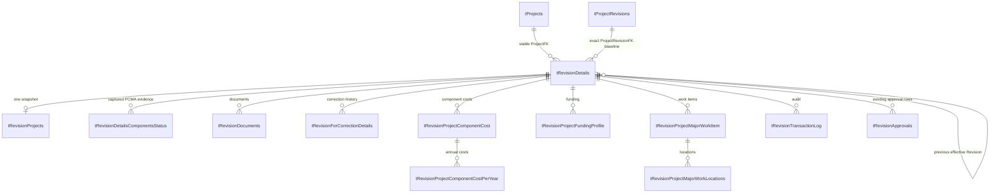
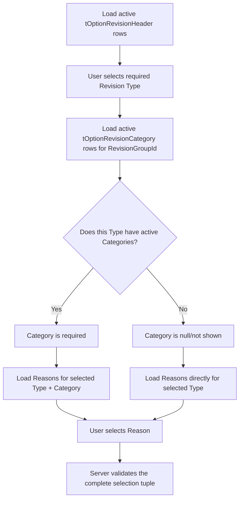
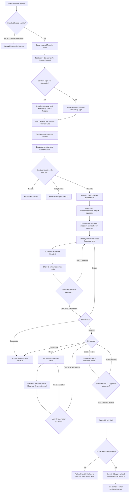

# MYPS Formal Project Revision Redesign and Migration Plan

Status: Planning baseline  
Date: 2026-08-11  
Implementation authorization: Not granted by this document  
Primary audience: Product owner, business analyst, database developer, application developer, QA, operations, and support

## 1. Purpose

This document defines how MYPS should redesign only the approved Formal Project Revision transaction and snapshot tables while preserving the existing Revision rule catalog, approval configuration, option tables, Program lifecycle, and Project lifecycle.

The intended result is a Formal Revision subsystem that:

- starts from the exact Project revision that was published to PCMA;
- retains the stable Project identity across every lifecycle stage and Formal Revision;
- copies the complete editable Project aggregate into a Formal Revision workspace;
- applies the existing `tRevisionRules` JSON without changing its schema or records;
- preserves the existing IO, RO, and CO approval structure;
- prevents pending, returned, or disapproved changes from replacing effective Project data;
- makes a successfully CO-approved and republished Formal Revision the next effective baseline;
- avoids textual parent-child joins where a physical relational key is available;
- supports deterministic retries, audit, reconciliation, migration rollback, and operational diagnosis.

This is a plan, not an executable migration. No production object should be changed until every decision gate and pre-deployment verification in this document passes.

## 2. Accuracy statement

Software cannot honestly be guaranteed to remain free of every future defect. This plan instead defines controls that target zero known defects at release and make future failures detectable, contained, recoverable, and testable.

The release must not proceed based only on successful DDL execution. It must pass:

1. live catalog verification;
2. source-to-target migration reconciliation;
3. application compatibility tests;
4. business use-case acceptance tests;
5. concurrency and idempotency tests;
6. PCMA failure-injection tests;
7. rollback rehearsal;
8. production monitoring and post-cutover reconciliation.

## 3. Sources and authority

This plan reconciles the following evidence:

- `sources/database/myps_db(08-10-2026-full-schema).sql`: current supplied MYPS schema;
- `sources/database/LOCAL-MYPS(revision).sql`: proposed/legacy Revision transaction table shape;
- `sources/context/MYPS_CODEX_MASTER_CONTEXT.md`: current architecture and terminology;
- `docs/architecture/04-formal-revision-erd.md`: existing Formal Revision model and IO/RO/CO workflow;
- client-confirmed answers recorded in this project discussion;
- `docs/architecture/database/MYPS_FORMAL_REVISION_SCHEMA_V2_SAMPLE.sql`: exploratory design sample only.

When these sources conflict, client-confirmed business behavior governs the process, while the live database catalog and running application govern what can safely be migrated.

## 4. Terminology that must remain distinct

| Term | Meaning | Primary object |
|---|---|---|
| Project anchor | Stable Project identity created once | `tProjects` |
| Lifecycle/base Project revision | Stage-specific Project state copied during Program advancement | `tProjectRevisions` |
| Formal Revision transaction | Post-publication change request with IO/RO/CO approval | `tRevisionDetails` |
| Formal Revision Project snapshot | Editable copy used by one Formal Revision transaction | `tRevisionProjects` target role |
| Effective Project | Published lifecycle baseline plus the latest fully approved and successfully republished Formal Revision, if one exists | Derived read model |

`tProjectRevisions` must never be described as the Formal Revision approval transaction. `tRevisionDetails` must never be used as a replacement for the stable `tProjects` identity.

## 5. Approved scope

### 5.1 Tables that may change

Only the following tables are in the redesign and migration scope:

| No. | Table | Intended responsibility |
|---:|---|---|
| 1 | `tRevisionDetails` | Formal Revision transaction root and identity anchors |
| 2 | `tRevisionDetailsComponentsStatus` | Frozen PCMA component construction/package status evidence |
| 3 | `tRevisionProjects` | One Formal Revision Project snapshot per transaction |
| 4 | `tRevisionDocuments` | Documents attached to the Formal Revision |
| 5 | `tRevisionForCorrectionDetails` | Return-for-correction history |
| 6 | `tRevisionProjectComponentCost` | Component-cost snapshot rows |
| 7 | `tRevisionProjectComponentCostPerYear` | Annual component-cost child rows |
| 8 | `tRevisionProjectFundingProfile` | Funding-profile snapshot rows |
| 9 | `tRevisionProjectMajorWorkItem` | Major work-item snapshot rows |
| 10 | `tRevisionProjectMajorWorkLocations` | Location rows owned by one Formal Revision work item |
| 11 | `tRevisionTransactionLog` | Immutable transaction/edit/state-change audit events |

### 5.2 Objects that must remain unchanged

The following are dependencies, not migration targets:

- `tRevisionRules`;
- `tRevisionApprovals`;
- `tOptionRevisionHeader`;
- `tOptionRevisionCategory`;
- `tOptionRevisionReasons`;
- `tOptionRevisionStatus`;
- `tOptionRevisionApprovalLevel`;
- `vRevisionRules`, `fRevisionRuleFor`, or the deployed equivalent;
- all funding, component, infrastructure, work-type, administrative-area, and other option tables;
- `tPrograms`, `tProgramRevisions`, and `tProgramStages`;
- `tProjects`, `tProjectRevisions`, and `tProjectStages`;
- existing base Project funding, component, work, location, document, and note tables;
- `PCMA_vw_ProjectComponentConstructionStatus` and its linked-server configuration;
- PCMA API endpoint contracts.

Compatibility changes in application queries are allowed. Schema changes to these preserved objects are not allowed under this work item.

### 5.3 Explicitly out of scope

- changing rule JSON meaning;
- changing Revision Type, Category, or Reason master data;
- changing IO/RO/CO status codes or approval-level definitions;
- redesigning Program stage advancement;
- changing ProjectId generation;
- defining LS/wallet Revision behavior;
- changing PCMA endpoint behavior;
- deleting historical Revision data during initial cutover.

## 6. Confirmed business rules

1. Only a published Project may begin a Formal Revision.
2. `tOptionRevisionHeader` supplies the required Revision Type. After the Type is selected, MYPS checks whether that `RevisionGroupId` has active rows in `tOptionRevisionCategory`.
3. If the selected Revision Type has active Categories, Category becomes required and Reasons are filtered by both the selected Type and selected Category.
4. If the selected Revision Type has no active Categories, Category remains null/not shown and Reasons are filtered directly by the selected Type.
5. A selected Reason must always belong to the selected Type. When Category applies, it must also belong to the selected Category.
6. PCMA component status is read through the read-only linked-server view `PCMA_vw_ProjectComponentConstructionStatus`.
7. PCMA data is used to determine rule eligibility and editability. MYPS does not write status changes back through that view.
8. JSON `true` means editable.
9. JSON `false` means read-only.
10. A field missing from the JSON defaults to read-only.
11. The starting baseline is the exact Project revision that was published.
12. Existing rule records cannot be changed while affected Revisions are pending.
13. Pending, returned, and disapproved Formal Revisions do not replace the effective Project.
14. A CO-approved Formal Revision becomes effective immediately as part of the successful approval/publication operation.
15. CO approval republishes the Project to PCMA.
16. If republication fails, the local CO approval/effective change must roll back, an error must be shown, and the user may retry or contact support.
17. A fully approved and successfully republished Formal Revision becomes the starting baseline for the next Formal Revision.
18. LS/wallet Project behavior remains an open decision and must not inherit standard behavior silently.
19. When IO chooses Submit or Resubmit, MYPS first opens an upload-document modal. A valid IO submission document is mandatory before the same command may place the Revision in the RO queue.
20. RO approval routes the already-documented Revision directly to CO pending. There is no business step in which RO approval sends the transaction back to IO merely to upload a document.
21. When CO chooses Approve, MYPS first opens a separate upload-document modal. A valid CO approval document is mandatory before the same command may start final approval and PCMA republication.
22. The IO submission document and CO approval document are separate workflow evidence and must remain distinguishable by actor/purpose and workflow attempt.

## 7. Non-negotiable data invariants

### 7.1 Identity invariants

- `ProjectFK` identifies the permanent Project and must remain stable.
- `ProjectRevisionFK` identifies the exact published lifecycle/base revision.
- A Formal Revision child belongs to one `tRevisionDetails.Id` through `RevisionDetailFK` or to an intermediate relational parent owned by that transaction.
- `TransactionId` is a business/idempotency identifier at the root. It must not be the physical child-table parent key.
- `ProjectId` is display/snapshot data and must not be used as the stable Project relationship.
- `ReferenceId` must not be reintroduced as the primary Project identity.

### 7.2 Ownership invariants

- `tRevisionDetails.ProjectFK` must equal the `ProjectFK` of `ProjectRevisionFK`.
- The referenced lifecycle Project revision must be the exact published baseline selected at creation.
- Every component cost, funding row, work item, location, document, correction, status snapshot, and log entry must resolve to exactly one Formal Revision transaction.
- A location must reference a work item owned by the same Formal Revision.
- An annual component cost must reference a component cost owned by the same Formal Revision.
- No child may reference a deleted, missing, or different transaction parent.

### 7.3 Effectivity invariants

- Base Project data remains effective until final approval and successful republication complete.
- A pending or returned snapshot is never visible as effective data to ordinary Project consumers.
- Disapproval is terminal for that transaction unless the existing business process explicitly supports reopening.
- At most one Formal Revision result may be selected as the latest effective overlay for a Project.
- Effective selection must use the existing approval rows and statuses, not a UI-only flag.

### 7.4 Rule invariants

- `tRevisionRules` remains unchanged.
- The application must resolve exactly one applicable active rule from the existing deployed rule surface.
- Zero matches blocks Revision creation/editing with a controlled business error.
- Multiple matches block Revision creation/editing with a configuration error; the application must not use nondeterministic `FirstOrDefault` behavior.
- Rule evaluation is deny-by-default: unknown section, unknown field, malformed field path, or missing property is read-only.
- Server-side validation must reapply the rule. Disabling a browser field is not sufficient enforcement.

### 7.5 Audit invariants

- Audit rows are append-only from the application perspective.
- Every state-changing request records actor, UTC/local policy-compliant timestamp, transaction, action, and affected entity.
- Old and new values must be recorded for editable business fields where allowed by privacy and size policy.
- Publication attempts must be distinguishable from ordinary edits even when PCMA returns no transaction identifier.
- Every accepted IO submission/resubmission must identify the IO submission document that satisfied that exact workflow attempt.
- Every accepted CO approval attempt must identify the separate CO approval document that satisfied that exact workflow attempt.
- A document uploaded for one actor/purpose must never satisfy the other actor's gate.

## 8. Target logical relationship model



The target design must use physical foreign keys wherever the referenced target is a valid unique or primary key. Relationships that cannot be physically enforced must be named, tested application invariants and must not be presented as physical FKs in documentation.

## 9. Table-by-table change specification

The column-level DDL remains a design deliverable. The following requirements define what that DDL must accomplish.

### 9.1 `tRevisionDetails`

Purpose: one root row per Formal Revision transaction.

Required behavior:

- retain `Id` as the physical primary key;
- retain one normalized `TransactionId` length and require uniqueness;
- store stable `ProjectFK`;
- store exact `ProjectRevisionFK`;
- store enough Program context for audit without using Program display identifiers as relational parents;
- store Revision Type/Group, optional Category, and Reason identifiers compatible with existing option tables;
- support a nullable link to the preceding effective Formal Revision if lineage is adopted;
- retain certification and any legacy document fields only for migration compatibility; the canonical IO and CO workflow documents must be relational rows in `tRevisionDocuments`, not one ambiguous root path;
- retain existing audit fields;
- support safe optimistic concurrency through a row-version or equivalent application token if compatible with the application stack.

Constraints and indexes:

- primary key on `Id`;
- unique key/index on `TransactionId`;
- FK to `tProjectRevisions.Id`;
- FK to the existing Revision option tables where the referenced columns are unique;
- FK to the previous Formal Revision when lineage is implemented;
- lookup index for Project history ordered by creation date/identity;
- lookup index for baseline Project revision;
- no destructive cascade delete.

Required service validation:

- stable Project and base Project revision ownership match;
- baseline is published and eligible;
- selected Type/Category/Reason combination is valid and active;
- Category is required only when the selected Type has active Category rows;
- Reason belongs to the selected Type and, when applicable, the selected Category;
- exactly one applicable rule exists;
- concurrency policy permits creation.

### 9.2 `tRevisionDetailsComponentsStatus`

Purpose: preserve the component-level PCMA status evidence used to derive the rule match.

Required behavior:

- replace child `TransactionId` with `RevisionDetailFK`;
- retain component identity, construction status code/name, and package state;
- record capture timestamp;
- allow zero rows when PCMA returns no components, while the derived status is `No Components`;
- prevent duplicate component rows within the same capture unless PCMA has a documented multi-row component contract.

This table is an audit snapshot. It does not become a writable substitute for PCMA status.

### 9.3 `tRevisionProjects`

Purpose: one editable Formal Revision Project snapshot.

Required behavior:

- replace `RevisionId`, textual `TransactionId`, and ambiguous `ReferenceId` ownership with `RevisionDetailFK`;
- enforce one snapshot per Formal Revision transaction;
- retain `ProjectId` as snapshot/display data;
- retain relevant fields currently copied from the published Project revision;
- preserve nullable values exactly; do not convert null to blank, zero, or default during migration;
- prevent the snapshot from becoming effective solely through an `IsActive` flag;
- use the existing approval/effectivity predicate as the authority.

Current-object mapping:

- if the live database contains `tRevisionProjectSnapshot`, it is the current normalized source role;
- if it contains legacy `tRevisionProjects`, it is the legacy source role;
- the migration must inventory which object and columns are actually deployed before selecting a rename or copy strategy;
- two competing writable snapshot tables must not remain after cutover.

### 9.4 `tRevisionDocuments`

Purpose: supporting and approval documents owned by a Formal Revision.

Required behavior:

- replace child `TransactionId` with `RevisionDetailFK`;
- retain document name, path/storage identifier, and approved-document classification;
- preserve the confirmed deployed classification `IsApprovedDocument = 1` for the CO approval document;
- do not treat `IsApprovedDocument` as a generic workflow approval status—it classifies the document's role;
- preserve the current repository contract `IsApprovedDocument = 0` for IO initial-submission and resubmission documents; profile deployed historical/manual rows before enforcing that meaning as a database constraint;
- record the workflow attempt/version to which the document belongs, plus uploader and upload timestamp;
- preserve replaced/superseded rows for audit instead of overwriting the only evidence;
- retain existing path length and storage conventions unless a separate storage migration is approved;
- never cascade-delete the physical document as a side effect of a database row migration;
- validate the IO submission document inside the Submit/Resubmit command before the RO-pending transition;
- validate a separate CO approval document inside the Approve command before publication or CO-approved/effective state;
- prohibit an IO-purpose document from satisfying the CO gate and vice versa.

Recommended canonical metadata, subject to final naming/profile verification:

| Concept | Requirement |
|---|---|
| `RevisionDetailFK` | Physical parent FK to the Formal Revision root |
| `IsApprovedDocument` | Existing classifier; client-confirmed and code-observed `1 = CO approval document`; current repository writers use `0` for IO initial submission/resubmission documents; profile historical data before adding a constraint |
| `WorkflowAttemptNo` | Identifies the submit/resubmit or CO-approval attempt |
| `DocumentName` | Original/display file name |
| `DocumentPath` or storage key | Durable storage locator; do not expose a user-controlled physical path |
| `UploadedBy`, `UploadedDate` | Immutable upload audit metadata |
| current/superseded marker | Identifies the document selected for the attempt without deleting history |
| file-validation metadata | Content type, size, checksum, and scan result if supported by the approved storage service |

The current application repository writes `0` only for initial IO submission and IO resubmission, and writes `1` for the CO approval document. That is sufficient for the target application contract, but the migration must still profile deployed historical/manual rows before enforcing a database constraint. If old data or a future feature uses `0` for ordinary supporting documents, final DDL needs an additional role/type discriminator within `tRevisionDocuments`. The current full-schema `IODocPath` still cannot represent the mandatory CO document. The older local schema's `IODocApprovalDate` and `CODocApprovalDate` prove two timing concepts but do not by themselves identify two document rows.

### 9.5 `tRevisionForCorrectionDetails`

Purpose: append-only history of every return for correction.

Required behavior:

- replace child `TransactionId` with `RevisionDetailFK`;
- retain reason and correction date;
- retain or derive the returning and receiving approval levels using existing approval codes;
- preserve whether the return originated from Central Office if the application requires the legacy flag;
- never overwrite an earlier correction row when the transaction is returned again.

### 9.6 `tRevisionProjectComponentCost`

Purpose: component-cost snapshot owned by a Formal Revision.

Required behavior:

- replace textual transaction and Project links with `RevisionDetailFK`;
- use the current MYPS component field names and compatible lengths;
- use `decimal(18,5)` for `Total`;
- retain source-row identity only as optional lineage, not as the parent relationship;
- preserve soft-delete behavior;
- support more than one component-cost row per Revision;
- enforce existing component-type lookup compatibility without changing the lookup table.

### 9.7 `tRevisionProjectComponentCostPerYear`

Purpose: annual allocation rows owned by one Formal Revision component cost.

Required behavior:

- replace textual `ComponentCostId` and transaction joins with `RevisionComponentCostFK`;
- use `decimal(18,5)` for `Amount`;
- retain Year, UACS, dates, approval date, and soft-delete behavior used by the current application;
- reject impossible date ranges;
- prevent a child from being attached to a component cost from a different Revision.

### 9.8 `tRevisionProjectFundingProfile`

Purpose: funding-profile snapshot rows owned by a Formal Revision.

Required behavior:

- replace textual transaction and Project links with `RevisionDetailFK`;
- allow multiple funding rows per Revision;
- remove or avoid any uniqueness rule that makes `TransactionId` globally unique in this child table;
- use `decimal(18,5)` for monetary amounts;
- define Percentage using an agreed exact numeric type and range;
- retain source organization, agreement code, wallet-draw compatibility, and soft-delete behavior;
- use existing lookup values without changing the lookup schema.

### 9.9 `tRevisionProjectMajorWorkItem`

Purpose: major work-item snapshot rows owned by a Formal Revision.

Required behavior:

- replace textual transaction, Project, and `ReferenceId` ownership with `RevisionDetailFK`;
- retain optional source-row lineage separately if needed for audit;
- retain ComponentId correlation, YearOfWork, Work Type, Infrastructure Type, and soft-delete state;
- do not invent a physical ComponentId FK when the deployed model only supports correlation;
- continue using existing Work Type and Infrastructure Type lookups.

### 9.10 `tRevisionProjectMajorWorkLocations`

Purpose: location rows owned by a Formal Revision work item.

Required behavior:

- replace textual `ParentId` and `TransactionId` with `RevisionWorkItemFK`;
- retain the current location/scope/target/coordinate/station/chainage fields;
- prevent orphan locations;
- validate numeric and coordinate rules at the service layer where business ranges are not yet confirmed;
- preserve soft-delete behavior.

### 9.11 `tRevisionTransactionLog`

Purpose: append-only audit history for Revision edits, state changes, publication attempts, and migration events.

Required behavior:

- replace child `TransactionId` ownership with `RevisionDetailFK` while allowing TransactionId to be included as denormalized display data only if proven necessary;
- retain transaction type, affected table/column, old value, new value, actor, and timestamp;
- define controlled transaction-type values in application code or existing configuration without changing preserved option tables;
- record publication requested, succeeded, failed, and retry events;
- prevent ordinary application update/delete operations on historical log rows;
- index by Revision and event time.

## 10. Existing rule compatibility

### 10.1 Revision Type, optional Category, and Reason resolution

The selector is conditional, not a flat three-field lookup:



Database evidence:

- `tOptionRevisionHeader.RevisionGroupId` is the unique Revision Type/group identifier.
- `tOptionRevisionCategory.RevisionGroupId` has a physical FK to Header and identifies which optional Categories belong to the Type.
- `tOptionRevisionReasons.RevisionGroupId` has a physical FK to Header, so every Reason is scoped to a Type.
- `tRevisionDetails.CategoryId` is nullable and has a physical FK to `tOptionRevisionCategory.CategoryId`.
- `tRevisionDetails.ReasonId` has a physical FK to `tOptionRevisionReasons.ReasonId`.
- `tOptionRevisionReasons.CategoryId` is `nvarchar(200) NOT NULL` in the supplied DDL and has no physical FK to `tOptionRevisionCategory`.
- The supplied schema contains no seed rows for these tables. Therefore, the exact encoding used by `tOptionRevisionReasons.CategoryId` and the no-Category sentinel cannot be inferred from DDL and must be verified from deployed rows/application code.

Required deployed-data inspection before query implementation:

```sql
SELECT * FROM dbo.tOptionRevisionHeader;
SELECT * FROM dbo.tOptionRevisionCategory;
SELECT * FROM dbo.tOptionRevisionReasons;
```

The review must group rows by `RevisionGroupId`, identify Types with zero versus one-or-more active Categories, enumerate every distinct raw `tOptionRevisionReasons.CategoryId` representation, and compare it with current application parsing. Do not implement a direct integer cast or string-contains filter until that evidence is captured.

Required server-side tuple validation:

1. selected Header is active;
2. determine `HasCategories` from active Category rows for the Header's `RevisionGroupId`;
3. if `HasCategories=true`, require an active Category with the same `RevisionGroupId`;
4. if `HasCategories=false`, require `tRevisionDetails.CategoryId IS NULL` and reject a supplied Category;
5. require an active Reason with the same `RevisionGroupId` as the selected Header;
6. when Category applies, require the Reason's deployed Category association to include the selected Category;
7. when Category does not apply, require the Reason to use the deployed type-level/no-Category representation;
8. reject mismatched, inactive, ambiguous, or unparseable combinations before rule lookup or transaction creation.

The rule lookup then uses the deployed rule/view contract and the validated Reason context:

```text
ReasonId
+ RevisionGroupId when exposed by the deployed view
+ derived PCMA construction status
+ derived package status
+ active rule condition
```

### 10.2 Construction-status derivation

Given the distinct PCMA component construction-status names:

1. zero components produces `No Components`;
2. any `On-Going` produces `On-Going`;
3. only `Terminated` produces `Terminated`;
4. `Not Yet Started` mixed with anything other than `On-Going` produces `Not Yet Started`;
5. remaining data containing `Completed` produces `Completed`, ignoring terminated components;
6. any unrecognized combination is invalid and blocks rule selection.

Status spelling and whitespace must be normalized only through an explicitly tested mapping. The database sample `Not yet started` and application value `Not Yet Started` must not create two business statuses.

### 10.3 Package-status derivation

- any component marked `Not Packaged` produces `Not Packaged`;
- otherwise the derived result is `Packaged`;
- the zero-component result is therefore `Packaged` under the supplied application logic unless the product owner later confirms a separate rule.

### 10.4 Rule enforcement

- validate JSON before use;
- treat missing fields as `false`;
- enforce both field editability and CRUD permissions on the server;
- return the configured rule message when an add/delete operation is denied;
- store or reconstruct the exact matched rule identity for audit without changing `tRevisionRules`;
- block administrative rule updates through application policy while affected Revisions are unresolved.

## 11. Formal Revision process flow



## 12. Concurrency and idempotency plan

### 12.1 Creation concurrency

Before copying the Project aggregate, the service must acquire a database-scoped lock keyed by stable `ProjectFK`, or use an equivalent serializable mechanism. After acquiring the lock, it must recheck eligibility and the unresolved-Revision policy.

The creation operation must accept or generate an idempotency key. Repeating the same request must return the existing transaction instead of creating a second snapshot.

### 12.2 Edit concurrency

Each save must include an optimistic concurrency token or verified last-updated value. A stale client must receive a conflict response and reload current data instead of silently overwriting another user's changes.

### 12.3 Approval concurrency

Every approval command must state the expected current approval state. The update must affect exactly one expected row. Zero affected rows means stale or invalid state and must not continue to publication.

### 12.4 Retry behavior

- creation retries are idempotent by transaction/request key;
- ordinary save retries are safe only when the same concurrency token is valid;
- approval retries return the already-applied result when the same command completed;
- publication retries must first determine whether PCMA already accepted the Project;
- no retry may create duplicate child graphs or double-increment revision counters.

## 13. PCMA consistency limitation and mitigation

A local SQL transaction cannot physically roll back an external HTTP/API side effect. The dangerous case is:

1. PCMA accepts the publication;
2. the response is lost or times out;
3. MYPS rolls back locally;
4. a retry publishes the same change again.

The implementation must therefore add an application-level consistency protocol even though PCMA returns no publication transaction ID:

1. send a deterministic MYPS transaction/revision identity if the endpoint supports an idempotency or correlation field;
2. if it does not, query the PCMA read surface after an ambiguous timeout to determine whether the submitted Project version is already present;
3. classify results as confirmed success, confirmed failure, or unknown outcome;
4. never blindly retry an unknown outcome;
5. write a local publication-attempt audit event after local rollback when possible;
6. provide an operations reconciliation procedure for unknown outcomes.

This protocol is a release blocker. Without it, “rollback on PCMA failure” cannot guarantee cross-system consistency.

## 14. Migration strategy

### Phase 0: Decision and catalog gate

1. Confirm the one-unresolved-Revision-per-Project policy.
2. Confirm the exact effective Revision predicate using existing approval levels/statuses.
3. Confirm whether `tRevisionProjects` replaces `tRevisionProjectSnapshot` by rename or by copy-and-swap.
4. Confirm how the exact previously approved Formal Revision baseline is represented if no lineage column exists.
5. Confirm whether PCMA status and rule permissions are frozen at creation or re-evaluated during correction/resubmission.
6. Inspect deployed rows from Header, Category, and Reasons to determine the exact `tOptionRevisionReasons.CategoryId` encoding and no-Category representation.
7. Confirm PCMA ambiguous-outcome handling.
8. Verify the live schema, indexes, constraints, row counts, null distributions, and orphan counts.
9. Verify whether `tProjects.ProjectPK` has a live unique key/index. The supplied DDL does not show one even though foreign keys reference it.
10. Verify actual `vRevisionRules`/`fRevisionRuleFor` deployment and result cardinality.

No DDL is written until this gate passes.

### Phase 1: Data profiling

For every in-scope table, collect:

- total and active row counts;
- minimum/maximum identifiers and dates;
- duplicate TransactionIds;
- orphan textual parent references;
- rows with missing Project or base revision identity;
- monetary precision loss candidates;
- overlength values relative to target columns;
- nulls in proposed required columns;
- invalid option/status values;
- duplicate one-to-one Project snapshots;
- child ownership conflicts;
- malformed or unresolvable legacy ReferenceIds.

Produce a signed exception report. Do not silently discard or coerce exceptions.

### Phase 2: Target DDL and migration map

1. Produce final target DDL only for the 11 approved tables.
2. Produce a source-to-target column map with conversion rule, null rule, default rule, and rejection rule for every column.
3. Produce a parent-key mapping table from legacy TransactionId/RevisionId to new `RevisionDetailFK`.
4. Define creation order, indexes, FKs, checks, and non-cascade behavior.
5. Review generated execution plans for migration queries on production-scale data.

### Phase 3: Shadow-table creation

1. Create versioned shadow tables, such as `_V2` or a deployment schema, without changing existing application reads.
2. Create constraints that do not block controlled loading where SQL Server supports staged validation.
3. Deny ordinary application writes to the shadow tables.
4. Record deployed DDL hashes and catalog metadata.

No old table is dropped or renamed in this phase.

### Phase 4: Deterministic data copy

Copy in dependency order:

1. `tRevisionDetails` roots;
2. `tRevisionDetailsComponentsStatus`;
3. `tRevisionProjects` snapshots;
4. `tRevisionDocuments`;
5. `tRevisionForCorrectionDetails`;
6. `tRevisionProjectComponentCost`;
7. `tRevisionProjectComponentCostPerYear` using the new component-cost key map;
8. `tRevisionProjectFundingProfile`;
9. `tRevisionProjectMajorWorkItem`;
10. `tRevisionProjectMajorWorkLocations` using the new work-item key map;
11. `tRevisionTransactionLog`.

Every source row must be classified as migrated, intentionally transformed, or rejected with a reason. “Missing from target” is not an acceptable unclassified result.

### Phase 5: Reconciliation

Required reconciliation includes:

- source vs target row counts by transaction and table;
- root-to-child cardinality comparisons;
- totals for component costs, annual costs, and funding amounts;
- hash comparisons for text and scalar snapshot fields;
- null-preservation checks;
- orphan checks returning zero;
- duplicate ownership checks returning zero;
- sample transaction reconstruction compared field-for-field;
- approval and correction history association checks;
- effective-data result comparison before application cutover.

Any unexplained difference blocks cutover.

### Phase 6: Application compatibility release

1. Introduce a repository/service layer that hides physical table differences from controllers/UI.
2. Switch child writes to relational parent keys.
3. Keep rules, approval objects, and option-table queries unchanged.
4. Add server-side rule enforcement and cardinality checks.
5. Add feature flags for new reads and writes.
6. Deploy with the new path disabled.
7. Run production-safe read-only comparisons between old and new result models.

### Phase 7: Controlled cutover

1. Announce a maintenance/change window.
2. Stop or drain Formal Revision writes only; unrelated MYPS functions should remain available if safe.
3. Apply the final delta copy.
4. Run the complete reconciliation suite.
5. Enable new reads for internal validation.
6. Enable new writes for a limited authorized cohort or one region if operationally possible.
7. Observe defined health metrics.
8. Expand only after the canary gate passes.

### Phase 8: Stabilization and cleanup

1. Retain old tables read-only for the agreed rollback period.
2. Retain key maps and reconciliation results as deployment evidence.
3. Remove compatibility code only after the rollback window closes.
4. Archive, rename, or drop old objects in a separate approved release.
5. Update ERD, data dictionary, runbooks, and support diagnostics to the final deployed model.

## 15. Rollback plan

Rollback must be rehearsed before production.

### Before write cutover

- disable the feature flag;
- discard/recreate shadow data as needed;
- no production data rollback is required because the old path remains authoritative.

### After limited write cutover

- stop new Revision writes;
- export all V2-only transactions and audit rows;
- determine whether reverse mapping to the old schema is lossless;
- if lossless and rehearsed, replay into the old model;
- otherwise keep V2 transactions read-only and route affected users through an approved operational procedure;
- restore old reads only after verifying that no approved/effective Revision will disappear.

### Hard rollback trigger examples

- orphan or cross-transaction child rows;
- incorrect effective Project selection;
- duplicate Formal Revision creation;
- rule bypass allowing forbidden edits;
- approval state transition corruption;
- PCMA duplicate or unknown publication outcomes above the agreed threshold;
- monetary reconciliation differences;
- sustained error/latency thresholds exceeded.

## 16. Application work plan

### 16.1 Data access

- add explicit repositories/query services for Formal Revision aggregate loading;
- prohibit direct controller joins through textual TransactionId or ProjectId;
- load children by relational FK;
- use one effective-data query/service shared by UI, API, publication, and reporting;
- retain parameterized queries and existing authorization filters.

### 16.2 Command services

Separate commands with explicit validation and transactions:

- create Formal Revision;
- save permitted Project details;
- add/update/delete permitted component/funding/work/location rows;
- attach document;
- submit to RO;
- return for correction;
- resubmit;
- RO approve/disapprove;
- CO approve/disapprove/return;
- publish/retry/reconcile;
- read history and effective Project.

### 16.3 Validation

Validation must run on both request and persistence boundaries:

- authorization and data-security scope;
- current state/expected state;
- rule JSON permission;
- lookup validity;
- required fields;
- parent ownership;
- monetary and date constraints;
- actor-specific IO submission and CO approval document gates;
- PCMA eligibility/status freshness policy;
- concurrency token;
- idempotency key.

### 16.4 Error contract

Define stable error codes for at least:

- Project not published;
- Project type pending/unsupported;
- Revision Category required for the selected Type;
- Revision Category not allowed because the selected Type has no Categories;
- Revision Category does not belong to the selected Type;
- Revision Reason does not belong to the selected Type/Category path;
- Revision Reason Category mapping cannot be parsed safely;
- PCMA unavailable;
- unknown PCMA status;
- no matching rule;
- multiple matching rules;
- field read-only;
- CRUD operation denied;
- stale Revision state;
- duplicate unresolved Revision;
- missing approval document;
- publication failed;
- publication outcome unknown;
- data integrity/configuration error.

User messages must be actionable without exposing SQL or linked-server internals.

## 17. Test strategy

### 17.1 Schema tests

- every intended PK, FK, unique key, check, and index exists;
- every FK source/target type matches;
- preserved tables are byte/catalog unchanged unless an unrelated approved deployment changed them;
- no unintended cascade delete/update exists;
- target DDL can be applied to a clean test copy and rolled back through the deployment mechanism.

### 17.2 Migration tests

- empty database/table set;
- representative normal history;
- duplicate legacy TransactionIds;
- missing parents;
- duplicate Project snapshots;
- multiple funding rows;
- maximum-length strings;
- null-heavy legacy rows;
- monetary precision boundaries;
- large-volume copy and restart after interruption;
- rerun/idempotency of migration batches;
- source and target reconciliation at full scale.

### 17.3 Rule tests

- every known construction-status precedence combination;
- Type with no Categories loads Reasons directly by `RevisionGroupId` and persists null Category;
- Type with Categories requires Category and filters Reasons by Type plus Category;
- Category from another Type is rejected;
- Reason from another Type is rejected even when its Category value appears compatible;
- Reason from another Category under the same Type is rejected;
- inactive Header, Category, or Reason is rejected;
- unknown or malformed `tOptionRevisionReasons.CategoryId` encoding fails closed;
- zero components;
- any `On-Going` wins;
- only `Terminated`;
- mixed `Not Yet Started` without `On-Going`;
- `Completed` with terminated components;
- unknown status;
- any `Not Packaged` wins;
- no matching rule;
- multiple matching rules;
- malformed JSON;
- missing field defaults read-only;
- true allows edit;
- false blocks edit;
- CRUD add/delete permissions enforced server-side.

### 17.4 Aggregate copy tests

- exact scalar Project snapshot;
- all funding rows;
- all component costs;
- all annual cost rows with remapped parent keys;
- all major work items;
- all locations with remapped work-item keys;
- all required documents;
- correct preservation of nulls and soft-delete state;
- no source parent identifier retained as a target physical parent.

### 17.5 Workflow tests

- IO create/save, open submission modal, upload the IO document, and submit atomically;
- IO submit/resubmit is blocked when the IO modal is cancelled or its document fails validation;
- RO return and repeated correction cycles;
- RO disapprove;
- RO approval routes directly to CO pending because the IO document was already required at submission;
- CO return and resubmit;
- CO disapprove;
- CO Approve opens its own upload modal and is blocked without a valid CO document;
- IO and CO documents cannot substitute for each other;
- CO approve with a valid CO document and successful publication;
- publication failure rollback;
- ambiguous timeout/reconciliation;
- next Revision uses latest effective baseline;
- pending/returned/disapproved data never appears effective.

### 17.6 Concurrency tests

- two users create a Revision for the same Project simultaneously;
- same creation request retried after timeout;
- two users edit the same snapshot;
- approval and edit race;
- RO and CO commands issued out of order;
- duplicate CO approval submission;
- two publication workers retry the same transaction;
- rule administration attempted while matching Revisions are pending.

### 17.7 Security tests

- unauthorized Project/region access;
- horizontal access using another RevisionDetailFK;
- attempted read-only field manipulation in raw HTTP payload;
- attempted child reassignment to another transaction;
- document-path traversal or unauthorized storage identifier;
- audit-log modification;
- SQL injection and oversized payloads;
- sensitive error-detail leakage.

### 17.8 Performance tests

- Project eligibility/status lookup;
- full aggregate creation for large Projects;
- load/edit/save of maximum expected child counts;
- Project Revision history query;
- IO/RO/CO queue queries;
- effective-data query;
- migration batch throughput and log growth;
- PCMA latency and timeout behavior.

Performance thresholds must be set from current production baselines before acceptance.

## 18. Acceptance and release gates

| Gate | Required result |
|---|---|
| Scope | Only the 11 approved tables are changed |
| Preserved objects | Catalog comparison shows no unintended changes |
| Referential integrity | Zero target orphans and zero cross-transaction children |
| Migration completeness | Every source row classified; all approved rows reconciled |
| Monetary integrity | Exact reconciled decimal totals |
| Rule enforcement | All allow/deny/CRUD cases pass through server-side tests |
| Workflow | Every approved use case and exception path passes |
| Effectivity | Only fully approved and successfully published Revision overlays the base |
| Concurrency | No duplicate graph, lost update, or invalid transition under stress |
| PCMA | Success, failure, timeout, unknown outcome, and retry behavior demonstrated |
| Security | No critical/high unresolved findings |
| Rollback | Rehearsal completed within the agreed recovery objective |
| Observability | Dashboards, alerts, queries, and support runbook verified |
| Product sign-off | Business owner accepts use-case results |

Any failed mandatory gate blocks production deployment.

## 19. Monitoring and support

Track at minimum:

- Formal Revisions created/submitted/returned/disapproved/approved per period;
- time spent in each approval state;
- no-rule and multiple-rule errors;
- PCMA linked-server failures and latency;
- PCMA publication success, confirmed failure, and unknown outcomes;
- publication retries;
- concurrency conflicts;
- aggregate-copy duration and child counts;
- reconciliation mismatches;
- orphan-detection results;
- effective-data query errors;
- migration/cutover feature-flag state.

Support diagnostics must accept `TransactionId`, `RevisionDetailId`, stable `ProjectFK`, and Project display ID, then show the relationship without requiring manual free-text joins.

## 20. Open decisions and blockers

| ID | Status | Decision/risk | Default safe position |
|---|---|---|---|
| `DEC-REV-CONC-001` | Open | May a Project have more than one unresolved Formal Revision? | Allow only one until explicitly approved otherwise |
| `DEC-REV-SNAP-001` | Verify live | Does deployed production use `tRevisionProjectSnapshot`, legacy `tRevisionProjects`, or both? | Inventory before DDL; never keep two writable sources |
| `DEC-REV-LINEAGE-001` | Open | Add explicit previous-effective Formal Revision linkage or derive it? | Prefer explicit lineage if scope approval allows it |
| `DEC-REV-PCMA-001` | Release blocker | How is an ambiguous PCMA timeout reconciled without a returned transaction ID? | Do not blind retry; verify PCMA state or require idempotency support |
| `DEC-REV-PCT-001` | Open technical | Exact numeric type and scale for funding Percentage | Use exact decimal after profiling current values |
| `DEC-REV-STATUS-001` | Verify live | Exact status values and effective approval predicate | Read deployed option data and current code |
| `DEC-REV-RULE-001` | Verify live | Which deployed object supplies `RevisionGroupId` in rule lookup? | Preserve object; fail closed on ambiguous cardinality |
| `DEC-REV-REASON-CATEGORY-001` | Data verification required | How does `tOptionRevisionReasons.CategoryId nvarchar(200)` encode one/multiple Categories, and what value represents a type-level Reason with no Category? | Inspect deployed rows and current application parsing; do not guess or cast directly |
| `DEC-REV-RULE-FRESH-001` | Open | Are PCMA status and field permissions frozen at creation or re-evaluated during correction/resubmission? | Never mix rule contexts silently; use one confirmed policy per transaction |
| `DEC-REV-DOC-001` | Open business | Does each IO/CO modal accept exactly one required document or multiple documents? | Require one designated gate document; allow no unclassified substitution |
| `DEC-REV-DOC-000` | Application contract confirmed; deployed-data profiling required | Current repository writers use `0` for IO initial submission/resubmission and `1` for CO approval; do historical/manual rows follow the same contract? | Implement the actor-specific mapping in code, but do not add a restrictive database constraint until deployed rows are profiled |
| `DEC-REV-DOC-002` | Open business | Must every resubmission/approval retry upload a new document, or may the actor explicitly reuse the current valid document? | Preserve every attempt and require explicit selection; never reuse silently |
| `DEC-REV-DOC-003` | Open business/operations | What file types, maximum size, storage, malware-scan, replacement, and retention policies apply? | Fail closed until the storage policy validates the upload |
| `DEC-REV-DOC-004` | Open business | After confirmed PCMA publication failure, may the CO reuse the uploaded CO document on retry? | Keep audit history but require explicit reuse or replacement decision |
| `DEC-SPECIAL-PRJ-001` | Pending | LS/wallet eligibility and behavior | Block and raise for clarification |
| `RSK-PROJECT-PK-001` | Verify live | Supplied DDL lacks visible uniqueness on `tProjects.ProjectPK` | Verify catalog before defining physical FK |

## 21. Implementation work breakdown

1. Approve open decisions and record them as ADRs.
2. Capture live schema and data-profile evidence.
3. Produce final column-level target DDL for only the 11 tables.
4. Produce source-to-target mapping and exception policy.
5. Implement migration scripts with key maps and restartable batches.
6. Implement reconciliation queries and reports.
7. Implement repository/effective-data layer.
8. Implement server-side rule evaluator and deny-by-default validation.
9. Implement creation/edit/approval/publication command services.
10. Implement idempotency, locking, and optimistic concurrency.
11. Implement PCMA ambiguous-outcome reconciliation.
12. Implement audit events and support diagnostics.
13. Build automated schema, migration, unit, integration, security, and performance tests.
14. Run full restored-database migration rehearsal.
15. Run business UAT using the linked use-case specification.
16. Run rollback rehearsal.
17. Deploy disabled, compare reads, canary writes, then expand.
18. Complete post-cutover reconciliation and stabilization.
19. Retire legacy objects only in a later approved release.

## 22. Definition of done

The redesign is done only when:

- all open release-blocking decisions are closed;
- only the approved 11 tables changed;
- preserved rule, approval, option, Program, and Project tables remain compatible;
- final DDL, ERD, data dictionary, and migration map match the deployed catalog;
- source-to-target reconciliation has no unexplained differences;
- every use case and negative scenario passes;
- IO cannot enter the RO queue without a valid IO submission document captured by the same command;
- RO approval has no post-approval IO-document waiting state;
- CO cannot approve or begin publication without a separate valid CO approval document captured by the same command;
- effectivity is correct for pending, returned, disapproved, approved, publication-failed, and publication-unknown states;
- PCMA retry behavior cannot create an unrecognized duplicate publication;
- no critical/high security issue remains;
- rollback has been rehearsed;
- monitoring and support diagnostics are operational;
- business, engineering, QA, database, and operations owners sign off.

## 23. Related documentation

- [Formal Revision Use-Case Specification](MYPS_FORMAL_REVISION_USE_CASE_SPECIFICATION.md)
- [`RevisionController` Refactoring Plan](../engineering/MYPS_REVISION_CONTROLLER_REFACTORING_PLAN.md)
- [Formal Revision ERD and Workflow](../architecture/04-formal-revision-erd.md)
- [Effective Data and Traceability](../architecture/05-effective-data-and-traceability.md)
- [Program-to-Project Process Flow Plan](../process/MYPS_PROGRAM_TO_PROJECT_PROCESS_FLOW_PLAN.md)
- [Exploratory Formal Revision V2 SQL Sample](../architecture/database/MYPS_FORMAL_REVISION_SCHEMA_V2_SAMPLE.sql)
