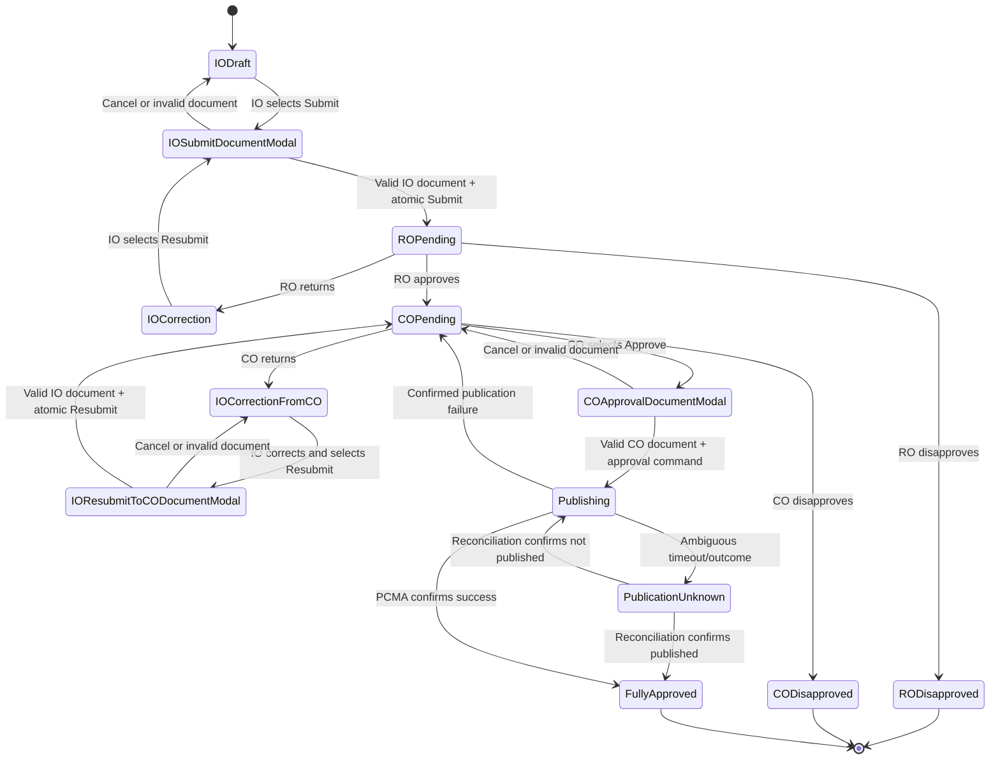
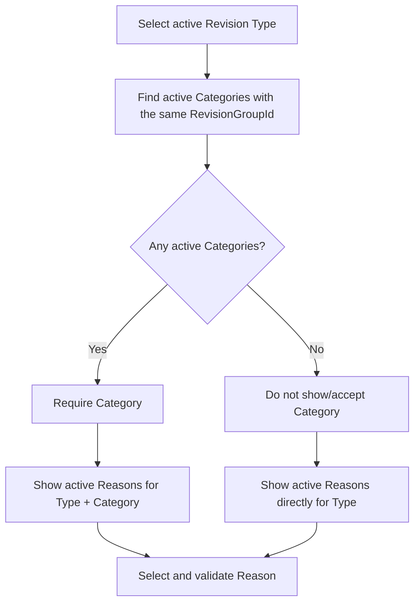

# MYPS Formal Project Revision Use-Case Specification

Status: Planning and UAT baseline  
Date: 2026-08-11  
Related plan: [Formal Revision Redesign and Migration Plan](MYPS_FORMAL_REVISION_REDESIGN_AND_MIGRATION_PLAN.md)

## 1. Purpose

This specification defines how a published MYPS Project enters a Formal Revision, receives field permissions from the existing rule configuration, moves through IO/RO/CO approval, republishes to PCMA, and becomes the effective baseline for a later Formal Revision.

It is both:

- a business description for review and UAT; and
- a developer/QA contract for commands, state transitions, data writes, validation, errors, idempotency, and effectivity.

## 2. Scope boundary

The use cases may write only through the approved Revision transaction/data tables and the existing approval table:

- `tRevisionDetails`;
- `tRevisionDetailsComponentsStatus`;
- `tRevisionProjects`;
- `tRevisionDocuments`;
- `tRevisionForCorrectionDetails`;
- `tRevisionProjectComponentCost`;
- `tRevisionProjectComponentCostPerYear`;
- `tRevisionProjectFundingProfile`;
- `tRevisionProjectMajorWorkItem`;
- `tRevisionProjectMajorWorkLocations`;
- `tRevisionTransactionLog`;
- existing `tRevisionApprovals` rows as required by the existing workflow.

The following are read-only dependencies for this redesign:

- `tRevisionRules` and its deployed view/function;
- all Revision option tables;
- base Program and Project lifecycle tables;
- the PCMA construction/package status view;
- other option/lookup tables.

## 3. Actors and systems

| Actor/system | Responsibility |
|---|---|
| Revision Initiator / IO | Selects required Revision Type, selects Category only when that Type has Categories, selects a compatible Reason, creates and edits the Revision, submits, corrects, and supplies required documents |
| Regional Office / RO | Reviews, returns, disapproves, or approves for CO processing |
| Central Office / CO | Performs final review, returns, disapproves, or approves and republishes |
| MYPS Revision Service | Enforces authorization, state, rule, integrity, concurrency, audit, and effectivity |
| MYPS Database | Stores lifecycle baseline, Formal Revision aggregate, approval state, and audit history |
| PCMA Status View | Read-only source of component construction/package status |
| PCMA Publication API | Receives the final approved Project payload |
| Support/Operations | Diagnoses configuration, publication, migration, and reconciliation failures |

This document uses functional roles only. Exact user, group, permission, and region mappings remain governed by existing MYPS security.

## 4. Global preconditions

Unless a use case says otherwise:

1. the actor is authenticated;
2. the actor can access the Project under existing data-security rules;
3. the stable Project exists;
4. the Project has a published lifecycle/base revision;
5. the Project is not deleted;
6. the required Revision Type is active, Category is active only when applicable, and the selected Reason is active and belongs to the validated Type/Category path;
7. the existing rule and approval configuration is available;
8. the PCMA status source is reachable when eligibility or rule evaluation requires it;
9. the Project is not an LS/wallet Project unless that behavior has been separately approved;
10. the request carries an idempotency/concurrency token when required.

## 5. Global postconditions

- Pending, returned, and disapproved Formal Revision data does not replace the effective Project.
- A fully CO-approved and successfully republished Formal Revision becomes effective.
- Every accepted command has an audit event.
- A rejected command performs no partial business-data writes.
- A repeated idempotent command does not duplicate the transaction or child graph.

## 6. State model

Semantic states are authoritative in this document. Numeric values must be mapped to the deployed `tOptionRevisionStatus` data before implementation.



`Publishing` and `PublicationUnknown` may be orchestration states rather than new database status codes because the existing status option table is out of scope. The technical design must still prevent duplicate commands and expose the operational state.

## 7. Effective-data rule

For a stable Project:

```text
Effective Project
= exact published lifecycle/base Project revision
+ latest Formal Revision that is fully approved and confirmed republished
```

If there is no fully approved Formal Revision, the base remains effective.

The following never overlays the base:

- draft;
- RO pending;
- returned for correction;
- RO disapproved;
- upload modal open/cancelled without a completed workflow command;
- CO pending;
- CO disapproved;
- confirmed publication failure;
- unresolved publication outcome.

## 8. Revision selection and PCMA status rules

### 8.1 Revision Type, optional Category, and Reason

`tOptionRevisionHeader` is the Revision Type source. Category is conditional:



The server must enforce all of these rules:

1. Type is always required and must be active.
2. `HasCategories` is determined by active `tOptionRevisionCategory` rows for the Type's `RevisionGroupId`.
3. If `HasCategories=true`, Category is required and must have the same `RevisionGroupId` as the Type.
4. If `HasCategories=false`, Category must remain null and a supplied Category is rejected.
5. Reason must be active and have the same `RevisionGroupId` as the selected Type.
6. If Category applies, Reason must be associated with the selected Category.
7. If Category does not apply, Reason must use the deployed type-level/no-Category representation.
8. The validated tuple is persisted as `RevisionGroupId`, nullable `CategoryId`, and `ReasonId` in `tRevisionDetails`.

Schema limitation: `tOptionRevisionReasons.CategoryId` is `nvarchar(200) NOT NULL` and has no FK to `tOptionRevisionCategory`. The supplied DDL contains no seed data, so its single/multiple-Category encoding and no-Category sentinel must be verified from deployed rows and current application parsing. Until verified, an unknown representation fails closed.

### 8.2 Construction status precedence

Input: distinct component construction-status names read from `PCMA_vw_ProjectComponentConstructionStatus`.

| Priority | Condition | Derived Project status |
|---:|---|---|
| 1 | No component rows | `No Components` |
| 2 | Any component is `On-Going` | `On-Going` |
| 3 | The only distinct status is `Terminated` | `Terminated` |
| 4 | `Not Yet Started` exists and `On-Going` does not | `Not Yet Started` |
| 5 | Remaining set contains `Completed`; terminated rows are ignored for this result | `Completed` |
| 6 | No known rule applies | Invalid/unknown; block rule selection |

### 8.3 Package status precedence

| Condition | Derived package status |
|---|---|
| Any component is `Not Packaged` | `Not Packaged` |
| Otherwise | `Packaged` |

The zero-component package result follows the supplied application logic and is `Packaged` unless the business owner changes that rule.

### 8.4 Field and CRUD permission interpretation

- `true`: editable/allowed;
- `false`: read-only/denied;
- missing field: read-only/denied;
- missing section: all fields and CRUD operations in that section are denied;
- malformed JSON or unknown rule structure: block editing and raise a configuration error;
- UI state is advisory; the server revalidates every submitted field and collection operation.

## 9. Use-case catalog

| ID | Use case | Primary actor | Success result |
|---|---|---|---|
| `UC-REV-001` | Open Revision eligibility and options | IO | Eligible reason/rule context displayed |
| `UC-REV-002` | Create Formal Revision | IO | Atomic draft aggregate created |
| `UC-REV-003` | Edit Project detail fields | IO | Only permitted scalar fields changed |
| `UC-REV-004` | Maintain permitted child collections | IO | Allowed child operation saved |
| `UC-REV-005` | Save and resume draft/correction | IO | Draft safely persisted without state advance |
| `UC-REV-006` | Upload IO document and submit/resubmit to review | IO | Document and transition are accepted together; Revision enters the correct RO or CO queue |
| `UC-REV-007` | Return from RO for correction | RO | Correction history added; IO regains edit access |
| `UC-REV-008` | Approve at RO | RO | Revision moves directly to CO pending |
| `UC-REV-009` | Disapprove at RO | RO | Revision becomes terminal; base remains effective |
| `UC-REV-010` | Validate and store a workflow-gate document | IO or CO | Actor-specific document evidence is stored for the same workflow attempt |
| `UC-REV-011` | Return from CO for correction | CO | Correction history added; IO can correct |
| `UC-REV-012` | Disapprove at CO | CO | Revision becomes terminal; base remains effective |
| `UC-REV-013` | Upload CO document, approve, and republish | CO | Separate CO evidence is stored; PCMA and MYPS confirm the new effective Revision |
| `UC-REV-014` | Handle publication failure or unknown outcome | CO/Operations | Safe retry or reconciliation without duplicate publication |
| `UC-REV-015` | Start a later Formal Revision | IO | New Revision starts from latest effective data |
| `UC-REV-016` | View history and effective Project | Authorized user | Correct base/formal history and effective result shown |
| `UC-REV-017` | Handle rule/configuration anomaly | IO/Support | Unsafe action blocked with diagnostic identifier |
| `UC-REV-018` | Handle concurrent or duplicate requests | Any command actor | One valid result; no duplicate/lost update |
| `UC-REV-019` | Attempt LS/wallet Revision | IO | Operation blocked pending approved business rules |

## 10. Detailed use cases

### UC-REV-001: Open Revision eligibility and options

**Goal:** Determine whether the published Project can begin a Formal Revision and show only compatible Revision choices.

**Primary actor:** IO  
**Supporting systems:** MYPS Revision Service, PCMA Status View

**Trigger:** The actor selects “Create Revision” for a published Project.

**Main flow:**

1. MYPS authorizes access to the stable Project.
2. MYPS identifies the exact published/effective baseline.
3. MYPS verifies that the Project type is supported.
4. MYPS loads active Revision Types from the existing Header table.
5. The actor selects the Revision Type.
6. MYPS loads active Categories whose `RevisionGroupId` matches the selected Type.
7. If one or more active Categories exist, MYPS requires the actor to select one and verifies that it belongs to the selected Type.
8. If no active Categories exist, MYPS does not display or accept a Category and keeps `CategoryId` null.
9. MYPS loads active Reasons with the selected Type's `RevisionGroupId`.
10. When Category applies, MYPS further filters Reasons by the selected Category using the verified deployed `tOptionRevisionReasons.CategoryId` encoding.
11. When Category does not apply, MYPS shows only the Reasons configured directly for the selected Type using the verified no-Category representation.
12. The actor selects a Reason, and MYPS validates the complete Type/optional-Category/Reason tuple.
13. MYPS reads PCMA component construction/package statuses.
14. MYPS derives the Project construction and package status.
15. MYPS resolves the applicable rule using the validated Reason and existing deployed rule surface.
16. MYPS displays the choices and derived eligibility context without creating transaction rows.

**Alternate and error flows:**

- Project is not published: block with `REV_PROJECT_NOT_PUBLISHED`.
- Selected Type has Categories but none was selected: block with `REV_CATEGORY_REQUIRED`.
- Category was supplied for a Type with no active Categories: block with `REV_CATEGORY_NOT_ALLOWED`.
- Category belongs to another Type: block with `REV_CATEGORY_TYPE_MISMATCH`.
- Reason belongs to another Type or Category path: block with `REV_REASON_NOT_ALLOWED`.
- Reason Category encoding cannot be interpreted safely: block with `REV_REASON_CATEGORY_MAPPING_UNKNOWN`.
- PCMA unavailable: block with `REV_PCMA_STATUS_UNAVAILABLE`; do not reuse stale status unless a separate freshness policy permits it.
- Unknown PCMA status: block with `REV_PCMA_STATUS_UNKNOWN`.
- No active compatible reason/rule: show not eligible, not a system crash.
- Multiple matching rules for a reason: hide/block that reason and raise `REV_RULE_AMBIGUOUS` for support.
- LS/wallet: follow `UC-REV-019`.

**Reads:** Project/base lifecycle tables, existing Revision option tables, existing rule surface, PCMA status view.  
**Writes:** None.

**Postcondition:** The actor sees an eligibility result derived from current authorized data.

**Acceptance criteria:**

- no Revision transaction exists before the actor confirms creation;
- inaccessible Projects reveal no eligibility data;
- a Type with Categories cannot bypass Category selection;
- a Type without Categories never persists a Category;
- the selected Reason always belongs to the selected Type and applicable Category;
- the displayed reason always has exactly one matching active rule;
- unknown/malformed statuses fail closed.

### UC-REV-002: Create Formal Revision

**Goal:** Atomically create a complete editable Formal Revision draft from the exact published/effective Project.

**Primary actor:** IO

**Preconditions:** `UC-REV-001` succeeded; the actor selected a valid Type/Category/Reason.

**Main flow:**

1. The client submits the selected identifiers and an idempotency key.
2. MYPS acquires a lock keyed by stable `ProjectFK`.
3. MYPS repeats authorization, publication, Project-type, unresolved-Revision, complete Type/optional-Category/Reason tuple, PCMA status, and rule checks.
4. MYPS identifies the exact baseline `ProjectRevisionFK` and latest effective Formal Revision, if any.
5. MYPS starts a database transaction.
6. MYPS inserts one `tRevisionDetails` root.
7. MYPS inserts the captured component statuses.
8. MYPS copies Project scalar data into one `tRevisionProjects` snapshot.
9. MYPS copies all applicable component costs and creates a source-to-target key map.
10. MYPS copies annual component costs using new component-cost parent keys.
11. MYPS copies all funding rows.
12. MYPS copies work items and creates a source-to-target key map.
13. MYPS copies all work locations using new work-item parent keys.
14. MYPS creates required existing approval rows/state.
15. MYPS writes a creation audit event.
16. MYPS verifies expected child counts and ownership.
17. MYPS commits and returns the existing/new transaction for the idempotency key.

**Alternate and error flows:**

- Repeated idempotency key: return the already-created transaction.
- Eligibility changed after the screen loaded: reject without partial rows.
- Copy/validation failure: roll back the full aggregate.
- Concurrent creation: one request wins; the other returns the existing transaction or the approved conflict error.
- Source data changes during copy: the configured transaction isolation/locking must provide one consistent baseline.

**Writes:** `tRevisionDetails`, status snapshot, Project snapshot, all copied child tables, existing approvals, audit log.

**Postcondition:** One complete draft aggregate exists or nothing exists.

**Acceptance criteria:**

- every child belongs to the new relational parent;
- no legacy source parent ID is reused as a target physical parent;
- monetary totals equal the source baseline exactly;
- rerunning the same request produces no duplicate rows.

### UC-REV-003: Edit Project detail fields

**Goal:** Allow the IO to edit only scalar fields enabled by the matched rule.

**Main flow:**

1. MYPS authorizes access and verifies an editable state.
2. The client submits changed fields and the concurrency token.
3. MYPS loads the existing matched rule context.
4. For each submitted field, MYPS resolves its JSON permission.
5. Missing or false permissions are denied.
6. MYPS validates allowed values and option references.
7. MYPS updates only the allowed fields.
8. MYPS writes field-level audit events.
9. MYPS advances the concurrency token and returns the saved snapshot.

**Error flows:**

- Payload contains a read-only field: reject the command with `REV_FIELD_READ_ONLY`; do not silently ignore it.
- Stale concurrency token: reject with `REV_CONCURRENCY_CONFLICT`.
- State is RO/CO review or terminal: reject with `REV_STATE_NOT_EDITABLE`.
- Rule cannot be resolved safely: block with a configuration error.

**Postcondition:** Only explicitly permitted fields changed.

**Acceptance criteria:** UI manipulation or raw API payloads cannot bypass the rule.

### UC-REV-004: Maintain permitted child collections

**Goal:** Add, update, or soft-delete component/funding/work/location data only when the existing rule permits the operation and fields.

**Covered collections:**

- component costs;
- annual component costs;
- funding profiles;
- major work items;
- major work locations.

**Main flow:**

1. MYPS authorizes the actor and editable state.
2. MYPS verifies the collection-level CRUD permission.
3. MYPS verifies every submitted field permission.
4. MYPS verifies lookup values, amount/date rules, and parent ownership.
5. MYPS executes one collection command transaction.
6. MYPS writes audit rows for the operation and affected fields.

**Error flows:**

- `CanAdd=false`: reject add with the configured rule message.
- `CanDelete=false`: reject delete with the configured rule message.
- Parent belongs to another Revision: reject as authorization/integrity violation.
- Annual cost parent or location parent is missing: reject without writes.
- Totals/percentages/date ranges are invalid: reject with field errors.

**Acceptance criteria:**

- false/missing CRUD rules deny the operation;
- a child can never be moved to another Revision by changing an ID in the request;
- failed commands leave the aggregate unchanged.

### UC-REV-005: Save and resume draft/correction

**Goal:** Persist permitted work without changing approval state.

**Main flow:**

1. IO opens an owned/authorized draft or correction state.
2. MYPS loads the aggregate using relational keys.
3. IO performs `UC-REV-003` and/or `UC-REV-004` commands.
4. MYPS persists each accepted command with concurrency and audit.
5. IO closes and later reopens the same transaction.

**Acceptance criteria:**

- save does not submit;
- reopening reconstructs the complete aggregate;
- effective Project consumers still see the prior effective data;
- another actor cannot resume without authorization.

### UC-REV-006: Upload IO document and submit/resubmit to review

**Goal:** Require IO's document in the Submit/Resubmit modal and move the complete Revision to the correct reviewer exactly once.

**Main flow:**

1. IO selects Submit or Resubmit.
2. MYPS opens the IO upload-document modal before sending the workflow command.
3. IO uploads/selects the required IO submission document and confirms Submit.
4. MYPS authorizes the action and validates expected state, idempotency key, file/storage policy, and the IO document classification. The current application contract maps IO initial-submission/resubmission documents to `IsApprovedDocument = 0`; deployed historical rows must be profiled before adding a restrictive database constraint.
5. MYPS validates required fields, child integrity, totals, and rule compliance.
6. In one command boundary, MYPS stores/version-links the IO document to this workflow attempt and writes the audit event. An initial submission or RO-return resubmission moves to RO pending; a CO-return resubmission preserves RO approval and moves back to CO pending.
7. MYPS locks IO editing according to the current workflow and sends/queues the existing notification behavior.

**Error flows:** modal cancelled; document absent; invalid type/size/scan/storage; wrong document purpose; validation failure; stale state; duplicate submit; missing required data.

**Acceptance criteria:** no valid IO document means no review-queue transition; success creates one correct RO/CO queue item and one attempt-linked IO document reference; duplicate requests do not advance or attach twice.

### UC-REV-007: Return from RO for correction

**Goal:** Return the Revision to IO with an immutable reason/history entry.

**Main flow:**

1. RO opens a Revision currently pending at RO.
2. RO supplies a required correction reason.
3. MYPS updates the existing approval state using an expected-state condition.
4. MYPS inserts a new `tRevisionForCorrectionDetails` row; prior returns remain unchanged.
5. MYPS writes an audit event.
6. IO receives edit access governed by the existing matched rule.

**Acceptance criteria:** repeated return cycles create separate correction rows; base remains effective.

### UC-REV-008: Approve at RO

**Goal:** Complete RO approval and move the already-documented Revision directly to CO pending.

**Main flow:**

1. RO opens a Revision pending at RO.
2. MYPS validates state and authorization.
3. RO approves with optional/required remarks according to existing policy.
4. MYPS updates the existing RO approval row using expected state.
5. MYPS verifies the IO submission attempt is internally consistent; absence is a data-integrity error because IO could not validly submit without it.
6. The Revision becomes CO-pending immediately; it is not routed back to IO for a post-RO upload.
7. MYPS writes an audit event.

**Acceptance criteria:** RO approval alone does not make the Revision effective or publish to PCMA.

### UC-REV-009: Disapprove at RO

**Goal:** End the transaction without changing effective Project data.

**Main flow:**

1. RO supplies the required disapproval reason.
2. MYPS validates RO-pending state.
3. MYPS sets the existing RO approval state to disapproved.
4. MYPS writes the audit event.
5. MYPS prevents further ordinary edits/submissions.

**Postcondition:** The transaction is historical; the prior effective Project remains effective.

### UC-REV-010: Validate and store a workflow-gate document

**Goal:** Provide one reusable server-side document-validation subflow for the two distinct modal gates without allowing one document to satisfy both.

**Main flow:**

1. The invoking command supplies actor, Revision, expected state, workflow attempt, required document role, and uploaded/storage object.
2. MYPS maps CO approval evidence to the confirmed `IsApprovedDocument = 1` and IO initial-submission/resubmission evidence to the code-observed `IsApprovedDocument = 0`. The command still validates actor, purpose, and workflow attempt instead of trusting the Boolean alone.
3. MYPS validates actor authorization, file/storage policy, content type, size, checksum/scan result when supported, and ownership of any pre-uploaded storage object.
4. MYPS inserts an immutable/versioned `tRevisionDocuments` row linked through `RevisionDetailFK`, uploader, upload time, confirmed classifier, and workflow attempt.
5. MYPS marks any earlier selected document as superseded only according to the approved replacement policy; it does not destroy audit history or the physical file unexpectedly.
6. Control returns to the invoking command. This subflow alone does not change RO/CO status or effectivity.

**Error flows:** missing file; wrong actor/purpose; invalid type/size; unauthorized storage ID; malware/storage validation failure; stale state; duplicate attempt/document command.

**Data rule:** `IsApprovedDocument = 1` means the CO document; it is not a generic approved/not-approved flag. Current repository writers use zero for IO initial-submission/resubmission documents. Historical/manual rows must be profiled before enforcing exclusivity at the database layer.

### UC-REV-011: Return from CO for correction

**Goal:** Return a CO-pending Revision to IO without losing prior RO/CO history.

**Main flow:**

1. CO supplies a required correction reason.
2. MYPS validates CO-pending state.
3. MYPS updates the existing CO approval state to correction/returned.
4. MYPS inserts a new correction-history row identifying the CO return path.
5. MYPS writes an audit event.
6. IO regains permitted edit access.
7. Resubmission returns through the IO upload-document modal in `UC-REV-006`.

**Open policy:** Whether PCMA status/rule permissions are re-evaluated on correction must be confirmed before implementation. Until confirmed, the system must not mix original and current rule contexts silently.

### UC-REV-012: Disapprove at CO

**Goal:** End final review without publication or effectivity.

**Main flow:**

1. CO supplies the required disapproval reason.
2. MYPS validates CO-pending state.
3. MYPS updates the existing CO approval row to disapproved.
4. MYPS writes an audit event.
5. MYPS prevents further ordinary processing.

**Postcondition:** PCMA is not called; the prior effective Project remains effective.

### UC-REV-013: Upload CO document, approve, and republish

**Goal:** Require CO's separate approval document, publish the approved Revision to PCMA, and make it effective exactly once.

**Main flow:**

1. CO selects Approve while the Revision is CO-pending.
2. MYPS opens the CO upload-document modal before sending the approval command.
3. CO uploads/selects the required separate CO approval document and confirms Approve.
4. MYPS validates/stores the document through `UC-REV-010` with `IsApprovedDocument = 1`, expected state, concurrency token, and idempotency key.
5. MYPS authorizes CO and acquires a transaction/publication lock.
6. MYPS confirms the Revision remains CO-pending and that this approval attempt references its own valid CO document; the IO document cannot satisfy this check.
7. MYPS validates aggregate integrity and creates the deterministic PCMA payload.
8. MYPS records or exposes a publishing operation without marking CO approved/effective yet.
9. MYPS sends the payload to the PCMA endpoint.
10. PCMA confirms success.
11. MYPS updates the existing CO approval row to approved.
12. MYPS marks/selects this Formal Revision as the latest effective overlay through the approved effectivity mechanism.
13. MYPS writes publication-success, document, and approval audit events.
14. MYPS commits the local approval/effectivity result.
15. The command returns the effective Project identity and Revision history reference.

**Confirmed-failure flow:**

1. PCMA explicitly rejects/fails.
2. MYPS does not commit CO approval or effectivity.
3. The Revision remains/reverts to CO-pending.
4. MYPS records a failure audit event and shows an actionable error.
5. The actor may retry or contact support.

**Ambiguous-outcome flow:** Follow `UC-REV-014`; do not blind retry.

**Acceptance criteria:**

- successful command changes both user-visible approval and effective data once;
- confirmed failure changes neither;
- pending data is never exposed as effective during the operation;
- duplicate command does not republish or increment counters twice.

### UC-REV-014: Handle publication failure or unknown outcome

**Goal:** Recover without duplicate PCMA publication or incorrect MYPS effectivity.

**Confirmed failure:**

1. Keep CO unapproved/pending.
2. Record the error category and attempt audit.
3. Permit a controlled retry using the same Revision identity.

**Unknown outcome, such as timeout after request submission:**

1. Mark/expose the operation as requiring reconciliation.
2. Block ordinary retry and additional final approval commands.
3. Query the available PCMA read surface for the submitted version/correlation data.
4. If PCMA confirms the new Revision exists, finalize MYPS approval/effectivity idempotently.
5. If PCMA confirms it does not exist, return the transaction to retryable CO-pending.
6. If PCMA cannot determine the outcome, keep it blocked and raise an operations case.

**Acceptance criteria:** No unknown outcome is converted into success or failure by assumption.

### UC-REV-015: Start a later Formal Revision

**Goal:** Use the latest fully approved and successfully republished data as the next Formal Revision baseline.

**Main flow:**

1. IO starts `UC-REV-001` for the same stable Project.
2. MYPS identifies the exact published lifecycle baseline.
3. MYPS identifies the latest effective Formal Revision using the existing approval predicate and approved lineage/effective query.
4. MYPS composes the effective Project aggregate.
5. `UC-REV-002` copies that effective aggregate into the new Formal Revision workspace.
6. MYPS records the previous-effective relationship or reconstructible audit link.

**Acceptance criteria:**

- pending/disapproved newer transactions are ignored;
- the prior approved Revision is not modified;
- the new transaction receives new relational child keys.

### UC-REV-016: View history and effective Project

**Goal:** Show lifecycle history, Formal Revision history, and the currently effective Project without mixing their meanings.

**Main flow:**

1. MYPS authorizes Project access.
2. MYPS shows the stable Project identity.
3. MYPS lists lifecycle/base Project revisions by Stage/date.
4. MYPS separately lists Formal Revision transactions and approval states.
5. MYPS identifies the exact base used by each Formal Revision.
6. MYPS marks only the fully approved/republished Formal Revision as effective.
7. MYPS loads the effective aggregate through one shared query/service.

**Acceptance criteria:** Returned or disapproved data is visible only as history, never as current effective data.

### UC-REV-017: Handle rule/configuration anomaly

**Goal:** Fail safely when configuration cannot produce one deterministic permission rule.

**Conditions:** no rule, multiple rules, malformed JSON, unknown field path, inactive/mismatched option, missing deployed rule view/function.

**System response:**

1. perform no edit/create/state-transition writes;
2. return a stable configuration error code and support correlation ID;
3. record a diagnostic event without exposing sensitive SQL details;
4. identify the reason/status combination for authorized support users;
5. keep all uncertain permissions read-only.

### UC-REV-018: Handle concurrent or duplicate requests

**Goal:** Prevent duplicate transactions, child graphs, lost updates, and invalid approval transitions.

**Scenarios:**

- two IO users create for the same Project;
- client retries after a network timeout;
- two editors save the same snapshot;
- IO edits while RO acts;
- RO and CO commands arrive out of order;
- CO approval is submitted twice;
- two workers retry publication.

**Expected behavior:**

- creation follows the approved unresolved-Revision policy under a Project lock;
- idempotency keys return the same command result;
- stale edits receive a concurrency conflict;
- expected-state updates prevent out-of-order transitions;
- only one publication operation owns the transaction at a time;
- conflicts do not create partial child or audit graphs.

### UC-REV-019: Attempt LS/wallet Revision

**Goal:** Avoid applying ordinary Project Revision behavior to an unresolved special Project type.

**Main flow:**

1. MYPS detects LS/wallet/special Project classification.
2. MYPS checks for an explicitly approved special Revision policy.
3. While none exists, MYPS blocks creation with `REV_PROJECT_TYPE_PENDING`.
4. MYPS informs the actor that the special process requires clarification.
5. No Revision transaction is created.

## 11. Rule-driven collection reference

| JSON section | Target data | Field permission | CRUD permission |
|---|---|---|---|
| `ProjectDetailsRules` | `tRevisionProjects` | Per scalar property | Not applicable unless defined |
| `ComponentCostRules` | `tRevisionProjectComponentCost` | `Fields` | `CRUD.CanAdd`, `CRUD.CanDelete` |
| `ComponentCostYearRules` | `tRevisionProjectComponentCostPerYear` | `Fields` | `CRUD.CanAdd`, `CRUD.CanDelete` |
| `FundingProfileRules` | `tRevisionProjectFundingProfile` | `Fields` | `CRUD.CanAdd`, `CRUD.CanDelete` |
| `MajorItemOfWorkRules` | `tRevisionProjectMajorWorkItem` | `Fields` | `CRUD.CanAdd`, `CRUD.CanDelete` |
| `MajorItemLocationRules` | `tRevisionProjectMajorWorkLocations` | `Fields` | `CRUD.CanAdd`, `CRUD.CanDelete` |

Unknown JSON sections do not grant access.

## 12. Transaction boundaries

| Operation | Required transaction boundary |
|---|---|
| Create Formal Revision | Root, full snapshot graph, statuses, approvals, and audit commit together |
| Edit scalar fields | Validated field changes and audit commit together |
| Child add/update/delete | Child change and audit commit together |
| IO Submit/Resubmit | IO-purpose document version, expected-state transition to RO, idempotency record, and audit commit together |
| RO return/approve/disapprove | Expected-state decision, correction history where applicable, and audit commit together |
| CO Approve | CO-purpose document version and publication command are correlated; CO approval/effectivity commits only after confirmed PCMA success |
| CO return/disapprove | Expected-state decision, correction history where applicable, and audit commit together |
| Final publication success | CO approval/effectivity commits only after confirmed PCMA success |
| Confirmed publication failure | No CO approval/effectivity commit; failure audit recorded safely |
| Unknown publication outcome | Block/reconcile; never assume result |

## 13. Error catalog

| Code | Meaning | Write result |
|---|---|---|
| `REV_PROJECT_NOT_PUBLISHED` | No eligible published baseline | No write |
| `REV_PROJECT_TYPE_PENDING` | LS/wallet/special policy unresolved | No write |
| `REV_CATEGORY_REQUIRED` | Selected Revision Type has Categories but none was selected | No write |
| `REV_CATEGORY_NOT_ALLOWED` | Category supplied for a Revision Type with no active Categories | No write |
| `REV_CATEGORY_TYPE_MISMATCH` | Selected Category belongs to another Revision Type | No write |
| `REV_REASON_NOT_ALLOWED` | Reason does not belong to the selected Type/Category path | No write |
| `REV_REASON_CATEGORY_MAPPING_UNKNOWN` | Reason Category encoding cannot be interpreted safely | No write |
| `REV_PCMA_STATUS_UNAVAILABLE` | Linked-server/read source unavailable | No write |
| `REV_PCMA_STATUS_UNKNOWN` | Status combination cannot be derived | No write |
| `REV_RULE_NOT_FOUND` | No active matching rule | No write |
| `REV_RULE_AMBIGUOUS` | More than one rule matched | No write |
| `REV_RULE_INVALID` | JSON or rule structure invalid | No write |
| `REV_FIELD_READ_ONLY` | Submitted field is false/missing | No write for the command |
| `REV_CRUD_DENIED` | Add/delete denied by rule | No write for the command |
| `REV_PARENT_MISMATCH` | Child/parent belongs to another Revision | No write; security audit |
| `REV_STATE_INVALID` | Command is invalid for current state | No write |
| `REV_CONCURRENCY_CONFLICT` | Client state is stale | No write |
| `REV_DUPLICATE_UNRESOLVED` | Concurrency policy blocks another open Revision | No new transaction |
| `REV_IO_DOCUMENT_REQUIRED` | IO Submit/Resubmit modal has no valid IO-purpose document | No RO transition |
| `REV_CO_DOCUMENT_REQUIRED` | CO Approve modal has no valid CO-purpose document | No publication or CO approval |
| `REV_DOCUMENT_CLASSIFICATION_MISMATCH` | Document classification/actor does not match the command | No state advance |
| `REV_DOCUMENT_INVALID` | File/storage/scan validation failed | No state advance; invalid storage object not selected |
| `REV_DOCUMENT_CLASSIFICATION_UNKNOWN` | A legacy/manual document row cannot be safely classified as the current IO `0` or CO `1` role | Fail closed for that row/attempt and require data reconciliation |
| `REV_PCMA_PUBLISH_FAILED` | PCMA confirmed failure | CO/effectivity not committed |
| `REV_PCMA_OUTCOME_UNKNOWN` | Request outcome cannot be confirmed | Block pending reconciliation |
| `REV_DATA_INTEGRITY` | Stored aggregate violates invariant | Block command and alert support |

## 14. UAT scenario matrix

### 14.1 Eligibility and rule scenarios

| ID | Scenario | Expected result |
|---|---|---|
| `UAT-REV-001` | Published standard Project with one matching rule | Creation option available |
| `UAT-REV-002` | Unpublished Project | Creation blocked |
| `UAT-REV-003` | PCMA has zero components | Derived `No Components` |
| `UAT-REV-004` | Any component On-Going | Derived `On-Going` |
| `UAT-REV-005` | Only Terminated | Derived `Terminated` |
| `UAT-REV-006` | Not Yet Started mixed without On-Going | Derived `Not Yet Started` |
| `UAT-REV-007` | Completed plus Terminated | Derived `Completed` |
| `UAT-REV-008` | Any component Not Packaged | Derived `Not Packaged` |
| `UAT-REV-009` | No matching rule | Safe not-eligible response |
| `UAT-REV-010` | Multiple matching rules | Configuration error; no nondeterministic selection |
| `UAT-REV-039` | Selected Type has no active Categories | Category hidden/null; Reasons loaded directly by Type |
| `UAT-REV-040` | Selected Type has active Categories | Category required; Reasons loaded by Type plus Category |
| `UAT-REV-041` | Type has Categories but Category omitted | Request blocked with `REV_CATEGORY_REQUIRED` |
| `UAT-REV-042` | Category belongs to another Type | Request blocked with `REV_CATEGORY_TYPE_MISMATCH` |
| `UAT-REV-043` | Reason belongs to another Type | Request blocked with `REV_REASON_NOT_ALLOWED` |
| `UAT-REV-044` | Reason belongs to another Category under the same Type | Request blocked with `REV_REASON_NOT_ALLOWED` |
| `UAT-REV-045` | Reason Category encoding or no-Category sentinel is unknown | Request fails closed with configuration error |

### 14.2 Permission scenarios

| ID | Scenario | Expected result |
|---|---|---|
| `UAT-REV-011` | JSON field is true | Edit succeeds when other validation passes |
| `UAT-REV-012` | JSON field is false | Server rejects edit |
| `UAT-REV-013` | JSON field missing | Server rejects edit |
| `UAT-REV-014` | CanAdd false | Add rejected with configured message |
| `UAT-REV-015` | CanDelete false | Delete rejected with configured message |
| `UAT-REV-016` | Browser sends forbidden field manually | Server rejects entire command |
| `UAT-REV-017` | Child ID belongs to another Revision | Server rejects and audits violation |

### 14.3 Copy and integrity scenarios

| ID | Scenario | Expected result |
|---|---|---|
| `UAT-REV-018` | Create Revision with full aggregate | Every expected row copied |
| `UAT-REV-019` | Annual costs copied | Every row points to new component-cost parent |
| `UAT-REV-020` | Locations copied | Every row points to new work-item parent |
| `UAT-REV-021` | Multiple funding rows | All rows preserved |
| `UAT-REV-022` | Copy fails midway | Entire creation rolls back |
| `UAT-REV-023` | Same creation request retried | Same transaction returned; no duplicates |

### 14.4 Approval and effectivity scenarios

| ID | Scenario | Expected result |
|---|---|---|
| `UAT-REV-024` | RO returns twice | Two correction-history rows preserved |
| `UAT-REV-025` | RO disapproves | Terminal; base remains effective |
| `UAT-REV-026` | IO selects Submit but cancels the upload modal | Remains IO draft/correction; no RO queue item |
| `UAT-REV-027` | CO returns, then IO corrects and resubmits | IO modal requires a valid IO document; RO approval is preserved; Revision returns to CO pending; base remains effective |
| `UAT-REV-028` | CO disapproves | Terminal; PCMA not called |
| `UAT-REV-029` | PCMA confirms success | CO approved and Revision effective |
| `UAT-REV-030` | PCMA confirms failure | CO/effectivity unchanged; retry allowed |
| `UAT-REV-031` | PCMA times out after receiving request | Outcome unknown; blind retry blocked |
| `UAT-REV-032` | Next Revision after approval | Starts from latest effective aggregate |
| `UAT-REV-033` | Newer Revision is pending/disapproved | Effective query ignores it |
| `UAT-REV-046` | IO submits with a valid IO-purpose document | Document and RO transition commit together |
| `UAT-REV-047` | IO submits with missing/invalid/wrong-purpose document | Entire command rejected; no RO transition |
| `UAT-REV-048` | RO approves a valid submitted Revision | Routes directly to CO pending; no post-RO IO-document state |
| `UAT-REV-049` | CO selects Approve but cancels or omits its document | Remains CO pending; PCMA is not called |
| `UAT-REV-050` | CO attempts to use the IO document | Rejected with `REV_DOCUMENT_CLASSIFICATION_MISMATCH` |
| `UAT-REV-051` | CO approves with a valid separate CO document | CO document and publication attempt are correlated; success becomes effective |
| `UAT-REV-052` | Document command is retried | Same attempt/document result; no duplicate evidence row or state transition |

### 14.5 Concurrency and special cases

| ID | Scenario | Expected result |
|---|---|---|
| `UAT-REV-034` | Two simultaneous creation requests | Approved policy enforced; no duplicate graph |
| `UAT-REV-035` | Two simultaneous saves | One succeeds; stale one receives conflict |
| `UAT-REV-036` | Duplicate CO approval command | One publication/effective transition |
| `UAT-REV-037` | Approval and edit race | Expected-state/concurrency check prevents corruption |
| `UAT-REV-038` | LS/wallet Project | Blocked pending approved rules |

## 15. Traceability matrix

| Requirement | Use cases | Primary tables |
|---|---|---|
| Exact published baseline | 001, 002, 015, 016 | `tRevisionDetails`, lifecycle tables |
| Required Type, conditional Category, compatible Reason | 001, 002, 017 | Existing Header/Category/Reason tables; `tRevisionDetails` selection columns |
| PCMA status evidence | 001, 002, 017 | `tRevisionDetailsComponentsStatus` |
| Rule-based field permissions | 003, 004, 005 | Existing `tRevisionRules`, snapshot/child tables |
| Full aggregate copy | 002 | `tRevisionProjects` and all child snapshot tables |
| Correction history | 007, 011 | `tRevisionForCorrectionDetails` |
| IO submit-modal document gate | 006, 010 | `tRevisionDocuments`, existing `tRevisionApprovals`, audit |
| RO direct handoff to CO | 008 | Existing `tRevisionApprovals`, queue/read model |
| CO approve-modal document gate | 010, 013 | `tRevisionDocuments`, existing `tRevisionApprovals`, audit |
| Base remains effective until success | 005-014, 016 | Effective-data query/service |
| Republish and rollback behavior | 013, 014 | Approval state, audit, PCMA integration |
| Next Revision baseline | 015 | `tRevisionDetails`, effective-data query |
| Auditability | All write use cases | `tRevisionTransactionLog` |
| No duplicate/lost update | 002-014, 018 | Root uniqueness, locks, concurrency/idempotency |
| LS/wallet pending | 019 | No transaction write |

## 16. Open decisions required before implementation

1. May more than one unresolved Formal Revision exist for a stable Project?
2. Does production currently use `tRevisionProjectSnapshot`, `tRevisionProjects`, or both?
3. Will lineage to the previous effective Formal Revision be stored explicitly or derived?
4. How does deployed `tOptionRevisionReasons.CategoryId nvarchar(200)` encode Category membership, including the no-Category/type-level Reason case?
5. Are PCMA statuses and edit permissions frozen at creation, or re-evaluated on each correction/resubmission?
6. What exact deployed status codes represent pending, correction, approved, and disapproved?
7. What PCMA field/read query can reconcile an ambiguous publication timeout?
8. What exact numeric scale is required for funding Percentage?
9. How will LS/wallet Projects participate, if at all?
10. Does each IO/CO modal require exactly one document, or can it accept multiple documents with one designated gate document?
11. Must every IO resubmission and CO approval retry upload a new document, or may the actor explicitly reuse a prior valid document?
12. What file type, maximum size, scan, storage, retention, and replacement policies apply?
13. After a confirmed PCMA failure, may CO explicitly reuse the same CO approval document on retry?
14. Do deployed historical/manual `tRevisionDocuments` rows consistently follow the current application mapping `0 = IO initial submission/resubmission`, `1 = CO approval`, or must ambiguous legacy rows be remediated?

No implementation should invent answers to these questions. The current repository mapping may be implemented for new writes, while historical rows remain subject to profiling and remediation.

## 17. Use-case completion gate

This specification is accepted only when:

- the business owner confirms the state flow and open policy decisions;
- deployed Header/Category/Reason rows and current `CategoryId` parsing are captured and approved;
- engineering maps every semantic state to deployed option values;
- QA turns every UAT row into an executable test case;
- database and application teams agree on transaction boundaries;
- operations accepts the PCMA unknown-outcome runbook;
- the linked migration plan and final DDL use the same table names, keys, and effectivity rule.

## 18. Related documentation

- [Formal Revision Redesign and Migration Plan](MYPS_FORMAL_REVISION_REDESIGN_AND_MIGRATION_PLAN.md)
- [Formal Revision ERD and Workflow](../architecture/04-formal-revision-erd.md)
- [Effective Data and Traceability](../architecture/05-effective-data-and-traceability.md)
- [Exploratory Formal Revision V2 SQL Sample](../architecture/database/MYPS_FORMAL_REVISION_SCHEMA_V2_SAMPLE.sql)
