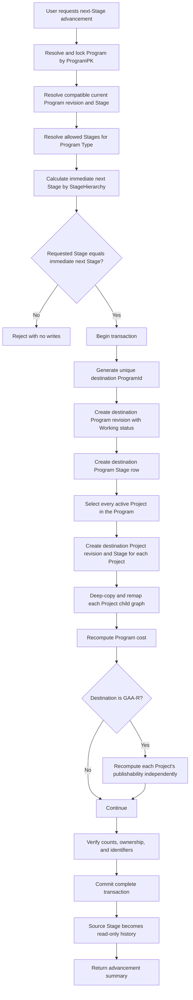

# MYPS Program Stage Advancement Specification

**Process ID:** `PROC-STG-001`  
**Document type:** Business process, data contract, developer reference, and acceptance-test baseline  
**Evidence date:** 10 August 2026  
**Status:** Client-confirmed baseline with named open implementation decisions  
**Scope:** Ordinary Program and Project lifecycle advancement. This is not the post-publication Formal Revision workflow.

## 1. Purpose

This document defines how one MYPS Program advances from its current lifecycle Stage to its immediate next configured Stage. It specifies what the user does, which records are created, which identifiers change, what must be copied, what may not block the action, and how history, publishability, and failure recovery work.

The governing business outcome is:

> One Program advancement creates a new Program state and a complete new lifecycle state for every active Project in that Program. Source-stage data remains read-only history. Invalid or incomplete Projects advance with the Program and are evaluated separately for publishability at GAA-R.

## 2. Evidence classification

| Evidence | Meaning in this document |
|---|---|
| `CLIENT-CONFIRMED` | The client explicitly confirmed the rule on 10 August 2026 |
| `DB-VERIFIED` | The supplied SQL schema directly supports the table, column, key, or lookup behavior |
| `OBSERVED` | The supplied SSMS screenshots demonstrate the behavior on sample data |
| `DOMAIN-INVARIANT` | The rule is required to avoid broken ownership, cross-stage links, or partial history |
| `PROPOSED` | Recommended implementation behavior that still requires application-level confirmation |
| `OPEN-DECISION` | A question remains unresolved and must not be silently guessed |

## 3. Confirmed business rules

1. A Program advances only one configured Stage at a time. (`CLIENT-CONFIRMED`)
2. A Program cannot jump over two or more Stages. (`CLIENT-CONFIRMED`)
3. A Program cannot move backward to a previous Stage. (`CLIENT-CONFIRMED`)
4. A Program may initially be created at any Stage allowed for its Program Type. (`CLIENT-CONFIRMED`)
5. Every active Project under the Program advances automatically. The user does not select a subset. (`CLIENT-CONFIRMED`)
6. An invalid or incomplete Project does not block Program advancement and does not remain at the old Stage. (`CLIENT-CONFIRMED`)
7. Advancement creates new rows. It does not overwrite the previous Program revision, Program Stage, Project revision, Project Stage, or Project child graph. (`CLIENT-CONFIRMED`, `DOMAIN-INVARIANT`)
8. The entire active Project aggregate is copied, including scalar details, funding, components, yearly costs, major work items, locations, supporting documents, and notes. (`CLIENT-CONFIRMED`)
9. Source-stage data becomes read-only history after a successful commit. (`CLIENT-CONFIRMED`)
10. The destination Program revision starts with Program status `Working`, current dictionary code `3`. (`CLIENT-CONFIRMED`)
11. Program status code `1` means `Approved`; status code `3` means `Working`. The deployed `tOptionProgramStatus` lookup remains authoritative. (`CLIENT-CONFIRMED`, `DB-VERIFIED`)
12. `ProgramId` is unique for each Program lifecycle revision and is regenerated for the destination Stage. (`CLIENT-CONFIRMED`)
13. `tPrograms` contains no `ProgramId`. The current Program identifier comes from `tProgramRevisions.ProgramId`. (`CLIENT-CONFIRMED`, `DB-VERIFIED`)
14. `ProjectPK` is the ProjectId assigned when the Project was first created and never changes. (`CLIENT-CONFIRMED`)
15. `tProjectRevisions.ProjectId` is the lifecycle display identifier and may change when the Project enters a different Stage-prefix group. (`CLIENT-CONFIRMED`)
16. A Project created after its Program has advanced starts in the Program's current Stage. The system does not manufacture Project history for earlier Program Stages. (`CLIENT-CONFIRMED`)
17. GAA-R advancement proceeds even when some Projects are not publishable. (`CLIENT-CONFIRMED`)
18. At GAA-R, each Project is evaluated independently. Publishable Projects may be sent to PCMA; invalid Projects remain unpublishable until corrected. (`CLIENT-CONFIRMED`)
19. LS/wallet and other special-Project behavior is pending. Any implementation or documentation that touches it must raise the question instead of assuming standard behavior. (`OPEN-DECISION`)

## 4. Terminology and revision boundary

| Term | Technical object | Meaning |
|---|---|---|
| Program anchor | `tPrograms` | One stable Program identity identified by `ProgramPK` |
| Program lifecycle revision | `tProgramRevisions` | Stage-specific ProgramId, name, status, cost, and audit state |
| Program Stage history | `tProgramStages` | Associates one Program revision with one Stage |
| Project anchor | `tProjects` | One stable Project identity identified by immutable `ProjectPK` |
| Lifecycle/base Project revision | `tProjectRevisions` | Ordinary Project state created or copied as the Program progresses |
| Project Stage history | `tProjectStages` | Associates one lifecycle Project revision with one Stage |
| Formal Revision transaction | `tRevisionDetails` and `tRevisionProject*` | Separate post-publication approval workflow; not created by ordinary Stage advancement |

The word "revision" must therefore be qualified in developer documentation. `tProjectRevisions` means a lifecycle/base Project state. A Formal Revision transaction is the post-publication aggregate rooted at `tRevisionDetails`.

## 5. Identity model

### 5.1 Program identity

```text
tPrograms.ProgramPK
    stable identity for the Program across all Stages

tProgramRevisions.ProgramId
    unique business-facing identifier for one Program lifecycle state

tProgramStages.ProgramId
    historical copy of the ProgramId associated with that Stage row
```

`tPrograms` intentionally has no `ProgramId`. Current-stage reads must resolve the Program revision associated with the current Program Stage. They must not look for a mutable identifier on the anchor.

The exact ProgramId generator and database uniqueness enforcement still require application-code and live-catalog verification. The non-negotiable contract is that a new destination value is generated for every advancement and all destination Program/Project lifecycle rows use the same destination ProgramId.

### 5.2 Project identity

```text
tProjects.ProjectPK
    the ProjectId assigned at creation; stable forever

tProjectRevisions.ProjectId
    the display identifier for a specific lifecycle revision

tRevisionProjectSnapshot.ProjectId
    the display identifier captured by a specific Formal Revision transaction
```

Examples:

```text
Created at BP:
  ProjectPK = BP01005501MN
  ProjectId = BP01005501MN

Advanced to NEP:
  ProjectPK = BP01005501MN
  ProjectId = P01005501MN

Advanced from NEP toward GAA-R:
  ProjectPK remains BP01005501MN
  ProjectId remains P01005501MN while the Stage remains in the P prefix group
```

If a Project is initially created at NEP, its initial `ProjectPK` may begin with `P`. If it is initially created at an allowed MY-group Stage, its initial `ProjectPK` may begin with `MY`. Initial creation Stage is not assumed to be BP.

### 5.3 ProjectId fixed-width segments

ProjectId has no delimiters. Resolve the Stage prefix first because it has variable width; then parse the remaining fixed-width segments.

| Segment | Width | Rule | Example |
|---|---:|---|---|
| Stage prefix | 1-2 | Derived from the lifecycle Stage group | `BP`, `MY`, or `P` |
| Fiscal year offset | 3 | `FiscalYear - 2016`, zero-padded | FY2026 becomes `010` |
| Category sequence | 5 | Reserved from the selected category's allowed range | `05501` |
| Island code | 0 or 2 | `LZ`, `VS`, `MN`, or blank, based on Region | `MN` |

Example: `BP01005501MN` means BP prefix, FY2026, sequence 05501, Mindanao.

### 5.4 Stage-prefix groups

| Project Stage | ProjectId prefix |
|---|---|
| BP, RBP, UPMO, UBP | `BP` |
| RDIP, UDIP, PIP | `MY` |
| NEP, HGAB, GAA, GAA-R | `P` |

The application must list supported Stages explicitly. It must not rely on an unknown-stage default of `P`, because that can produce a plausible but wrong ProjectId when a new Stage is introduced.

During advancement, the year, sequence, and island-code segments remain unchanged. Only the Stage-prefix segment is recalculated. A new `tProjectRevisions` row is still required when the prefix does not change.

### 5.5 New Project sequence allocation

For a newly created Project, sequence allocation uses the selected category range and the atomic counter mechanism:

1. Resolve the Program's current Stage and Stage-prefix group.
2. Resolve the Program fiscal year.
3. Resolve `IslandCode` from the selected Region through `tOptionAdminAreaRegion`.
4. Resolve the selected category's `Minimum` and `Maximum` sequence range.
5. Reserve the next value through `pReserveProjectIdBlock` and `tProjectIdSequence`.
6. Compose the ProjectId.
7. Store it as both the initial immutable `ProjectPK` and the first lifecycle `ProjectId`.

The old live `MAX + 1` scan is not an acceptable write strategy because concurrent creation can allocate the same value.

## 6. Stage selection rules

### 6.1 Initial Program creation

The user may choose any starting Stage allowed for the selected Program Type. The system does not require the first Stage in the overall dictionary.

### 6.2 Existing Program advancement

For an existing Program, the only permitted destination is the immediate next allowed Stage for that Program Type.

Recommended resolution algorithm, based on the supplied schema:

```text
current = current Stage associated with the current Program revision
allowed = active StageIds configured for Program.Type in tProgramTypeStages
ordered = allowed Stages joined to tOptionProgramStage and ordered by StageHierarchy
destination = first ordered Stage whose StageHierarchy is greater than current.StageHierarchy
```

The request is valid only when the requested destination equals `destination`.

Do not use:

- `StageId + 1`;
- array position without joining the Stage dictionary;
- a hard-coded global next-Stage table when Program Types have different allowed sets;
- the highest `tProgramStages.Id` without checking Stage hierarchy and revision compatibility;
- a destination two or more positions after the current Stage.

If no allowed Stage has a greater `StageHierarchy`, the Program is at its terminal configured Stage and cannot advance.

## 7. Trigger, actor, and transaction boundary

### Trigger

An authorized user selects the Program's single available next Stage and confirms advancement.

Detailed role names and permission mappings are deferred. The implementation must still perform action authorization and Program-level visibility checks before writing.

### Transaction boundary

One database transaction must cover:

- destination Program revision;
- destination Program Stage row;
- every destination Project revision;
- every copied Project child row and parent-ID remapping;
- every destination Project Stage row;
- derived cost and publishability changes that are part of the advancement;
- the advancement audit event.

Any failure rolls back the complete advancement. A Program must never appear partly advanced.

## 8. Preconditions

1. `ProgramPK` resolves to one nondeleted Program anchor.
2. The user can view and advance that Program.
3. The current Program revision and current Program Stage resolve as one compatible pair.
4. The Program Type has an active Stage configuration.
5. The requested destination is exactly the immediate next allowed Stage.
6. The destination Stage dictionary row is active and its `StageId`, `StageName`, and `StageHierarchy` agree.
7. No concurrent transaction has already advanced the same Program.
8. Every selected active Project has one stage-correct source revision that can be copied.
9. Required identifier generators and sequence reservations are available.

Project validity and publishability are deliberately not advancement preconditions.

## 9. Authoritative advancement flow



### Numbered main flow

1. Accept `ProgramPK`, requested destination `StageId`, and an idempotency token.
2. Resolve the Program anchor and acquire a transaction-scoped lock that serializes advancement for that Program.
3. Resolve the current Program revision through the current Program Stage association.
4. Join the Program Type's active `StageIds` to the Stage dictionary and order by `StageHierarchy`.
5. Calculate the immediate next allowed Stage.
6. Reject the request if the requested Stage is not exactly that Stage.
7. Begin the advancement write transaction if it has not already begun with the lock.
8. Generate a new unique destination `ProgramId`.
9. Generate the Program name prefix as `destination StageName + fiscal year`; combine it with the user-entered pretext.
10. Insert the destination `tProgramRevisions` row with status `Working (3)`, destination ProgramId, copied or recomputed cost fields, creator, and timestamp.
11. Insert the destination `tProgramStages` row using the destination Program revision ID and the same destination ProgramId.
12. Select every active Project whose stable `ProgramFK` equals the Program's `ProgramPK`.
13. Resolve one source Project revision and Project Stage compatible with the Program's current Stage for each active Project.
14. Derive the destination ProjectId by replacing only the Stage-prefix segment when required.
15. Insert one new `tProjectRevisions` row for every selected Project. Copy scalar state and use the destination ProgramId and destination ProjectId.
16. Copy the complete active child graph in dependency order, replacing every source SQL parent ID with the corresponding destination SQL parent ID.
17. Insert one destination `tProjectStages` row for each destination Project revision.
18. Recompute Program cost according to the approved cost policy.
19. If the destination is GAA-R, recompute `IsPublishable` independently for every destination Project aggregate.
20. Verify source counts, destination counts, ownership, Stage values, ProgramId consistency, ProjectId transformation, and absence of source-parent references.
21. Write the audit record and commit.
22. Return destination identifiers, copied counts, publishability results, and any Project validation failures.

## 10. Project selection

The selection rule is all active Projects, not all valid Projects.

At minimum, an active Project selection must enforce:

```text
tProjects.ProgramFK = requested ProgramPK
AND stage-correct source tProjectRevisions.IsDeleted = 0
AND tProjectStages.RevisionId = stage-correct source tProjectRevisions.Id
AND tProjectStages.StageId = current Program StageId
```

The supplied schema has no `tProjects.IsDeleted` column. Do not invent an anchor-level deletion filter. For this process, an active Project is a Project anchor owned by the Program that has a nondeleted lifecycle revision associated with the Program's current Stage.

The source revision must belong to the source Stage being advanced. Do not select a newer or older Project revision merely because its SQL `Id` is highest.

The following conditions do not remove a Project from advancement:

- missing publication fields;
- incomplete funding;
- incomplete component/year/work/location structure;
- `IsPublishable = 0`;
- other validation failures that do not make the source graph impossible to copy.

Project anchors without an active, stage-correct source revision do not qualify as active; they must be reported in the pre-commit selection summary. The treatment of LS/wallet and special Project types remains `OPEN-DECISION`.

## 11. Deep-copy contract

| Copy order | Source | Destination ownership | Required behavior |
|---:|---|---|---|
| 1 | `tProjectRevisions` | New Project revision `Id` | Copy scalar state; set destination ProgramId and ProjectId |
| 2 | `tProjectFundingProfile` | New `ProjectRevisionFK` | Copy active funding rows |
| 3 | `tProjectComponentCost` | New `ProjectRevisionFK` | Create new component SQL IDs and retain business correlation values |
| 4 | `tProjectComponentCostPerYear` | New `ComponentCostFK` | Use the source-to-destination component ID map |
| 5 | `tProjectMajorWorkItem` | New `ComponentCostFK` | Create new work-item SQL IDs using the component map |
| 6 | `tProjectMajorWorkLocations` | New `WorkItemFK` | Use the source-to-destination work-item ID map |
| 7 | `tProjectSupportingDocs` | New `ProjectRevisionFK` | Copy supporting-document metadata according to file-storage policy |
| 8 | `tProjectNotes` | New `ProjectRevisionFK` | Copy note metadata and paths according to file-storage policy |
| 9 | `tProjectStages` | New Project revision `Id` | Insert destination Stage history row |

Required maps:

```text
source ProjectRevision.Id -> destination ProjectRevision.Id
source Component.Id       -> destination Component.Id
source WorkItem.Id        -> destination WorkItem.Id
```

No destination child may point to a source-stage parent SQL ID. `ComponentId` is correlation data, not a substitute for `ComponentCostFK`. A work location receives its year through its destination work-item parent; `tProjectMajorWorkLocations` has no `YearOfWork` column.

## 12. Program name behavior

The Program name is a composite input group:

```text
[read-only generated prefix] + [user-entered pretext]
NEP 2026                    + TESTBP
```

Rules:

1. The first field is generated from destination `StageName + fiscal year` and is read-only.
2. The second field contains the user-editable pretext.
3. The persisted `tProgramRevisions.Name` is the composed value.
4. The separator and whitespace must be normalized by one shared formatter.
5. Historical names remain unchanged.

## 13. GAA-R and PCMA behavior

GAA-R advancement and PCMA publication are separate actions.

```text
Advance Program to GAA-R
    -> copy every active Project
    -> commit Program and Project lifecycle history
    -> evaluate each destination Project
       -> valid: IsPublishable = 1; eligible for later PCMA publication
       -> invalid: IsPublishable = 0; remains editable in current GAA-R state
```

One invalid Project must not:

- block the Program from entering GAA-R;
- block valid Projects from becoming publishable;
- be silently omitted from the destination Stage;
- be sent to PCMA before it passes validation.

The later publication function selects only eligible Projects and sends them to PCMA endpoints. `IsPublishable` expresses readiness; `IsPublished` records that publication occurred.

## 14. Projects created after advancement

When a Program is already at a later Stage, the user may add a new Project directly to that current Stage.

The creation transaction must:

1. resolve the Program's current revision and Stage;
2. generate a ProjectId using the current Stage-prefix group;
3. store that first ProjectId as immutable `ProjectPK`;
4. create exactly one initial `tProjectRevisions` row;
5. create exactly one `tProjectStages` row for the current Stage;
6. create no rows for earlier Program Stages.

Historical Project counts can therefore differ by Program Stage. This is expected behavior, not missing data.

## 15. Historical and current reads

| Reader need | Required approach |
|---|---|
| Stable Program | Resolve by `tPrograms.ProgramPK` |
| Current Program state | Resolve a compatible Program revision and Program Stage using Stage hierarchy |
| Program at a specific Stage | Use the Stage row's `RevisionId`; do not independently choose latest revision |
| Stable Project | Resolve by `tProjects.ProjectPK` |
| Project at a specific Stage | Use the Project Stage row's `RevisionId` |
| Current Project | Use the current stage-aware read model such as `vProjectLatest`, subject to its documented safeguards |
| Historical Project aggregate | Load base child rows through the historical Project revision ID |
| Formal post-publication proposal | Use Formal Revision transaction reads; do not mix them into base lifecycle history |

The current schema retains `tProjects.ProgramId`. The screenshots show it retaining the creation-time ProgramId while destination lifecycle rows carry the new ProgramId. Until that field's long-term purpose is formally confirmed, it must not be used as the current ProgramId; use the stage-specific Project revision and Stage rows.

## 16. Concurrency, retry, and atomicity

### Required controls

1. Serialize advancement per `ProgramPK`.
2. Re-read the current Stage after acquiring the lock.
3. Reject a stale request whose source or destination no longer matches.
4. Require an idempotency token or equivalent request identity.
5. Return the prior successful result when the same token is retried.
6. Prevent duplicate destination Program/Project Stage rows for the same advancement event.
7. Roll back every destination row when one Project copy fails.
8. Reserve new-Project sequences atomically through `pReserveProjectIdBlock`.

### Post-commit checks

- one destination Program revision;
- one destination Program Stage;
- destination Project revision count equals selected active Project count;
- destination Project Stage count equals destination Project revision count;
- child counts match the approved active-row copy policy;
- all destination ProgramIds equal the new destination ProgramId;
- every ProjectPK is unchanged;
- every ProjectId contains the correct destination prefix and unchanged remaining segments;
- no destination child references a source parent;
- GAA-R publishability results are recorded per Project.

## 17. Exception behavior

| ID | Condition | Result |
|---|---|---|
| `EX-STG-001` | Requested Stage is not allowed for Program Type | Reject without writes; return allowed Stages |
| `EX-STG-002` | Requested Stage is later but not the immediate next allowed Stage | Reject without writes; return the one permitted next Stage |
| `EX-STG-003` | Requested Stage is current or earlier | Reject without writes |
| `EX-STG-004` | Program is already at terminal Stage | Reject; no next Stage exists |
| `EX-STG-005` | Current Program revision and Stage do not form a compatible pair | Stop and report data-integrity error |
| `EX-STG-006` | Project is incomplete or invalid | Copy it anyway; report validation failures separately |
| `EX-STG-007` | A Project child cannot be remapped | Roll back the whole advancement and identify the source record |
| `EX-STG-008` | Concurrent request advances first | Reject stale request or return prior idempotent result |
| `EX-STG-009` | ProgramId generator returns a duplicate | Roll back and retry according to the generator's collision policy |
| `EX-STG-010` | GAA-R Project is not publishable | Commit advancement; set/retain `IsPublishable = 0`; do not send it to PCMA |
| `EX-STG-011` | LS/wallet or special-Project behavior is encountered | Raise the pending policy decision before implementation |
| `EX-STG-012` | User retries after an unknown timeout | Resolve by idempotency token before starting another copy |

## 18. Business-rule catalogue

| Rule ID | Rule |
|---|---|
| `BR-PGM-STG-001` | Initial Program Stage must be allowed for the Program Type |
| `BR-PGM-STG-002` | Existing Program destination must be the immediate next allowed Stage by `StageHierarchy` |
| `BR-PGM-STG-003` | Backward and same-Stage advancement are prohibited |
| `BR-PGM-STG-004` | Advancement writes one new Program revision and Stage row |
| `BR-PGM-STAT-001` | Destination Program revision starts as `Working (3)` |
| `BR-PGM-ID-001` | Every destination Program revision receives a new unique ProgramId |
| `BR-PGM-NAME-001` | Generated name prefix is destination StageName plus fiscal year |
| `BR-PRJ-SEL-001` | Every active Project advances automatically |
| `BR-PRJ-SEL-002` | Project validity does not control advancement selection |
| `BR-PRJ-ID-001` | ProjectPK equals the initial ProjectId and never changes |
| `BR-PRJ-ID-002` | Stage advancement recalculates only the ProjectId Stage-prefix segment |
| `BR-PRJ-ID-003` | Initial Project sequence allocation uses the atomic counter procedure |
| `BR-COPY-001` | Complete active Project aggregate is copied |
| `BR-COPY-002` | Destination children reference destination parents only |
| `BR-HIST-001` | Successful source Stage data is read-only history |
| `BR-PUB-001` | GAA-R advancement is not blocked by unpublishable Projects |
| `BR-PUB-002` | Publishability is calculated independently per Project |
| `BR-PUB-003` | Only publishable Projects are eligible for PCMA publication |
| `BR-NEW-PRJ-001` | A Project created in an advanced Program begins only in the current Stage |

## 19. Acceptance-test catalogue

| Test ID | Scenario | Expected result |
|---|---|---|
| `AT-STG-001` | Create Program at an allowed nonfirst Stage | Anchor, first revision, and one Stage row are created |
| `AT-STG-002` | Advance to immediate next allowed Stage | Complete transaction commits |
| `AT-STG-003` | Request a Stage two positions ahead | Request is rejected with no rows created |
| `AT-STG-004` | Request a previous Stage | Request is rejected with no rows created |
| `AT-STG-005` | Request same Stage | Request is rejected; no copy occurs |
| `AT-STG-006` | Advance terminal Program | Request reports no next configured Stage |
| `AT-STG-007` | Program has zero active Projects | Program revision and Stage advance successfully with zero copied Projects |
| `AT-STG-008` | Program has several active Projects | Every active Project receives a destination revision and Stage row |
| `AT-STG-009` | One Project is invalid | All Projects advance; invalid Project remains flagged for correction |
| `AT-STG-010` | A Project anchor has no nondeleted revision in the current Stage | It is reported as nonactive and receives no destination rows |
| `AT-STG-011` | Copy Project scalar fields | Destination values equal source except approved destination-specific fields |
| `AT-STG-012` | Copy complete child graph | Funding, components, years, work, locations, documents, and notes are present |
| `AT-STG-013` | Inspect destination FKs | No destination child points to a source-stage parent ID |
| `AT-STG-014` | Advance BP Project to NEP | ProjectPK stays `BP...`; destination ProjectId becomes `P...` |
| `AT-STG-015` | Advance within same prefix group | ProjectPK and nonprefix segments stay fixed; a new revision row is still created |
| `AT-STG-016` | Project created initially at NEP | Initial ProjectPK and ProjectId begin with `P` |
| `AT-STG-017` | Project created initially at an MY-group Stage | Initial ProjectPK and ProjectId begin with `MY` |
| `AT-STG-018` | Advance Program | Destination ProgramId differs from every earlier ProgramId for the Program |
| `AT-STG-019` | Inspect destination status | Destination Program revision is `Working (3)` |
| `AT-STG-020` | Inspect Program name | Read-only prefix matches destination StageName and fiscal year; pretext is preserved |
| `AT-STG-021` | Fail during the third Project copy | No destination Program or Project records remain |
| `AT-STG-022` | Send concurrent advancement requests | Exactly one destination Stage is committed |
| `AT-STG-023` | Retry the same idempotency token | Prior result is returned; no duplicate rows are created |
| `AT-STG-024` | Advance to GAA-R with mixed validity | Program and all Projects advance; valid Projects are publishable, invalid are not |
| `AT-STG-025` | Publish to PCMA after mixed-validity GAA-R | Only publishable Projects are submitted |
| `AT-STG-026` | Add Project after Program advancement | Project begins at current Stage and has no earlier Stage rows |
| `AT-STG-027` | Load historical source Stage | Source Program, Projects, and children remain unchanged and read-only |
| `AT-STG-028` | Encounter unsupported special Project behavior | Action raises the LS/wallet decision instead of assuming behavior |

## 20. Implementation work plan

### Phase 1: Confirm deployed configuration

1. Extract deployed Program Types, Program Stages, `StageHierarchy`, Type-to-Stage JSON, and Program statuses.
2. Produce the immediate-next transition matrix per Program Type.
3. Confirm the ProgramId generator, format, collision handling, and uniqueness constraints.
4. Confirm whether the source Program revision becomes Approved inside the advancement transaction or through a preceding action.
5. Verify `tProjects.ProjectPK` and declared foreign keys against the live catalog.

### Phase 2: Define the application command

1. Define an `AdvanceProgramStage` request using stable `ProgramPK`, requested `StageId`, and idempotency token.
2. Define authorization and record-scope checks.
3. Define current-stage resolution and stale-request checks.
4. Define the response summary and user-facing errors.

### Phase 3: Implement transactional writes

1. Add Program-scoped serialization.
2. Create the destination Program revision and Stage.
3. Select all active Projects.
4. Create destination Project revisions, deep-copy children, and create Project Stages.
5. Recompute cost and GAA-R publishability.
6. Add verification counts and audit data.
7. Commit only after every invariant passes.

### Phase 4: Implement historical protection

1. Make noncurrent Program/Project Stages read-only at API and UI layers.
2. Ensure all historical reads use Stage-associated revision IDs.
3. Prevent direct edits to prior child graphs.
4. Keep Formal Revision workflow separate from ordinary Stage advancement.

### Phase 5: Verify and release

1. Execute `AT-STG-001` through `AT-STG-028`.
2. Run concurrency, retry, rollback, and volume tests.
3. Reconcile source/destination counts on production-like data.
4. Review LS/wallet encounters and keep them blocked pending a client decision.
5. Obtain business, developer, DBA, and QA sign-off.

## 21. Open decisions and risks

| ID | Status | Question or risk | Required action |
|---|---|---|---|
| `DEC-STG-CONFIG-001` | Proposed resolution | Is immediate-next Stage always the next allowed `StageHierarchy` entry from `tProgramTypeStages.StageIds`? | Verify against application code and deployed transition configuration |
| `DEC-PGM-ID-001` | Open | What exact ProgramId generator, format, uniqueness constraint, and retry policy apply? | Inspect current C# and live indexes before implementation |
| `DEC-PGM-STAT-001` | Open | Is source status set to Approved by the advancement transaction or by a prior action? | Confirm UI/service behavior; destination Working is already confirmed |
| `DEC-SPECIAL-PRJ-001` | Open | How do LS/wallet and other special Project types advance and contribute to cost? | Raise whenever related; do not assume standard behavior |
| `RSK-PRJ-ID-030` | Open verification | Did the Region-to-IslandCode lookup survive the administrative-area restructuring? | Verify current C# and deployed lookup data |
| `RSK-PROJECT-PK-001` | Open verification | Supplied DDL declares FKs to `tProjects.ProjectPK` without showing a unique target constraint | Verify live catalog before relying on enforcement |
| `RSK-PROJECT-PROGRAMID-001` | Observed | `tProjects.ProgramId` appears creation-time while lifecycle rows carry current ProgramId | Treat it as nonauthoritative for current Stage until normalized or confirmed |

## 22. Definition of done

Stage advancement is implementation-ready only when:

1. the immediate-next transition matrix is extracted for every Program Type;
2. ProgramId generation and uniqueness are verified;
3. all active Project selection is implemented without validity filtering;
4. complete child-copy remapping is proven;
5. historical write protection is active;
6. GAA-R mixed-validity behavior is proven;
7. concurrency, idempotency, rollback, and retry tests pass;
8. LS/wallet behavior remains blocked or receives an explicit approved rule;
9. every acceptance test is linked to implementation evidence;
10. business, engineering, DBA, and QA reviewers approve the baseline.

## 23. Sources

- `sources/context/MYPS_CODEX_MASTER_CONTEXT.md`
- `sources/database/myps_db(08-10-2026-full-schema).sql`
- Client-confirmed lifecycle decisions from the MYPS process-analysis task, 10 August 2026
- Supplied SSMS screenshots showing BP to NEP Program and Project lifecycle rows, 10 August 2026
- Operator-confirmed Project ID generation specification, 25 June 2026, cross-referenced with ADR-018, ADR-020, ADR-029, and ADR-043
