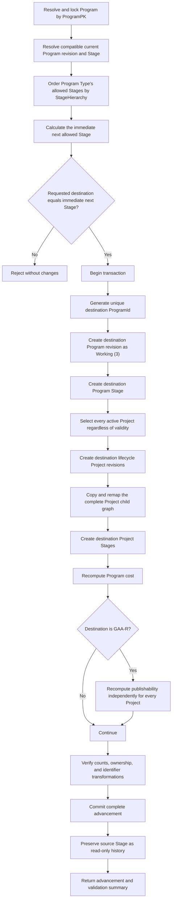
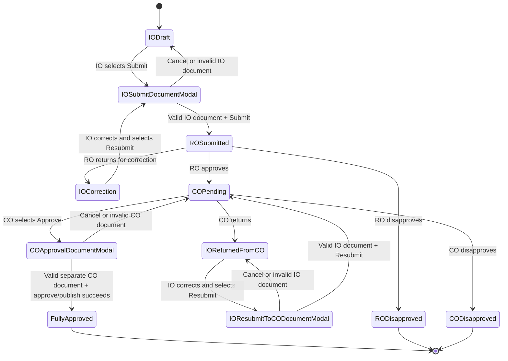
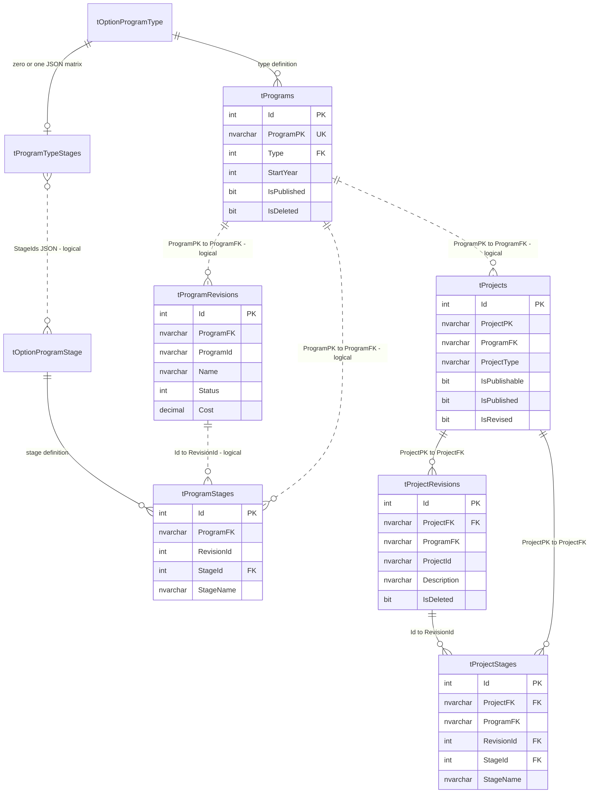
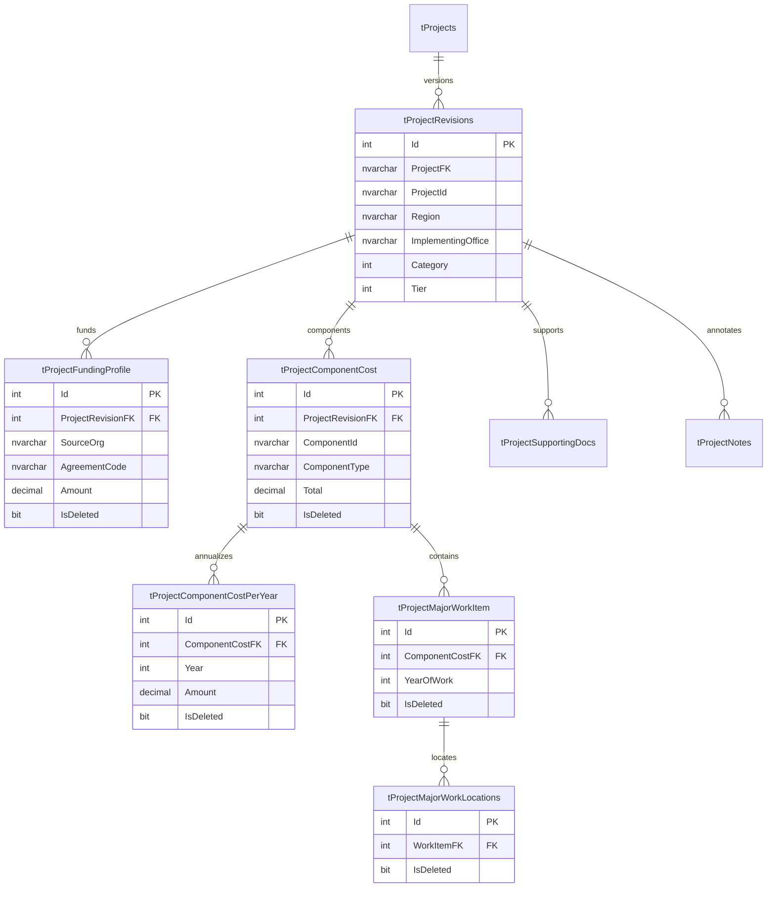
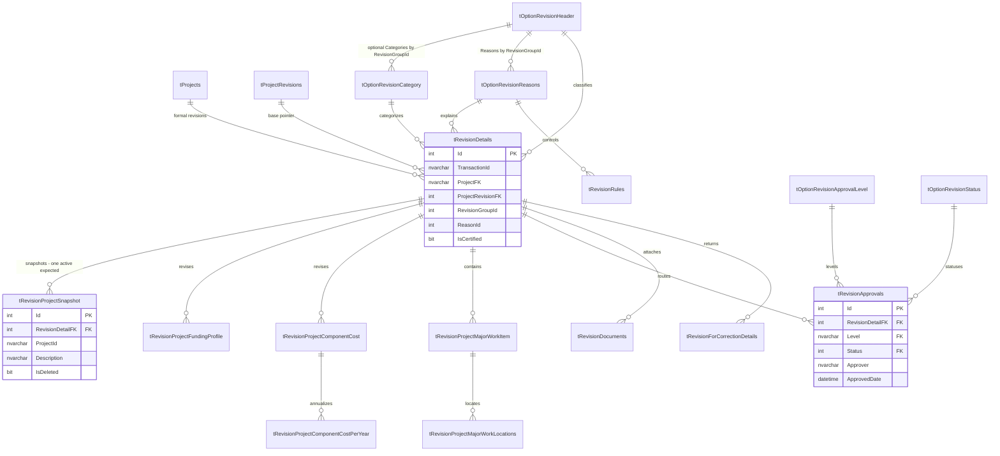
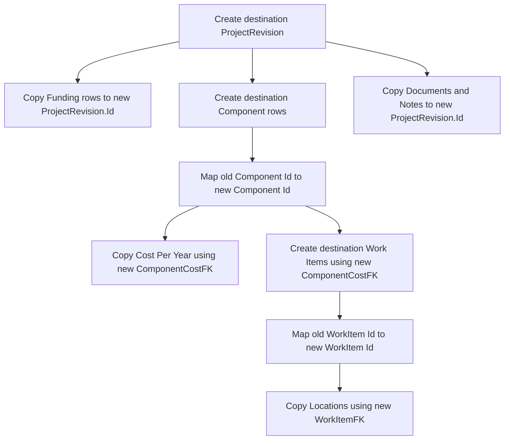
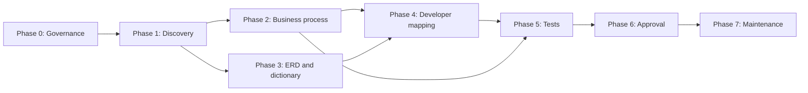

# MYPS Program-to-Project Process Flow Documentation Plan

**Document type:** Documentation delivery blueprint  
**Primary audiences:** MYPS client stakeholders, process owners, business analysts, developers, testers, and support personnel  
**Technical source of truth:** `sources/context/MYPS_CODEX_MASTER_CONTEXT.md` and `sources/database/myps_db(08-10-2026-full-schema).sql`  
**Reference date:** 10 August 2026  
**Status:** Partially client-validated; Program Stage advancement baseline confirmed 10 August 2026  
**Authoritative Stage specification:** `docs/process/MYPS_PROGRAM_STAGE_ADVANCEMENT_SPECIFICATION.md`

---

## 1. Purpose

This plan defines how to produce a complete, traceable, and maintainable description of the MYPS Program-to-Project lifecycle. The final documentation set must explain the business process clearly to the client while giving developers enough precision to implement or change MYPS without damaging lifecycle, revision, publication, security, or historical-data rules.

The final documentation must answer five questions at every major process step:

1. **Business:** Why does the step exist and what outcome does it produce?
2. **Ownership:** Who initiates, performs, reviews, approves, and monitors it?
3. **Workflow:** What happens next under normal, correction, rejection, and failure conditions?
4. **Data:** Which business records are created, read, copied, updated, or preserved?
5. **Development:** Which database objects, application services, validation rules, and tests implement the behavior?

---

## 2. Target outcomes

When this plan is completed, the repository should contain a documentation suite that provides:

- one client-readable end-to-end Program-to-Project narrative;
- one level-zero lifecycle diagram showing the complete process;
- detailed process flows for every major subprocess;
- swimlane diagrams identifying organizational ownership;
- a business glossary and state dictionary;
- logical, physical, and workflow-specific ERDs;
- a business-rule catalogue with unique identifiers;
- a data dictionary for all core Program, Project, child, and Revision objects;
- traceability from process step to business rule, table/view/function/procedure, API, permission, and test;
- exception, correction, rejection, rollback, and recovery flows;
- developer implementation guidance and transaction boundaries;
- objective acceptance criteria for client, engineering, and QA review;
- a change-control approach that prevents the documentation from becoming stale.

---

## 3. Documentation principles

### 3.1 Separate audiences without separating truth

Business and technical documents may explain the system at different levels, but they must reference the same canonical process and rule identifiers.

| Layer | Main reader | Required content |
|---|---|---|
| Executive overview | Sponsors and decision-makers | Purpose, scope, lifecycle, governance, major decisions |
| Client process handbook | Process owners and users | Actors, triggers, activities, decisions, exceptions, outputs |
| Business-rule catalogue | Business analysts and approvers | Validations, conditions, ownership, source, status |
| Developer guide | Developers and architects | Tables, keys, transactions, functions, procedures, APIs, invariants |
| Test catalogue | QA and developers | Acceptance scenarios, test data, expected states, negative cases |
| Master technical context | Coding agents and maintainers | Complete implementation context and cautions |

### 3.2 Evidence must be visible

Every material statement must be tagged as one of:

- **DB-VERIFIED:** directly supported by the supplied database schema.
- **APP-VERIFIED:** confirmed against current application code or observed behavior.
- **CLIENT-CONFIRMED:** explicitly accepted by the designated business owner.
- **DOMAIN-INVARIANT:** required for the combined system to remain logically correct.
- **PROPOSED:** recommended behavior not yet approved or implemented.
- **LEGACY:** historical behavior that must not be treated as current.
- **OPEN-DECISION:** unresolved and requiring a named owner and target date.

### 3.3 Use stable identifiers

Assign stable identifiers so changes remain traceable:

| Artifact | Prefix | Example |
|---|---|---|
| Process | `PROC` | `PROC-PGM-ADV-001` |
| Business rule | `BR` | `BR-PRJ-PUB-007` |
| Decision | `DEC` | `DEC-COST-001` |
| Data entity | `ENT` | `ENT-PROJECT-REVISION` |
| Requirement | `REQ` | `REQ-REV-APP-012` |
| Acceptance test | `AT` | `AT-STAGE-018` |
| Risk | `RSK` | `RSK-DATA-004` |

### 3.4 Preserve lifecycle history

The documentation must distinguish:

- stable identity from revision/state rows;
- current state from historical state;
- base Project data from proposed formal Revision data;
- `IsPublishable` from `IsPublished`;
- an unresolved Revision from an approved effective Revision;
- business stage order from numeric `StageId` order.

### 3.5 Never infer lookup values from names alone

Stage, status, type, reason, category, permission, and approval values must be extracted from deployed lookup data or confirmed with the client. Enum text and numeric adjacency are not authoritative substitutes.

---

## 4. Scope

### 4.1 In scope

The end-to-end documentation will cover:

1. master-data and option-table prerequisites;
2. user, group, role, permission, region, office, and data visibility setup;
3. Program creation and initial stage assignment;
4. Program editing and history behavior;
5. Program Type-to-Stage validation;
6. Project creation under a Program;
7. Project identifier allocation;
8. Project details and administrative/geographic assignment;
9. Project funding profiles;
10. Project components and yearly cost schedules;
11. major work items and locations;
12. supporting documents and notes;
13. Program and Project stage advancement;
14. deep-copy and foreign-key remapping rules;
15. Program cost recomputation;
16. GAA-R publishability validation;
17. publication and PCMA-facing extracts;
18. formal post-publication Project Revision initiation;
19. Revision snapshot and child-graph creation;
20. IO, RO, and CO queues and decisions;
21. IO Submit/Resubmit document modal and separate CO Approve document modal;
22. correction, return, rejection, and resubmission;
23. approved effective-data overlay;
24. revision history and audit trail;
25. import jobs, background processing, and results;
26. reporting and operational monitoring;
27. failure handling, retry, rollback, and reconciliation;
28. security enforcement at every relevant read and action.

### 4.2 Out of scope unless separately approved

- redesigning the MYPS database;
- changing existing application behavior;
- inventing lookup values not present in the deployed environment;
- defining external PCMA, AAMS, IOMS, or RBIA processes beyond the MYPS interface boundary;
- UI visual design beyond documenting screens, fields, actions, and navigation;
- infrastructure deployment architecture except where required to explain background jobs and integration recovery;
- legal or policy interpretation not confirmed by the client.

---

## 5. Stakeholders and governance

### 5.1 Required roles

| Role | Documentation responsibility |
|---|---|
| Executive sponsor | Approves scope, objectives, and unresolved policy decisions |
| Product/process owner | Owns the canonical business lifecycle and terminology |
| Program management representative | Validates Program creation, stages, cost, and publication |
| Implementing Office representative | Validates Project entry and Revision preparation activities |
| Regional Office representative | Validates RO review, correction, approval, and rejection behavior |
| Central Office representative | Validates final review and approval behavior |
| Security administrator | Validates permissions, visibility, office, region, and data-security filters |
| Data/integration owner | Validates imports, exports, reconciliation, and external boundaries |
| Database engineer | Verifies tables, constraints, functions, views, and procedures |
| Application developer | Maps flows to APIs, services, UI actions, and transactions |
| QA lead | Converts process branches and rules into test scenarios |
| Documentation owner | Maintains IDs, cross-references, versions, and approval history |

### 5.2 RACI template

Every subprocess must complete this matrix:

| Activity | Requester | IO | RO | CO | System | Administrator | Integration owner |
|---|---|---|---|---|---|---|---|
| Initiate |  |  |  |  |  |  |  |
| Prepare data |  |  |  |  |  |  |  |
| Validate |  |  |  |  |  |  |  |
| Approve |  |  |  |  |  |  |  |
| Correct |  |  |  |  |  |  |  |
| Publish |  |  |  |  |  |  |  |
| Monitor |  |  |  |  |  |  |  |
| Reconcile |  |  |  |  |  |  |  |

`R`, `A`, `C`, and `I` assignments must be confirmed by the client rather than inferred solely from database names.

---

## 6. Canonical process hierarchy

### Level 0 — Complete MYPS lifecycle

```mermaid
flowchart LR
    A["Configure access and reference data"] --> B["Create Program"]
    B --> C["Establish Program revision and starting stage"]
    C --> D["Create and develop Projects"]
    D --> E["Validate Program and Project completeness"]
    E --> F["Advance lifecycle stages"]
    F --> G{"At publication stage?"}
    G -- "No" --> D
    G -- "Yes" --> H["Evaluate publishability"]
    H --> I{"All publication rules satisfied?"}
    I -- "No" --> D
    I -- "Yes" --> J["Publish Program and eligible Projects"]
    J --> K["Generate reports and external extracts"]
    J --> L{"Post-publication change required?"}
    L -- "No" --> M["Operate, monitor, and report"]
    L -- "Yes" --> N["Initiate formal Project Revision"]
    N --> O["IO preparation"]
    O --> O1["IO Submit modal: upload required IO document"]
    O1 --> P["Atomic IO document + submission to RO"]
    P --> Q["RO review"]
    Q --> R["CO review"]
    R --> R1["CO Approve modal: upload separate CO document"]
    R1 --> S{"Fully approved and republished?"}
    S -- "Correction/return" --> O
    S -- "Disapproved" --> T["Close Revision; retain effective baseline"]
    S -- "Approved" --> U["Use approved Revision as effective Project data"]
    U --> K
```



### Level 1 process groups

| ID | Process group | Trigger | Final outcome |
|---|---|---|---|
| `PROC-SEC-001` | Access and visibility setup | User or organizational access required | Authorized user can see and perform permitted actions |
| `PROC-PGM-001` | Program creation | Approved Program request | Program anchor, first revision, and first stage committed |
| `PROC-PRJ-001` | Project creation | Program is open for Project development | Stable Project and first Project revision exist |
| `PROC-PRJ-DET-001` | Project detail development | Project revision exists | Complete Project aggregate is available |
| `PROC-STG-001` | Stage advancement | User requests the immediate next configured Stage | Program and every active Project are copied to the one permitted destination Stage |
| `PROC-PUB-001` | Publication | Publication stage and readiness reached | Program and eligible Projects are published/exportable |
| `PROC-REV-001` | Formal Project Revision | Published baseline requires change | Approved Revision becomes effective or is closed without effect |
| `PROC-INT-001` | Imports and integration | Authorized import/export request | Validated results and reconciliation evidence exist |
| `PROC-RPT-001` | Reporting | Business or statutory report required | Traceable report/extract is produced |

---

## 7. Detailed process specifications to produce

Every process below must be documented using: objective, trigger, actors, preconditions, inputs, numbered main flow, decision table, alternate flows, outputs, postconditions, business rules, permissions, audit events, data changes, API mapping, and acceptance tests.

### 7.1 Access and visibility

Document:

- user activation and organizational attributes;
- group assignment;
- group-to-action and group-to-view permissions;
- Program user groups and data-security groups;
- visible Programs, Projects, regions, and offices;
- denial behavior and audit expectations;
- difference between route visibility, API authorization, and record-level visibility.

Developer objects include `tUsers`, `tUserGroups`, `tGroups`, `tGroupRoles`, `tApiActions`, `tAppViews`, `vUserActionPermission`, `vUserViewPermission`, and visibility functions.

### 7.2 Program creation

Canonical transaction:

```text
Validate request
→ resolve Program Type
→ resolve allowed starting Stage
→ validate Type × Stage
→ generate stable ProgramPK
→ create tPrograms anchor
→ create tProgramRevisions state
→ create tProgramStages history row
→ commit all records atomically
```

The detailed flow must specify:

- required and optional fields;
- ProgramPK generation/ownership;
- uniqueness behavior;
- initial status and stage source;
- security group assignment;
- cancellation and rollback behavior;
- duplicate-submission handling;
- audit events and user feedback.

Client-confirmed Stage behavior:

- the user may create a Program at any starting Stage allowed for its Program Type;
- `tPrograms.ProgramPK` is the stable Program identity;
- `tPrograms` has no `ProgramId`;
- the first stage-specific `ProgramId` belongs to `tProgramRevisions` and is repeated on the corresponding `tProgramStages` history row;
- the generated part of the Program name is `StageName + fiscal year`, followed by a separate user-editable pretext field.

### 7.3 Program editing

Explicitly separate:

- anchor fields on `tPrograms`;
- revision/state fields on `tProgramRevisions`;
- stage history on `tProgramStages`;
- permitted editing of current state;
- handling of published Programs;
- historical read behavior;
- effects on Program cost and Project selection.

### 7.4 Project creation

Canonical flow:

```text
Select visible Program
→ verify Program/current stage accepts new Project
→ verify user permission and data scope
→ reserve/generate Project ID when applicable
→ generate stable ProjectPK
→ create tProjects anchor
→ create tProjectRevisions state
→ create tProjectStages history row
→ save minimum required child data
→ recompute derived state when required
→ commit
```

Document AIP, LS/wallet, Project group, and Project-set variations separately where behavior differs.

For a Project created after its Program has already advanced, create only the current-stage Project revision and Project Stage. Do not backfill Project rows for earlier Program Stages. The first generated ProjectId becomes immutable `ProjectPK`; later lifecycle ProjectIds may change their Stage prefix without changing `ProjectPK`.

### 7.5 Project aggregate development

Document the entry and validation sequence:

1. scalar Project revision details;
2. funding profile;
3. component costs;
4. component cost per year;
5. major work items;
6. major work locations;
7. supporting documents;
8. notes;
9. derived cost/readiness recomputation.

The documentation must explain that generated parent IDs must be saved before dependent children are inserted.

### 7.6 Stage advancement

The complete authoritative process, identifier rules, copy matrix, exception catalogue, implementation phases, and acceptance tests are defined in `docs/process/MYPS_PROGRAM_STAGE_ADVANCEMENT_SPECIFICATION.md`.

Canonical high-level transaction:



Client-confirmed rules:

- initial creation may begin at any Stage allowed for the Program Type;
- subsequent advancement is exactly one configured Stage forward;
- skipping two or more Stages, reverting, and same-Stage copying are prohibited;
- all active Projects advance automatically; the user cannot choose a subset;
- invalid or incomplete Projects advance and do not block the Program;
- the entire Project aggregate is copied to new rows;
- `ProjectPK` is the original ProjectId and remains stable forever;
- the lifecycle `ProjectId` recalculates only its Stage-prefix segment (`BP`, `MY`, or `P`);
- the destination Program revision receives a new ProgramId and defaults to `Working (3)`;
- prior Program and Project Stage data is read-only history;
- at GAA-R, the Program still advances and publishability is evaluated per Project;
- valid publishable Projects may later be sent to PCMA, while invalid Projects remain for correction;
- Projects added after advancement begin only in the current Stage;
- LS/wallet and special-Project behavior remains an explicit open decision.

The detailed implementation must include:

- current-stage resolution using `StageHierarchy`;
- Type-to-Stage validation through the active `tProgramTypeStages.StageIds` set;
- immediate-next validation rather than merely checking that a destination is later;
- all-active-Project source selection without validity filtering;
- idempotency and retry behavior;
- deep-copy ordering;
- foreign-key remapping;
- soft-deleted child handling;
- partial-failure rollback;
- concurrent advancement protection;
- cost and publishability recomputation;
- post-commit verification counts.

The exact ProgramId generator, the point at which the source Program revision becomes Approved, and special LS/wallet handling remain named implementation decisions. They must not be inferred.

### 7.7 Publication readiness

Document each readiness rule individually and give it a `BR-PRJ-PUB-*` identifier. At minimum, cover:

- nonblank DEO;
- nonblank legislative district;
- nonblank implementing office;
- nonblank operating unit;
- at least one active component;
- at least one yearly row per component;
- valid amount, year, start date, and end date;
- at least one work item per component;
- at least one location per work item;
- at least one funding row;
- required Program stage;
- security and authorization;
- difference between readiness and actual publication.

The client document should display human-readable validation failures. The developer guide should map each failure to the relevant query or procedure predicate.

### 7.8 Publication

Document:

- allowed Program status and stage;
- scope of Projects selected for publication;
- treatment of non-publishable Projects;
- `IsPublishable` versus `IsPublished` updates;
- Program publication state;
- PCMA-facing procedures and extracts;
- transaction or compensating-action strategy;
- re-publication behavior;
- reporting and reconciliation totals;
- preservation of the published baseline for later formal Revision.

### 7.9 Formal post-publication Project Revision

Canonical initiation:

```text
Select published/effective Project
→ verify user visibility and permission
→ verify no unresolved Revision exists
→ choose required Revision Type from tOptionRevisionHeader
→ check active tOptionRevisionCategory rows for the Type's RevisionGroupId
→ if Categories exist: require Category, then choose Reason by Type + Category
→ if no Categories exist: keep Category null, then choose Reason directly by Type
→ validate the full Type/optional-Category/Reason tuple
→ resolve editable-field rule
→ create TransactionId and tRevisionDetails
→ snapshot effective Project scalar data
→ copy applicable Revision child graph
→ attach documents/certification
→ create or initialize approval state
→ expose in IO queue
```

### 7.10 IO–RO–CO approval



For every transition, document:

- authorized role;
- current required state;
- action and payload;
- validation rules;
- approval row changes;
- correction-history row changes;
- document requirements;
- notification recipients;
- resulting queue owner;
- audit event;
- invalid-transition response;
- retry/idempotency behavior.

### 7.11 Effective Project resolution

Document the invariant:

```text
If a fully approved formal Revision exists:
    effective Project = latest fully approved Revision overlay
Else:
    effective Project = latest active base Project revision
```

Pending, returned, and disapproved Revisions must not replace effective Project data. Historical Revision lists and current effective Project lists must remain distinct.

### 7.12 Imports, reporting, and monitoring

Document:

- request and authorization;
- background job acquisition;
- status progression: Pending, Processing, Completed, Failed;
- heartbeat and stale-job detection;
- row totals and processed counts;
- validation/warning/error results;
- retry and duplicate protection;
- reconciliation with source systems;
- report parameter validation;
- report lineage to effective or stage-specific data.

---

## 8. ERD strategy

One giant ERD will be unreadable. Produce four coordinated ERDs with consistent colors, identifiers, and cardinalities.

### 8.1 ERD A — Program-to-Project core



The final ERD must visually distinguish physically enforced foreign keys from logical relationships that the application must preserve. The supplied DDL declares foreign keys to `tProjects.ProjectPK` but does not show a unique constraint on that column; those relationships require live-catalog verification before deployment documentation labels them fully valid.

### 8.2 ERD B — Project aggregate



### 8.3 ERD C — Formal Revision and approval



The Revision selector is conditional: Type is required; Category is required only when the selected Type has active Category rows; Reason is always scoped by Type and, when Category applies, by Category. The supplied DDL stores `tOptionRevisionReasons.CategoryId` as `nvarchar(200)` without a Category FK or seed data, so its deployed encoding must be inspected before documenting or implementing the final filter.

`TransactionId` uniqueness and one-snapshot-per-Revision behavior are not physically enforced by the supplied schema. They must be documented as application/domain invariants unless live-catalog verification identifies additional constraints.

### 8.4 ERD D — Security and integration

Include:

- users, groups, group roles, views, controllers, and actions;
- Program security-group JSON relationships;
- office and administrative-area lookups;
- import jobs, job results, and Hangfire dependency boundary;
- external source staging/inventory tables;
- reporting/export procedures as annotated read dependencies.

### 8.5 ERD verification checklist

For every relationship:

1. verify source and target columns;
2. record whether SQL Server enforces it;
3. record delete behavior and soft-delete filter;
4. state cardinality and optionality;
5. identify owning aggregate;
6. identify copy/remapping behavior during stage advancement;
7. identify base-versus-formal-Revision differences;
8. identify the canonical read model;
9. link to the relevant process and business rules.

---

## 9. Foreign-key remapping specification

Stage advancement documentation must contain this explicit dependency order:



Acceptance evidence must prove that no destination child points to a source-stage parent.

---

## 10. Business-rule catalogue design

Each rule record should contain:

| Field | Meaning |
|---|---|
| Rule ID | Stable `BR-*` identifier |
| Name | Short business-readable title |
| Description | Unambiguous rule statement |
| Process step | Process and step where rule applies |
| Trigger | Event that evaluates the rule |
| Condition | Inputs and predicate |
| Outcome | Pass/fail result and resulting action |
| Error message | User-facing response |
| Owner | Business authority |
| Evidence | DB, app, client, proposed, or legacy |
| Implementation | Table, function, procedure, service, or API |
| Test IDs | Positive and negative verification scenarios |
| Version | Effective date and change history |

Initial rule families:

- `BR-SEC-*`: permissions and visibility;
- `BR-PGM-ID-*`: Program identity;
- `BR-PGM-STG-*`: Program Type/Stage validity;
- `BR-PRJ-ID-*`: Project identity allocation;
- `BR-PRJ-OWN-*`: Program/Project/revision ownership;
- `BR-COPY-*`: deep-copy and remapping;
- `BR-COST-*`: Project and Program costs;
- `BR-PUB-*`: readiness and publication;
- `BR-REV-OPEN-*`: unresolved Revision guard;
- `BR-REV-APP-*`: approval transitions;
- `BR-REV-EFF-*`: effective approved Revision selection;
- `BR-INT-*`: import/export and reconciliation.

---

## 11. Traceability matrix

The project must maintain a matrix in this form:

| Process step | Actor | Business rules | Entities | Read/write objects | API/UI action | Permissions | Tests |
|---|---|---|---|---|---|---|---|
| Program creation | Authorized Program user | `BR-PGM-*` | Program, ProgramRevision, ProgramStage | `tPrograms`, `tProgramRevisions`, `tProgramStages` | To verify | Action + record visibility | `AT-PGM-*` |
| Stage advancement | Authorized stage manager | `BR-PGM-STG-*`, `BR-COPY-*` | Program and Project aggregates | stage/copy/recompute objects | To verify | Action + Program scope | `AT-STG-*` |
| Publishability | System/user action | `BR-PUB-*` | Project aggregate | `pRecomputeProjectPublishable` and read functions | To verify | Visible Program/Project | `AT-PUB-*` |
| RO review | RO approver | `BR-REV-APP-*` | Revision, Approval, Correction | Revision queue/status objects | To verify | RO queue + action grant | `AT-REV-RO-*` |
| CO review | CO approver | `BR-REV-APP-*` | Revision, Approval, Documents | Revision queue/status objects | To verify | CO queue + action grant | `AT-REV-CO-*` |

No process should be marked complete until every column is populated or explicitly marked not applicable.

---

## 12. Exception and alternate-flow catalogue

At minimum, document these paths:

| ID | Exception/alternate flow | Required resolution |
|---|---|---|
| `EX-001` | Invalid Program Type/Stage combination | Reject without writes and return allowed stages |
| `EX-002` | Duplicate Program or Project request | Idempotent return or explicit conflict response |
| `EX-003` | Project ID allocation race | Atomic reservation and uniqueness verification |
| `EX-004` | Stage advancement fails mid-copy | Roll back complete transaction |
| `EX-005` | Child remapping cannot resolve parent | Abort and identify offending source record |
| `EX-006` | Program cost differs across LS/wallet readers | Block semantic change pending approved decision |
| `EX-007` | Project is not publishable | Return itemized validation failures |
| `EX-008` | Partial publication failure | Roll back or execute documented compensation/reconciliation |
| `EX-009` | Open Revision already exists | Prevent second unresolved Revision |
| `EX-010` | RO returns for correction | Record reason, return owner to IO, preserve history |
| `EX-011` | RO or CO disapproves | Close Revision without changing effective Project |
| `EX-012` | IO Submit/Resubmit modal lacks a valid IO document | Reject the whole command; remain with IO; do not create a review-queue transition |
| `EX-013` | CO returns Revision | Return to IO and preserve RO decision/history as defined |
| `EX-014` | Approval action retried | Prevent duplicate or invalid transition |
| `EX-015` | Import heartbeat becomes stale | Mark/recover according to approved retry policy |
| `EX-016` | User loses access during workflow | Deny subsequent action without corrupting state |
| `EX-017` | Concurrent Project edit/lock conflict | Apply confirmed lock timeout and ownership rule |
| `EX-018` | Lookup value is inactive/deprecated | Preserve history but prevent invalid new selection as approved |
| `EX-019` | Requested Stage is later but not the immediate next allowed Stage | Reject without writes and return the one permitted next Stage |
| `EX-020` | Project is incomplete during advancement | Copy it with all active data; report validation failures without blocking advancement |
| `EX-021` | Project added after Program advancement | Create only the current-stage Project revision and Stage; do not backfill history |
| `EX-022` | GAA-R contains a mix of publishable and unpublishable Projects | Advance all; publish only individually eligible Projects |
| `EX-023` | CO Approve modal lacks a valid separate CO document | Remain CO pending; do not call PCMA or mark CO approved |
| `EX-024` | IO document is presented as CO evidence or vice versa | Reject the classification mismatch; `IsApprovedDocument = 1` is CO evidence and cannot satisfy the IO gate |

---

## 13. Open-decision register

Create and maintain a decision log for at least:

| Decision ID | Question | Proposed owner | Blocks |
|---|---|---|---|
| `DEC-COST-001` | What is the canonical LS/wallet contribution to Program cost? | Program finance owner | Cost rules and advancement validation |
| `DEC-LOCK-001` | What are Project lock acquisition, timeout, takeover, and release semantics? | Product owner/security owner | Concurrent-edit process |
| `DEC-HIST-001` | Must Program security/type/start-year changes be historically versioned? | Product owner/data architect | Program editing specification |
| `DEC-COMP-001` | What uniquely identifies a component across stage copies? | Process owner/data architect | Copy correlation and duplicate validation |
| `DEC-WORK-001` | What uniquely identifies a work item across stage copies? | Process owner/data architect | Location remapping and copy verification |
| `DEC-PUB-001` | Is publication all-or-nothing at Program level or partially recoverable? | Publication owner | Publication transaction design |
| `DEC-SLA-001` | What are IO, RO, and CO target turnaround times and escalation rules? | Workflow owner | Queue monitoring and notifications |
| `DEC-NOTIF-001` | Which transitions send notifications and through which channel? | Product owner | Workflow experience and audit |
| `DEC-STG-CONFIG-001` | Is immediate-next Stage always the next allowed `StageHierarchy` entry from `tProgramTypeStages.StageIds`? | Product owner/data architect | Exact transition resolver |
| `DEC-PGM-ID-001` | What exact generator, format, uniqueness constraint, and collision policy apply to stage-specific ProgramId? | Application owner/DBA | Advancement write contract |
| `DEC-PGM-STAT-001` | Does advancement set the source Program revision to Approved, or must it already be Approved? | Product owner | Status transition timing |
| `DEC-SPECIAL-PRJ-001` | How do LS/wallet and other special Project types advance? | Product owner/finance owner | Special Project copy and cost behavior |

Each decision must record options, recommendation, final decision, approver, date, affected rules, and affected diagrams.

---

## 14. Documentation production phases

### Phase 0 — Governance and evidence setup

**Activities**

- nominate business and technical owners;
- agree artifact names, IDs, versioning, and approval method;
- confirm source-of-truth priority;
- capture exact deployed lookup values;
- identify application and API source snapshots;
- open the decision register.

**Outputs**

- documentation charter;
- stakeholder/RACI list;
- evidence register;
- glossary seed;
- decision register.

**Exit criteria**

- named approvers exist for business, data, security, and engineering;
- schema and application reference versions are recorded;
- no diagram uses guessed stage or status values.

### Phase 1 — Current-state discovery

**Activities**

- inventory all Program, Project, child, Revision, security, integration, and reporting objects;
- extract physical foreign keys and logical relationships;
- inventory lookup values and workflow statuses;
- map current screens, actions, APIs, services, and jobs;
- interview IO, RO, CO, Program, publication, and integration representatives;
- identify current manual workarounds and pain points.

**Outputs**

- verified object inventory;
- current-state process notes;
- actor/action inventory;
- initial physical ERDs;
- gap and contradiction log.

**Exit criteria**

- every core table is classified by aggregate and lifecycle role;
- every workflow action has an observed or documented source;
- unresolved conflicts are registered rather than silently resolved.

### Phase 2 — Canonical business process design

**Activities**

- finalize Level 0 and Level 1 flows;
- define Level 2 subprocesses;
- complete swimlanes and RACI assignments;
- define triggers, inputs, outputs, preconditions, and postconditions;
- document normal, alternate, exception, and terminal paths;
- separate current behavior from proposed improvements.

**Outputs**

- client process handbook draft;
- process-flow catalogue;
- state-transition tables;
- exception catalogue;
- client decision pack.

**Exit criteria**

- every decision branch has an owner and outcome;
- client reviewers can follow the lifecycle without database knowledge;
- IO, RO, and CO confirm their respective workflow sections.

### Phase 3 — ERD and data dictionary

**Activities**

- produce the four ERDs;
- label physical versus logical relationships;
- document keys, stable identities, and revision identities;
- record optionality, soft deletes, ownership, and copy behavior;
- document current/effective/historical read sources;
- build a field-level data dictionary for critical objects.

**Outputs**

- Program-to-Project core ERD;
- Project aggregate ERD;
- formal Revision ERD;
- security/integration ERD;
- data dictionary;
- relationship verification register.

**Exit criteria**

- every ERD relationship maps to verified columns;
- all logical-but-unenforced relationships are visibly marked;
- stage-copy remapping is reviewable from the diagrams and dictionary.

### Phase 4 — Developer mapping

**Activities**

- map process steps to tables, views, functions, procedures, APIs, services, and permissions;
- specify transaction boundaries and recomputation timing;
- document canonical reads for current, historical, pending, and approved-effective data;
- define request/response and error shapes where application code is available;
- identify missing enforcement and duplication risks.

**Outputs**

- developer implementation guide;
- API/action catalogue;
- traceability matrix;
- transaction and locking guide;
- technical risk register.

**Exit criteria**

- a developer can implement each action without inventing lifecycle semantics;
- pending Revision data cannot be mistaken for effective Project data;
- source/destination parent remapping is explicit.

### Phase 5 — Test and validation design

**Activities**

- derive tests from every process branch and business rule;
- create positive, negative, boundary, concurrency, authorization, and recovery scenarios;
- define representative Program Types, stages, Project types, and Revision states;
- validate SQL outputs and UI/API behavior against the same expected states.

**Outputs**

- acceptance-test catalogue;
- test-data matrix;
- requirements-to-test traceability;
- client walkthrough scripts.

**Exit criteria**

- every critical rule has at least one pass and one fail test;
- every workflow transition has authorized and unauthorized tests;
- every terminal Revision state is verified against effective Project behavior.

### Phase 6 — Review, approval, and publication

**Activities**

- conduct business walkthroughs by process group;
- conduct technical walkthroughs by aggregate and workflow;
- reconcile comments through controlled dispositions;
- perform diagram rendering and link checks;
- obtain formal approval;
- publish versioned artifacts.

**Outputs**

- approved documentation baseline;
- comment-resolution register;
- signed decision log;
- release notes and version manifest.

**Exit criteria**

- business, engineering, QA, and security approvals are recorded;
- all critical open decisions are resolved or explicitly accepted as limitations;
- all internal links, diagrams, IDs, and traceability references pass validation.

### Phase 7 — Maintenance

**Activities**

- require documentation impact assessment for schema, API, workflow, permission, or lookup changes;
- add automated link and Mermaid syntax checks;
- compare schema snapshots and flag affected ERDs/data dictionary entries;
- review unresolved decisions and known risks on a regular cadence;
- publish change history.

**Exit criteria**

- every production change identifies affected `PROC`, `BR`, `ENT`, and `AT` records;
- documentation changes are reviewed alongside implementation changes;
- the master context and audience-specific documents remain synchronized.

---

## 15. Dependency and sequencing plan



The business process and ERD work can proceed in parallel after discovery, but developer mapping must wait until both agree. Tests must trace to the approved process rules and the verified technical implementation.

---

## 16. Proposed repository deliverables

```text
docs/
├── 00-governance/
│   ├── documentation-charter.md
│   ├── evidence-register.md
│   ├── decision-register.md
│   └── glossary.md
├── 01-client-handbook/
│   ├── executive-overview.md
│   ├── end-to-end-lifecycle.md
│   ├── program-processes.md
│   ├── project-processes.md
│   ├── publication-process.md
│   └── formal-revision-process.md
├── 02-process-flows/
│   ├── process-catalogue.md
│   ├── swimlanes.md
│   ├── state-machines.md
│   └── exception-catalogue.md
├── 03-data-model/
│   ├── erd-program-project.md
│   ├── erd-project-aggregate.md
│   ├── erd-formal-revision.md
│   ├── erd-security-integration.md
│   └── data-dictionary.md
├── 04-business-rules/
│   ├── business-rule-catalogue.md
│   └── lookup-and-state-dictionary.md
├── 05-developer-guide/
│   ├── implementation-mapping.md
│   ├── transaction-boundaries.md
│   ├── effective-data-reads.md
│   ├── api-action-catalogue.md
│   └── technical-risks.md
├── 06-testing/
│   ├── acceptance-test-catalogue.md
│   ├── test-data-matrix.md
│   └── traceability-matrix.md
└── MYPS_PROGRAM_TO_PROJECT_PROCESS_FLOW_PLAN.md
```

---

## 17. Acceptance criteria for the documentation project

### Business completeness

1. The Level 0 flow covers access, Program creation, Project development, advancement, publication, formal Revision, approval, reporting, and monitoring.
2. Every Level 1 process has a trigger, owner, preconditions, inputs, numbered steps, decisions, exceptions, outputs, and postconditions.
3. IO, RO, and CO each approve the activities and transitions assigned to their swimlane.
4. `IsPublishable`, `IsPublished`, pending Revision, approved Revision, and effective Project are explained in business language.
5. Every unresolved policy question appears in the decision register with an owner.

### Data-model completeness

6. All core Program, Project, child, Revision, security, import, and reporting objects are inventoried.
7. Every ERD relationship is verified against the schema or marked as logical/unverified.
8. Stable identifiers and SQL row IDs are visibly distinguished.
9. Soft deletes and effective-data filters are documented.
10. Stage-copy foreign-key remapping is represented and tested.

### Developer usefulness

11. Every workflow step maps to current database objects and, when available, API/service/UI actions.
12. Canonical current, historical, stage-specific, pending, and effective reads are identified.
13. Transaction boundaries exist for Program creation, Project creation, stage advancement, publication, and Revision approval actions.
14. No developer instruction relies on `StageId + 1`, enum text, or guessed option-table values.
15. Formal Revision data is never documented as directly replacing base data before full approval.

### Testability

16. Every critical business rule has positive and negative acceptance tests.
17. Every approval transition has valid-role, invalid-role, valid-state, and invalid-state tests.
18. Stage advancement tests confirm that destination children reference destination parents.
19. Publication tests distinguish readiness computation from publication state change.
20. Disapproved and pending Revisions are proven not to affect effective Project results.
21. Stage tests reject jumps of two or more configured Stages and every backward transition.
22. Stage tests prove that incomplete Projects advance with the Program.
23. Identifier tests prove that ProgramId changes, ProjectPK does not change, and only the ProjectId Stage prefix may change.
24. GAA-R tests prove that mixed Project validity does not block advancement and controls PCMA eligibility per Project.
25. New-Project tests prove that a Project added to an advanced Program has no fabricated earlier Stage history.

### Quality and maintenance

21. All Mermaid diagrams render successfully.
22. All internal links and referenced files resolve.
23. No document contains an unclassified assertion about current system behavior.
24. Every artifact shows version, evidence date, owner, status, and approval history.
25. The change process requires documentation impact review for all lifecycle-related implementation changes.

---

## 18. Review checklist

### Client review

- Can a nontechnical reader explain the complete lifecycle after reading the handbook?
- Are actor responsibilities and handoffs correct?
- Are all correction, rejection, and exception paths represented?
- Are terms consistent with the client’s operational language?
- Are business decisions separated from technical limitations?
- Are SLA, notification, and escalation expectations stated or logged as open decisions?

### Developer review

- Are stable keys and revision keys unambiguous?
- Are logical foreign keys and cross-ownership risks identified?
- Is the stage dictionary authoritative?
- Are copy dependencies and ID remapping explicit?
- Are derived cost and publishability recomputed at the correct points?
- Are pending and approved-effective data sources clearly separated?
- Are permissions and record visibility both enforced?
- Are retries, idempotency, locking, and transaction rollback addressed?

### QA review

- Does every decision diamond generate test branches?
- Are terminal and intermediate states covered?
- Are negative authorization and visibility tests included?
- Are concurrency, duplicate submission, and retry cases included?
- Are imports and publication reconciled by counts and totals?
- Are historical results unchanged after current-state actions?

---

## 19. Risks and mitigations

| Risk | Impact | Mitigation |
|---|---|---|
| Technical master context is treated as client handbook | Client cannot validate the workflow confidently | Produce separate audience layers with shared IDs |
| Lookup data is unavailable | Incorrect stages/statuses may be documented | Extract deployed data and use open-decision markers until verified |
| Current app differs from schema | Documentation may describe impossible or stale behavior | Record both evidence sources and resolve conflicts explicitly |
| One oversized ERD becomes unreadable | Relationships and ownership are misunderstood | Use four coordinated ERDs plus a relationship register |
| Program/Project stage and revision are selected independently | Current-state reads may mix incompatible rows | Document canonical resolution and add mismatch tests |
| Destination children retain source parent IDs | Historical stages become cross-linked | Enforce copy order, mapping tables, and integrity acceptance tests |
| LS/wallet cost remains ambiguous | Program totals differ between screens/reports | Resolve `DEC-COST-001` before changing cost logic |
| Workflow rules are duplicated in clients/APIs | Queues and actions disagree | Name canonical database/service rules and test all consumers |
| Documentation becomes stale | Client and developer guidance diverges | Make documentation impact part of definition of done |

---

## 20. Definition of done

The Program-to-Project documentation initiative is complete when:

1. the client handbook tells the full lifecycle in business language;
2. the process catalogue describes all normal and exception flows;
3. approved swimlanes identify ownership and handoffs;
4. the four ERDs and data dictionary match the verified schema;
5. the business-rule catalogue is complete and traceable;
6. the developer guide maps processes to implementation objects and invariants;
7. the acceptance-test catalogue covers every critical branch;
8. all critical open decisions are resolved or accepted with documented limitations;
9. business, engineering, security, data, and QA owners approve the baseline;
10. maintenance controls are active so later changes update documentation and implementation together.

---

## 21. Immediate next actions

1. Approve this documentation plan and repository structure.
2. Nominate the client process owner and IO, RO, CO, publication, security, and integration reviewers.
3. Extract the deployed option-table data for stages, statuses, types, reasons, categories, and approval levels.
4. Inventory current application controllers, services, endpoints, screens, permissions, and background jobs.
5. Resolve or assign the initial open decisions, including the ProgramId generator, status-transition timing, and LS/wallet advancement behavior.
6. Treat `docs/process/MYPS_PROGRAM_STAGE_ADVANCEMENT_SPECIFICATION.md` as the first client/developer review package and link its rules and tests into the future catalogues.
7. Build and validate ERD A and ERD B before documenting stage-copy implementation details.
8. Build ERD C alongside the IO–RO–CO state-transition table.
9. Complete traceability and acceptance tests before final approval.

---

## 22. Source references

- `sources/context/MYPS_CODEX_MASTER_CONTEXT.md` — master MYPS technical and domain context.
- `sources/database/myps_db(08-10-2026-full-schema).sql` — primary database schema reference dated 10 August 2026.

- `docs/process/MYPS_PROGRAM_STAGE_ADVANCEMENT_SPECIFICATION.md` - client-confirmed Stage advancement baseline, identifier rules, copy contract, and acceptance tests.

These sources establish the current technical baseline. Client-confirmed policies, deployed lookup values, and current application behavior must be added as evidence during execution of this plan.
